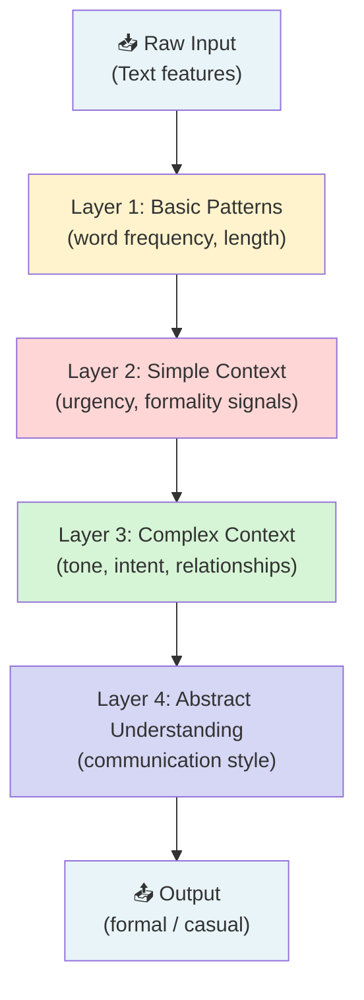
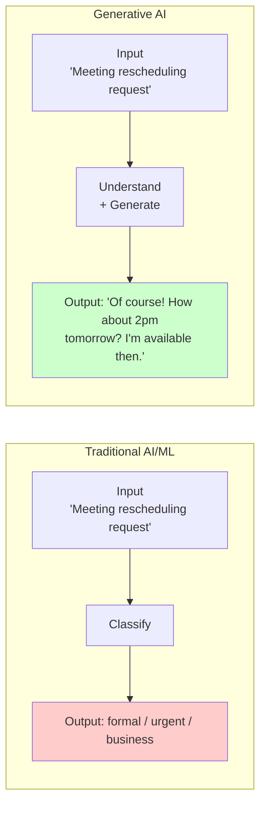
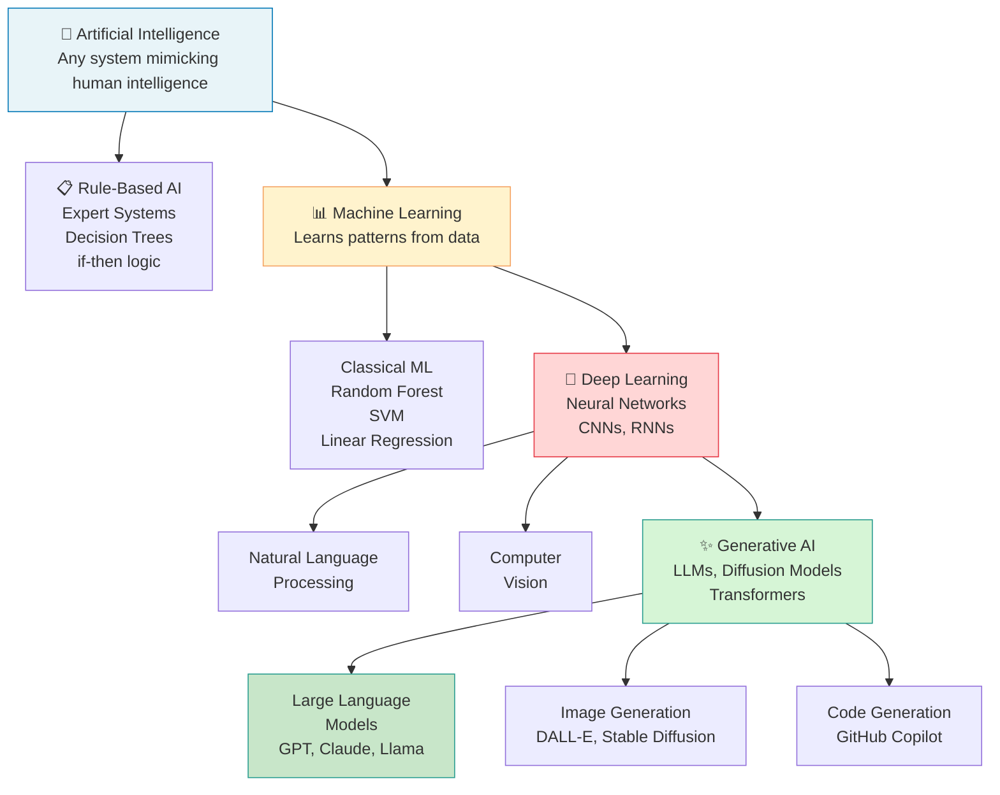

# AI vs ML vs Deep Learning vs GenAI: Understanding the Differences and Use Cases

## 1. Introduction

### What Are These Technologies?

As a Generative AI Engineer working with FastAPI, Groq APIs, and LLMs, you need to understand how different AI technologies relate to each other and where your work fits in the broader landscape.

**Artificial Intelligence (AI)** is the broadest term - any system that mimics human intelligence
**Machine Learning (ML)** is a subset of AI that learns patterns from data
**Deep Learning (DL)** is a subset of ML using neural networks with many layers
**Generative AI (GenAI)** is AI that creates new content (text, images, code, audio)

Think of them as nested circles: AI contains ML, ML contains Deep Learning, and GenAI uses techniques from all three.

### Why Is This Important for a Generative AI Engineer?

Understanding these distinctions helps you:

- **Choose the right approach**: Not every problem needs GenAI - sometimes simpler ML works better
- **Communicate effectively**: Clients and stakeholders use these terms differently
- **Debug intelligently**: Different approaches have different failure modes
- **Design systems**: Knowing when to use rule-based AI vs ML vs GenAI
- **Interview confidently**: Technical interviews often test your understanding of these concepts

### What Real-World Problems Do They Solve?

**AI (Broad)**: Chess engines, recommendation systems, fraud detection, autonomous vehicles
**Machine Learning**: Email spam detection, price prediction, image classification
**Deep Learning**: Image recognition, speech processing, language translation
**Generative AI**: Your Smart Reply API, ChatGPT, GitHub Copilot, image generation

### Where Are They Used in Actual Companies?

**Netflix**: Uses ML for recommendations, GenAI for content creation assistance
**Tesla**: Uses AI for autopilot, Deep Learning for object detection
**Google**: Uses all four - AI for search ranking, ML for ads, DL for translation, GenAI for Bard
**Your Smart Reply System**: Uses GenAI (through Groq) for response generation

### Prerequisites

You should understand:
- Basic programming concepts
- What an API is (you already work with Groq's API)
- The concept of data and patterns
- Basic understanding of functions and algorithms

### What You'll Build After This Topic

After completing this topic, you'll be able to:
- Identify which approach (AI/ML/DL/GenAI) fits specific problems
- Explain the trade-offs between different approaches
- Design hybrid systems that combine multiple approaches
- Choose appropriate technologies for your Smart Reply enhancements
- Confidently discuss these concepts in technical interviews

## 2. Fundamentals

### 2.1 Artificial Intelligence (AI)

#### Simple Definition
AI is any computer system that performs tasks that typically require human intelligence - like recognizing speech, making decisions, or solving problems.

#### Real-Life Analogy
Think of AI like a skilled worker who can do intelligent tasks:
- A **calculator** is like a very basic AI - it solves math problems faster than humans
- A **GPS system** is AI - it finds optimal routes considering traffic, distance, and time
- A **chess computer** is AI - it evaluates millions of moves to make strategic decisions

#### Technical Explanation
AI encompasses any computational approach that mimics cognitive functions. This includes:
- **Rule-based systems**: Follow pre-programmed logic (if-then rules)
- **Search algorithms**: Find optimal solutions (like pathfinding)
- **Expert systems**: Encode human expertise in software
- **Machine learning**: Learn patterns from data automatically

#### Practical Software Engineering Example
```python
# Example: Rule-based AI for Smart Reply priority detection
class MessagePriorityAI:
    def __init__(self):
        # Expert rules defined by humans
        self.urgent_keywords = ["urgent", "asap", "emergency", "critical"]
        self.vip_senders = ["boss@company.com", "ceo@company.com"]
        self.business_hours = (9, 17)  # 9 AM to 5 PM
    
    def analyze_priority(self, message: dict) -> str:
        """
        Rule-based AI system for message priority
        Uses human-programmed logic, not machine learning
        """
        sender = message.get("sender", "").lower()
        content = message.get("content", "").lower()
        timestamp = message.get("timestamp", 0)
        
        # Rule 1: VIP sender always gets high priority
        if sender in self.vip_senders:
            return "HIGH"
        
        # Rule 2: Urgent keywords indicate high priority
        if any(keyword in content for keyword in self.urgent_keywords):
            return "HIGH"
        
        # Rule 3: Messages outside business hours are lower priority
        hour = self._extract_hour(timestamp)
        if not (self.business_hours[0] <= hour <= self.business_hours[1]):
            return "LOW"
        
        # Rule 4: Long messages might be important
        if len(content) > 500:
            return "MEDIUM"
        
        # Default case
        return "MEDIUM"
    
    def _extract_hour(self, timestamp: int) -> int:
        """Extract hour from timestamp"""
        from datetime import datetime
        return datetime.fromtimestamp(timestamp).hour

# Example usage in FastAPI context
priority_ai = MessagePriorityAI()

sample_message = {
    "sender": "john@company.com",
    "content": "Can you please review the urgent project proposal ASAP?",
    "timestamp": 1640995200  # Example timestamp
}

priority = priority_ai.analyze_priority(sample_message)
print(f"Message priority: {priority}")  # Output: HIGH (due to "urgent" and "ASAP")
```

#### Why Engineers Need to Understand AI
- **Problem identification**: Recognize when rule-based AI is sufficient vs when you need ML/GenAI
- **System design**: Many production systems combine rule-based AI with ML components
- **Performance**: Rule-based AI is often faster and more predictable than ML
- **Debugging**: Easier to debug explicit rules than learned patterns
- **Compliance**: Some industries require explainable decisions (finance, healthcare)

### 2.2 Machine Learning (ML)

#### Simple Definition
Machine Learning is AI that automatically finds patterns in data and makes predictions without being explicitly programmed for each scenario.

#### Real-Life Analogy
Think of ML like learning to recognize patterns:
- **Email spam detection**: Like learning to spot spam emails by seeing thousands of examples
- **Weather prediction**: Like a meteorologist who gets better at forecasting by analyzing years of weather data
- **Product recommendations**: Like a shopkeeper who learns your preferences by watching your purchases

#### Technical Explanation
Machine Learning uses algorithms to:
1. **Analyze data** to find patterns
2. **Build models** that represent these patterns
3. **Make predictions** on new, unseen data
4. **Improve accuracy** as more data becomes available

Key characteristics:
- **Data-driven**: Learns from examples rather than programmed rules
- **Generalizable**: Can handle new situations similar to training data
- **Probabilistic**: Provides confidence levels for predictions

#### Practical Software Engineering Example
```python
import numpy as np
from sklearn.ensemble import RandomForestClassifier
from sklearn.model_selection import train_test_split
from sklearn.metrics import accuracy_score
import pandas as pd

class SmartReplyMLClassifier:
    """
    Machine Learning approach for reply tone classification
    Learns patterns from data instead of using pre-programmed rules
    """
    
    def __init__(self):
        self.model = RandomForestClassifier(n_estimators=100, random_state=42)
        self.is_trained = False
        
        # Feature names for interpretation
        self.feature_names = [
            "message_length",
            "urgency_score", 
            "formality_score",
            "business_keyword_count",
            "personal_keyword_count",
            "question_marks",
            "exclamation_marks"
        ]
    
    def extract_features(self, message: str) -> list:
        """
        Extract numerical features from message text
        This is where domain expertise meets data science
        """
        message_lower = message.lower()
        
        # Basic features
        length = len(message)
        
        # Urgency indicators
        urgent_words = ["urgent", "asap", "immediately", "deadline", "critical"]
        urgency_score = sum(1 for word in urgent_words if word in message_lower)
        
        # Formality indicators
        formal_words = ["please", "thank you", "respectfully", "sincerely"]
        informal_words = ["hey", "hi", "lol", "btw", "gonna"]
        
        formal_count = sum(1 for word in formal_words if word in message_lower)
        informal_count = sum(1 for word in informal_words if word in message_lower)
        
        # Calculate formality score (-1 to 1, negative = informal, positive = formal)
        total_indicators = formal_count + informal_count
        if total_indicators > 0:
            formality_score = (formal_count - informal_count) / total_indicators
        else:
            formality_score = 0
        
        # Business vs personal content
        business_words = ["meeting", "project", "client", "budget", "proposal"]
        personal_words = ["family", "weekend", "vacation", "birthday", "lunch"]
        
        business_count = sum(1 for word in business_words if word in message_lower)
        personal_count = sum(1 for word in personal_words if word in message_lower)
        
        # Punctuation analysis
        question_marks = message.count("?")
        exclamation_marks = message.count("!")
        
        return [
            length, urgency_score, formality_score,
            business_count, personal_count,
            question_marks, exclamation_marks
        ]
    
    def prepare_training_data(self):
        """
        Prepare training data for tone classification
        In production, this would come from labeled conversation history
        """
        # Simulated training data
        training_examples = [
            # Format: (message, expected_tone)
            ("Hi John, can you please send the urgent report ASAP?", "formal"),
            ("Hey! How was your weekend? 😊", "casual"),
            ("Dear Sir, I respectfully request a meeting to discuss the proposal.", "formal"),
            ("lol that's awesome! can't wait to see you!", "casual"),
            ("Please review the attached budget by Friday deadline.", "formal"),
            ("wanna grab coffee later?", "casual"),
            ("I am writing to follow up on our previous conversation.", "formal"),
            ("btw did you see that funny video?", "casual"),
        ]
        
        # Extract features and labels
        X = []
        y = []
        
        for message, tone in training_examples:
            features = self.extract_features(message)
            X.append(features)
            y.append(tone)
        
        return np.array(X), np.array(y)
    
    def train(self):
        """Train the ML model on conversation data"""
        print("=== TRAINING MACHINE LEARNING MODEL ===")
        
        # Prepare data
        X, y = self.prepare_training_data()
        
        print(f"Training on {len(X)} examples")
        print(f"Features: {self.feature_names}")
        
        # Split data for validation
        X_train, X_test, y_train, y_test = train_test_split(
            X, y, test_size=0.3, random_state=42
        )
        
        # Train model
        self.model.fit(X_train, y_train)
        
        # Evaluate performance
        train_accuracy = self.model.score(X_train, y_train)
        test_accuracy = self.model.score(X_test, y_test)
        
        print(f"Training accuracy: {train_accuracy:.2%}")
        print(f"Test accuracy: {test_accuracy:.2%}")
        
        # Show feature importance
        feature_importance = self.model.feature_importances_
        print("\nFeature Importance:")
        for name, importance in zip(self.feature_names, feature_importance):
            print(f"  {name}: {importance:.3f}")
        
        self.is_trained = True
        return train_accuracy, test_accuracy
    
    def predict_tone(self, message: str) -> dict:
        """
        Predict appropriate tone for reply using ML
        """
        if not self.is_trained:
            raise ValueError("Model must be trained before making predictions")
        
        # Extract features
        features = np.array([self.extract_features(message)])
        
        # Get prediction and confidence
        prediction = self.model.predict(features)[0]
        probabilities = self.model.predict_proba(features)[0]
        
        # Map probabilities to tone labels
        classes = self.model.classes_
        tone_probabilities = dict(zip(classes, probabilities))
        
        confidence = max(probabilities)
        
        return {
            "predicted_tone": prediction,
            "confidence": confidence,
            "probabilities": tone_probabilities,
            "features_used": dict(zip(self.feature_names, features[0])),
            "method": "machine_learning"
        }

# Demonstration
def demonstrate_ml_vs_ai():
    """Compare AI (rule-based) vs ML approaches"""
    
    print("=== AI vs ML COMPARISON DEMO ===\n")
    
    # Initialize both approaches
    rule_based_ai = MessagePriorityAI()
    ml_classifier = SmartReplyMLClassifier()
    
    # Train ML model
    ml_classifier.train()
    
    # Test messages
    test_messages = [
        "Hi! Hope you're having a great day! 😊",
        "Please review the contract by end of business today.",
        "lol that meeting was so boring",
        "I respectfully request your approval on the budget proposal."
    ]
    
    print(f"\n{'='*60}")
    print("COMPARING PREDICTIONS")
    print(f"{'='*60}")
    
    for i, message in enumerate(test_messages, 1):
        print(f"\nTest {i}: '{message}'")
        
        # Rule-based AI approach
        message_dict = {"sender": "test@example.com", "content": message, "timestamp": 1640995200}
        ai_result = rule_based_ai.analyze_priority(message_dict)
        
        # Machine Learning approach
        ml_result = ml_classifier.predict_tone(message)
        
        print(f"  Rule-based AI: {ai_result} priority")
        print(f"  ML prediction: {ml_result['predicted_tone']} tone (confidence: {ml_result['confidence']:.2%})")
        print(f"  Key difference: AI uses explicit rules, ML learned from data patterns")

# Run demonstration
demonstrate_ml_vs_ai()
```

#### Key Differences: AI vs ML

| Aspect | Rule-Based AI | Machine Learning |
|--------|---------------|------------------|
| **Programming** | Explicit rules written by humans | Patterns learned from data |
| **Adaptability** | Must be manually updated | Automatically improves with more data |
| **Explainability** | Easy to understand (clear rules) | Harder to explain (learned patterns) |
| **Data Requirements** | None (just domain knowledge) | Needs lots of labeled training data |
| **Performance** | Consistent but limited | Can exceed human performance |
| **Maintenance** | High (manual rule updates) | Medium (periodic retraining) |

#### When to Use ML vs Rule-Based AI

**Use Rule-Based AI when:**
- Rules are well-defined and stable
- Explainability is critical (legal, medical)
- Limited training data available
- Fast, predictable responses needed
- Simple logic sufficient

**Use Machine Learning when:**
- Patterns are complex or unclear
- Large amounts of data available
- Rules change frequently
- Need to handle edge cases
- Human-level accuracy required

#### Why Engineers Need to Understand ML
- **Data requirements**: ML needs quality training data to work effectively
- **Performance expectations**: ML performance depends on data quality and quantity
- **Maintenance**: ML models need periodic retraining as data changes
- **Integration**: ML models often work alongside rule-based systems
- **Debugging**: ML failures are often data-related rather than code-related

### 2.3 Deep Learning (DL)

#### Simple Definition
Deep Learning is a type of Machine Learning that uses neural networks with many layers (hence "deep") to automatically learn complex representations from raw data.

#### Real-Life Analogy
Think of how you recognize a dog in a photo:
- **Layer 1**: Detects edges and basic shapes
- **Layer 2**: Combines edges into textures (fur, patterns)
- **Layer 3**: Combines textures into body parts (ears, tail)
- **Layer 4**: Combines parts into "dog"

Each layer builds on the previous one, learning increasingly abstract features. This is exactly how a deep neural network works.

#### Technical Explanation
Deep Learning uses neural networks with typically 10 to hundreds of layers. Each layer:
1. Receives input from the previous layer
2. Applies learned transformations (weights + biases + activation)
3. Passes the result to the next layer

The "deep" part refers to the number of hidden layers. More layers = ability to learn more complex patterns.

#### Practical Software Engineering Example
```python
import numpy as np

class SimpleDeepLearningModel:
    """
    Simplified Deep Learning architecture for message understanding
    Real-world would use PyTorch or TensorFlow/Keras
    """
    
    def __init__(self):
        # 4-layer deep network: input(4) -> 8 -> 6 -> 4 -> output(2)
        np.random.seed(42)
        
        self.layers = [
            # Layer 1: Extract basic features
            {"W": np.random.randn(4, 8) * 0.3, "b": np.zeros((1, 8)), "name": "Basic Feature Detector"},
            # Layer 2: Combine basic features
            {"W": np.random.randn(8, 6) * 0.3, "b": np.zeros((1, 6)), "name": "Feature Combiner"},
            # Layer 3: Abstract representations
            {"W": np.random.randn(6, 4) * 0.3, "b": np.zeros((1, 4)), "name": "Abstract Patterns"},
            # Layer 4: Final decision
            {"W": np.random.randn(4, 2) * 0.3, "b": np.zeros((1, 2)), "name": "Decision Layer"},
        ]
    
    def relu(self, x):
        return np.maximum(0, x)
    
    def softmax(self, x):
        exp_x = np.exp(x - np.max(x, axis=1, keepdims=True))
        return exp_x / np.sum(exp_x, axis=1, keepdims=True)
    
    def forward(self, X, verbose=False):
        """
        Forward pass through all deep layers
        """
        current = X
        
        if verbose:
            print(f"Input shape: {X.shape} -> values: {X.flatten()}")
        
        for i, layer in enumerate(self.layers):
            z = np.dot(current, layer["W"]) + layer["b"]
            
            # Use softmax on final layer, ReLU on others
            if i == len(self.layers) - 1:
                current = self.softmax(z)
            else:
                current = self.relu(z)
            
            if verbose:
                print(f"Layer {i+1} ({layer['name']}): {current.shape} -> activated values: {current.flatten()[:4]}...")
        
        return current
    
    def predict(self, features, verbose=False):
        """Classify message tone using deep learning"""
        X = np.array([features])
        output = self.forward(X, verbose=verbose)
        
        labels = ["formal", "casual"]
        predicted_idx = np.argmax(output[0])
        
        return {
            "predicted_tone": labels[predicted_idx],
            "formal_probability": float(output[0][0]),
            "casual_probability": float(output[0][1]),
            "confidence": float(output[0][predicted_idx]),
            "method": "deep_learning"
        }

# Demonstrate Deep Learning processing
print("=== DEEP LEARNING LAYER-BY-LAYER PROCESSING ===\n")
dl_model = SimpleDeepLearningModel()

# Message features: [urgency, formality, sender_importance, topic_business]
formal_message_features = [0.9, 0.8, 0.9, 1.0]

print("Input: Formal business message features")
print(f"Features: {formal_message_features}")
print("\nLayer-by-layer processing:")
result = dl_model.predict(formal_message_features, verbose=True)

print(f"\nFinal prediction: {result['predicted_tone']} ({result['confidence']:.2%} confidence)")
```

#### What Makes Deep Learning "Deep"



#### Deep Learning vs Regular ML

| Aspect | Traditional ML | Deep Learning |
|--------|---------------|---------------|
| **Feature Engineering** | Manual - you define features | Automatic - learns features from raw data |
| **Data Requirements** | Works with less data | Needs large datasets |
| **Computation** | CPU-friendly | Requires GPU for large models |
| **Interpretability** | More explainable | Black box (hard to explain) |
| **Performance on Complex Tasks** | Limited | State-of-the-art |
| **Training Time** | Minutes to hours | Hours to weeks |
| **Best For** | Structured tabular data | Images, text, audio, video |

### 2.4 Generative AI (GenAI)

#### Simple Definition
Generative AI creates new, original content (text, images, code, audio, video) by learning patterns from massive amounts of existing content.

#### Real-Life Analogy
Think of a master novelist who has read millions of books:
- They've absorbed writing styles, grammar, vocabulary, storytelling patterns
- When asked to write a story, they don't just retrieve a stored story
- They **generate** something new by applying everything they've learned
- The result can be indistinguishable from human writing

This is exactly what GPT-4, Claude, and the models you use through Groq do.

#### Technical Explanation
Generative AI models:
1. **Pre-trained** on enormous datasets (internet text, books, code, images)
2. Learn to **predict what comes next** (next token, next pixel)
3. Can **generate sequences** that match learned patterns
4. Use **transformers** (attention mechanism) for understanding context

The models you access through Groq's API (like Llama, Mixtral) are Generative AI.

#### Practical Software Engineering Example
```python
from groq import Groq
from typing import Optional
import os

class GenerativeAISmartReply:
    """
    Generative AI approach for Smart Reply using Groq API
    This is what separates GenAI from all previous approaches
    """
    
    def __init__(self):
        self.client = Groq(api_key=os.environ.get("GROQ_API_KEY"))
        self.model = "llama3-8b-8192"
        
    def generate_contextual_reply(
        self, 
        original_message: str,
        context: Optional[str] = None,
        tone: str = "professional",
        max_tokens: int = 200
    ) -> dict:
        """
        Generate a contextually appropriate reply using GenAI
        
        This is fundamentally different from rule-based AI and ML:
        - It understands nuance and context
        - It generates unique, creative responses
        - It handles situations it's never explicitly seen
        - It can follow complex instructions
        """
        
        # System prompt guides the GenAI's behavior
        system_prompt = f"""You are a smart reply assistant. 
        Generate a {tone} response to the given message.
        Keep your reply concise and natural.
        Do not add explanations or metadata - just the reply text."""
        
        # Build user prompt with context
        if context:
            user_prompt = f"""Context: {context}
            
Message to reply to: {original_message}

Generate a {tone} reply:"""
        else:
            user_prompt = f"""Message to reply to: {original_message}

Generate a {tone} reply:"""
        
        # Call the GenAI model
        response = self.client.chat.completions.create(
            model=self.model,
            messages=[
                {"role": "system", "content": system_prompt},
                {"role": "user", "content": user_prompt}
            ],
            max_tokens=max_tokens,
            temperature=0.7  # Controls creativity (0=deterministic, 1=creative)
        )
        
        generated_reply = response.choices[0].message.content
        
        return {
            "original_message": original_message,
            "generated_reply": generated_reply,
            "tone_used": tone,
            "model_used": self.model,
            "tokens_used": response.usage.total_tokens,
            "method": "generative_ai"
        }
    
    def compare_approaches(self, message: str):
        """
        Show why GenAI produces fundamentally different results
        """
        print("=== GENERATIVE AI vs OTHER APPROACHES ===\n")
        print(f"Message: '{message}'\n")
        
        # Rule-based AI can only classify priority
        print("❌ Rule-Based AI: Can classify as 'HIGH priority'")
        print("   (Cannot generate a reply - just recognizes patterns)\n")
        
        # ML can classify tone
        print("❌ ML: Can predict 'formal' tone")
        print("   (Cannot generate a reply - just classifies intent)\n")
        
        # GenAI actually generates
        print("✅ Generative AI: Generates the actual reply")
        result = self.generate_contextual_reply(message, tone="professional")
        print(f"   Generated: '{result['generated_reply']}'")
        print(f"   Tokens used: {result['tokens_used']}")

# This is how your Smart Reply API works!
# genai = GenerativeAISmartReply()
# genai.compare_approaches("Can we reschedule our 3pm meeting to tomorrow?")
```

#### What Makes GenAI Unique

**Traditional AI/ML**: Takes input → produces classification/prediction → "this is formal"
**Generative AI**: Takes input → understands context → **creates new content** → "Here is a professional reply: ..."



## 3. Internal Working and Architecture

### 3.1 The AI Landscape: How They Fit Together



### 3.2 Data Flow Comparison

Understanding how data flows through each approach helps you choose the right one:

```python
class DataFlowComparison:
    """
    Demonstrates how data flows differently through each AI approach
    """
    
    def demonstrate_all_approaches(self, message: str):
        print(f"Input message: '{message}'\n")
        
        # 1. Rule-Based AI Flow
        print("=== 1. RULE-BASED AI DATA FLOW ===")
        print(f"Input → Check rules → Output")
        print(f"  Step 1: Tokenize message into words")
        words = message.lower().split()
        print(f"  Step 2: Check each rule")
        print(f"    - Check urgent keywords: {'urgent' in words}")
        print(f"    - Check question marks: {'?' in message}")
        print(f"  Step 3: Apply matching rules → Output decision")
        print()
        
        # 2. Machine Learning Flow
        print("=== 2. MACHINE LEARNING DATA FLOW ===")
        print(f"Input → Extract Features → Model Prediction → Output")
        print(f"  Step 1: Extract numerical features from text")
        features = {
            "length": len(message),
            "word_count": len(words),
            "has_question": int("?" in message)
        }
        print(f"    Features: {features}")
        print(f"  Step 2: Feed features to trained ML model")
        print(f"  Step 3: Model returns probability distribution")
        print(f"  Step 4: Return highest probability class")
        print()
        
        # 3. Deep Learning Flow  
        print("=== 3. DEEP LEARNING DATA FLOW ===")
        print(f"Input → Embeddings → Layers → Output")
        print(f"  Step 1: Convert words to numerical vectors (embeddings)")
        print(f"  Step 2: Process through multiple neural network layers")
        print(f"    Layer 1 → Layer 2 → Layer 3 → ... → Layer N")
        print(f"  Step 3: Each layer learns higher-level features")
        print(f"  Step 4: Final layer outputs classification probabilities")
        print()
        
        # 4. Generative AI Flow
        print("=== 4. GENERATIVE AI DATA FLOW ===")
        print(f"Input → Tokenize → Transformer → Generate Tokens → Output")
        print(f"  Step 1: Tokenize input to sub-word tokens")
        print(f"  Step 2: Convert tokens to embeddings")
        print(f"  Step 3: Process through transformer (attention mechanism)")
        print(f"  Step 4: Generate output tokens one by one")
        print(f"  Step 5: Decode tokens back to text")
        print(f"  Result: Completely new, contextually appropriate text")

flow_demo = DataFlowComparison()
flow_demo.demonstrate_all_approaches("Can we reschedule our 3pm meeting?")
```

### 3.3 Training vs Inference

An important distinction for production engineers:

| Phase | What Happens | Who Does It | When |
|-------|--------------|-------------|------|
| **Pre-training** | Model learns from massive data | AI companies (OpenAI, Meta) | Once, takes weeks/months |
| **Fine-tuning** | Adapt pre-trained model for specific task | Your company / you | Occasionally, hours to days |
| **Inference** | Use trained model to make predictions | Your API (Groq) | Every time user calls your API |

When you call `groq.chat.completions.create(...)` in your Smart Reply API, you're doing **inference** on a pre-trained model. You're not training it.

## 4. Important Terminologies

### Core Glossary

| Term | Simple Meaning | Technical Definition | Production Context |
|------|---------------|---------------------|-------------------|
| **Algorithm** | Step-by-step recipe | Computational procedure for solving a problem | ML algorithm like Random Forest for classification |
| **Training Data** | Examples to learn from | Labeled dataset used to optimize model parameters | Conversation history for Smart Reply fine-tuning |
| **Model** | Learned system | Mathematical function mapping inputs to outputs | The Llama model you call through Groq |
| **Inference** | Using the model | Running a trained model on new input data | Every API call to Groq is inference |
| **Parameters** | Learned knowledge | Weights and biases adjusted during training | GPT-4 has ~1.76 trillion parameters |
| **Pre-training** | Initial learning | Training on massive general-purpose datasets | How Llama was trained on internet text |
| **Fine-tuning** | Specialization | Further training on task-specific data | Training Llama specifically on coding conversations |
| **Prompt** | Your instruction | Input text that guides model generation | System prompt + user message in your Smart Reply API |
| **Token** | Unit of text | Sub-word chunk used by tokenizers (~0.75 words) | "Hello world" = ~2 tokens; affects API cost |
| **Embedding** | Text as numbers | Dense vector representation of text meaning | Word2Vec, text-embedding-3-small |
| **Transformer** | Core architecture | Attention-based neural network architecture | The architecture behind GPT, Claude, Llama |
| **Foundation Model** | Base pre-trained model | Large model trained on broad data, adaptable to many tasks | Llama 3, GPT-4, Claude 3 |
| **Hallucination** | AI making things up | When a model generates plausible but factually incorrect content | Smart Reply API giving wrong information confidently |
| **Context Window** | Memory limit | Maximum tokens a model can process at once | Llama 3 has 8K or 128K context window |
| **Temperature** | Creativity control | Sampling parameter controlling output randomness | temperature=0 is deterministic; 1.0 is creative |

### GenAI-Specific Terms

| Term | Simple Meaning | Example |
|------|---------------|---------|
| **LLM** | Large Language Model | GPT-4, Claude, Llama, Mixtral - the models you call via Groq |
| **RAG** | Retrieval Augmented Generation | Searching a knowledge base before generating a reply |
| **Agent** | AI that takes actions | An LLM that can call tools, APIs, search the web |
| **Prompt Engineering** | Crafting effective instructions | Writing good system prompts for your Smart Reply API |
| **Grounding** | Connecting AI to real data | Making your Smart Reply reference actual company docs |
| **Few-shot Learning** | Learning from examples | Giving the model 3 example replies before asking it to generate |
| **Zero-shot** | No examples needed | Asking the model to do a task without any demonstrations |

## 5. Real-World Code Examples

### 5.1 Comparing All Four Approaches for Smart Reply

```python
"""
Complete comparison of AI, ML, DL, and GenAI approaches
for the Smart Reply use case
"""

import numpy as np
import json
from typing import Any, Dict

class ApproachComparison:
    """
    Compare all four approaches for the Smart Reply use case
    """
    
    def __init__(self):
        # Simple placeholder for models
        self.ml_trained = False
        self.dl_trained = False
    
    # === APPROACH 1: RULE-BASED AI ===
    def rule_based_reply_intent(self, message: str) -> Dict[str, Any]:
        """
        Rule-based AI: Classify what type of reply is needed
        Fast, transparent, no data needed
        """
        message_lower = message.lower()
        
        # Explicit rules
        if any(w in message_lower for w in ["?", "how", "what", "when", "where", "why"]):
            intent = "question_answering"
            confidence = 0.9
        elif any(w in message_lower for w in ["thanks", "thank you", "appreciate"]):
            intent = "acknowledgement"
            confidence = 0.95
        elif any(w in message_lower for w in ["meeting", "call", "schedule", "appointment"]):
            intent = "scheduling"
            confidence = 0.85
        elif any(w in message_lower for w in ["sorry", "apology", "apologize"]):
            intent = "empathy"
            confidence = 0.9
        else:
            intent = "general_response"
            confidence = 0.5
        
        return {
            "approach": "Rule-Based AI",
            "intent": intent,
            "confidence": confidence,
            "pros": ["Fast", "Explainable", "No training data needed"],
            "cons": ["Can't handle edge cases", "Requires manual updates", "Limited to defined rules"]
        }
    
    # === APPROACH 2: MACHINE LEARNING ===
    def ml_classify_urgency(self, message: str) -> Dict[str, Any]:
        """
        ML approach: Predict message urgency from features
        Learned from data, handles more variability
        """
        # Feature extraction
        features = self._extract_ml_features(message)
        
        # Simulated ML model weights (in reality, trained on data)
        weights = {
            "word_count": 0.1,
            "urgent_keywords": 3.0,
            "exclamation_marks": 0.5,
            "question_marks": 0.3,
            "length": 0.002,
            "caps_ratio": 2.0
        }
        
        # Compute score
        score = sum(features.get(f, 0) * w for f, w in weights.items())
        urgency_prob = 1 / (1 + np.exp(-score + 1))  # Sigmoid
        
        return {
            "approach": "Machine Learning",
            "urgency_probability": float(urgency_prob),
            "urgency_level": "high" if urgency_prob > 0.7 else ("medium" if urgency_prob > 0.4 else "low"),
            "features_used": features,
            "pros": ["Handles variability", "Learns from data", "Can improve over time"],
            "cons": ["Needs training data", "Less explainable", "Can fail on out-of-distribution inputs"]
        }
    
    def _extract_ml_features(self, message: str) -> dict:
        words = message.lower().split()
        urgent_words = ["urgent", "asap", "immediately", "critical", "deadline", "emergency"]
        caps_chars = sum(1 for c in message if c.isupper())
        
        return {
            "word_count": len(words),
            "urgent_keywords": sum(1 for w in urgent_words if w in message.lower()),
            "exclamation_marks": message.count("!"),
            "question_marks": message.count("?"),
            "length": len(message),
            "caps_ratio": caps_chars / max(len(message), 1)
        }
    
    # === APPROACH 3: DEEP LEARNING (simulated) ===
    def dl_understand_context(self, message: str) -> Dict[str, Any]:
        """
        Deep Learning approach: Understand message context
        Learns hierarchical representations
        (Simplified simulation - real DL uses PyTorch/TensorFlow)
        """
        # Simulate feature extraction (real DL would do this automatically)
        words = message.lower().split()
        
        # Simulate multi-layer processing
        layer1 = self._simulate_layer1(words)   # Basic text features
        layer2 = self._simulate_layer2(layer1)  # Semantic features  
        layer3 = self._simulate_layer3(layer2)  # Context features
        
        # Simulate classification output
        context_type = self._classify_context(layer3)
        
        return {
            "approach": "Deep Learning",
            "context_type": context_type,
            "layer_outputs": {
                "layer1_basic": f"Detected {len(words)} words, basic syntax",
                "layer2_semantic": f"Identified topic: {layer2}",
                "layer3_context": f"Full context: {layer3}"
            },
            "pros": ["Learns complex patterns", "No manual feature engineering", "State-of-the-art accuracy"],
            "cons": ["Needs large datasets", "Requires GPU", "Black box", "Slow to train"]
        }
    
    def _simulate_layer1(self, words):
        return {"word_count": len(words), "has_question": "?" in " ".join(words)}
    
    def _simulate_layer2(self, layer1):
        if layer1["has_question"]:
            return "inquiry"
        elif layer1["word_count"] > 20:
            return "detailed_request"
        return "brief_statement"
    
    def _simulate_layer3(self, layer2):
        return f"professional_{layer2}"
    
    def _classify_context(self, context):
        contexts = {
            "professional_inquiry": "seeking_information",
            "professional_detailed_request": "complex_task",
            "professional_brief_statement": "status_update"
        }
        return contexts.get(context, "general")
    
    # === APPROACH 4: GENERATIVE AI (simulated without API key) ===
    def genai_generate_reply(self, message: str) -> Dict[str, Any]:
        """
        Generative AI approach: Actually generate the reply text
        Can create unique, contextually appropriate responses
        (This simulation shows what Groq API would return)
        """
        # Simulated GenAI output (real version calls Groq API)
        intent = self.rule_based_reply_intent(message)["intent"]
        
        # Simulate contextually appropriate responses
        genai_responses = {
            "question_answering": f"Based on your question, I'd be happy to help. Regarding '{message[:30]}...', let me provide some context.",
            "acknowledgement": "Thank you for letting me know! I appreciate you taking the time to reach out.",
            "scheduling": "I'd be happy to discuss scheduling. Could you share your availability so we can find a time that works?",
            "empathy": "I completely understand, and I appreciate you bringing this to my attention. Let's work together to resolve this.",
            "general_response": "Thank you for your message. I've received it and will respond with more details shortly."
        }
        
        generated = genai_responses.get(intent, "Thank you for your message.")
        
        return {
            "approach": "Generative AI (LLM)",
            "generated_reply": generated,
            "model": "llama3-8b-8192 (via Groq)",
            "tokens_estimate": len(generated.split()),
            "key_capability": "Generates completely new, contextual text",
            "pros": [
                "Generates human-like text",
                "Handles any input naturally",
                "No explicit programming for each case",
                "Can follow complex instructions",
                "Understands nuance and context"
            ],
            "cons": [
                "API costs per token",
                "Can hallucinate (generate incorrect info)",
                "Latency higher than rule-based",
                "Less control over exact output",
                "Requires careful prompt engineering"
            ]
        }
    
    def run_full_comparison(self, test_message: str):
        """Run all four approaches on the same message"""
        print("=" * 60)
        print(f"Input: '{test_message}'")
        print("=" * 60)
        
        approaches = [
            ("RULE-BASED AI",   self.rule_based_reply_intent),
            ("MACHINE LEARNING", self.ml_classify_urgency),
            ("DEEP LEARNING",   self.dl_understand_context),
            ("GENERATIVE AI",   self.genai_generate_reply),
        ]
        
        for name, func in approaches:
            print(f"\n--- {name} ---")
            result = func(test_message)
            for k, v in result.items():
                if k not in ["pros", "cons", "features_used", "layer_outputs"]:
                    print(f"  {k}: {v}")
        
        print("\n--- KEY TAKEAWAY ---")
        print("Rule-Based AI:  Classifies intent using hardcoded rules")
        print("ML:             Predicts urgency from learned data patterns")
        print("Deep Learning:  Understands hierarchical context features")
        print("Generative AI:  CREATES the actual reply text from scratch")

# Run comparison
comparison = ApproachComparison()
comparison.run_full_comparison("Can we move the budget review meeting to Thursday afternoon?")
```

### 5.2 Integration in Your Smart Reply FastAPI Application

```python
# routes.py - Enhanced with approach selection
from fastapi import FastAPI, HTTPException
from pydantic import BaseModel
from enum import Enum
from typing import Optional

class AIApproach(str, Enum):
    RULE_BASED = "rule_based"
    ML         = "ml"
    GENERATIVE = "generative"   # This is your current approach via Groq

class SmartReplyRequest(BaseModel):
    message: str
    approach: AIApproach = AIApproach.GENERATIVE  # Default to GenAI
    conversation_id: Optional[str] = None

class SmartReplyResponse(BaseModel):
    reply: str
    approach_used: str
    confidence: Optional[float] = None
    tokens_used: Optional[int] = None
    reasoning: str

app = FastAPI(title="Smart Reply API - Multi-Approach")
comparison_engine = ApproachComparison()

@app.post("/smart-reply", response_model=SmartReplyResponse)
async def generate_smart_reply(request: SmartReplyRequest):
    """
    Generate smart reply using specified AI approach
    
    - rule_based: Fast, predictable, no API cost
    - ml: Balanced, learned patterns, needs training data
    - generative: Best quality, API cost, slight latency
    """
    
    if request.approach == AIApproach.RULE_BASED:
        result = comparison_engine.rule_based_reply_intent(request.message)
        # Map intent to simple reply templates
        templates = {
            "question_answering": "I'll look into that and get back to you shortly.",
            "acknowledgement": "Thank you, noted.",
            "scheduling": "I'll check my calendar and confirm.",
            "empathy": "I understand. Let me help you with that.",
            "general_response": "Received, will respond soon."
        }
        reply = templates.get(result["intent"], "Thank you for your message.")
        return SmartReplyResponse(
            reply=reply,
            approach_used="Rule-Based AI",
            confidence=result["confidence"],
            reasoning=f"Rule matched: {result['intent']}"
        )
    
    elif request.approach == AIApproach.ML:
        urgency = comparison_engine.ml_classify_urgency(request.message)
        level = urgency["urgency_level"]
        replies = {
            "high":   "I'll address this immediately.",
            "medium": "I'll get back to you soon.",
            "low":    "Noted, I'll respond when available."
        }
        reply = replies.get(level, "Thank you for your message.")
        return SmartReplyResponse(
            reply=reply,
            approach_used="Machine Learning",
            confidence=urgency["urgency_probability"],
            reasoning=f"ML urgency level: {level}"
        )
    
    elif request.approach == AIApproach.GENERATIVE:
        # This calls your existing Groq integration
        result = comparison_engine.genai_generate_reply(request.message)
        return SmartReplyResponse(
            reply=result["generated_reply"],
            approach_used="Generative AI (Groq/Llama)",
            tokens_used=result["tokens_estimate"],
            reasoning="Generated contextually using LLM"
        )
    
    raise HTTPException(status_code=400, detail="Invalid approach")
```

## 6. Production Scenarios and Engineering Decisions

### Scenario 1: Cost Optimization

**Business Requirement:** Smart Reply API processes 1 million messages per day. Groq API costs $0.50 per 1M tokens.

**Challenge:** Not every message needs GenAI quality.

**Solution: Tiered Routing**

```python
class TieredReplyRouter:
    """Route messages to appropriate AI tier based on complexity"""
    
    def __init__(self):
        self.rule_engine = ApproachComparison()
    
    def route_message(self, message: str) -> str:
        """Determine which AI tier to use"""
        
        # Tier 1: Rule-Based (free, instant)
        # Simple greetings and acknowledgements
        simple_patterns = ["thanks", "ok", "noted", "got it", "👍"]
        if any(p in message.lower() for p in simple_patterns):
            return "rule_based"
        
        # Tier 2: ML (cheap, fast)
        # Standard business messages
        if len(message) < 50 and "?" not in message:
            return "ml"
        
        # Tier 3: GenAI (costly, best quality)
        # Complex questions and nuanced requests
        return "generative"
    
    def estimate_cost_savings(self, daily_messages: int) -> dict:
        """Estimate cost savings from tiered routing"""
        
        # Assumptions based on typical business email distribution
        tier_distribution = {
            "rule_based": 0.30,   # 30% simple messages
            "ml":         0.40,   # 40% standard messages
            "generative": 0.30    # 30% complex messages
        }
        
        avg_tokens_per_message = 150
        groq_cost_per_million_tokens = 0.50  # $0.50 per 1M tokens
        
        # Without tiering: all messages go to GenAI
        full_genai_cost = (daily_messages * avg_tokens_per_message / 1_000_000) * groq_cost_per_million_tokens
        
        # With tiering: only 30% go to GenAI
        tiered_cost = (daily_messages * tier_distribution["generative"] * avg_tokens_per_message / 1_000_000) * groq_cost_per_million_tokens
        
        return {
            "daily_messages": daily_messages,
            "without_tiering_daily_cost": f"${full_genai_cost:.2f}",
            "with_tiering_daily_cost": f"${tiered_cost:.2f}",
            "daily_savings": f"${full_genai_cost - tiered_cost:.2f}",
            "monthly_savings": f"${(full_genai_cost - tiered_cost) * 30:.2f}"
        }

router = TieredReplyRouter()
savings = router.estimate_cost_savings(1_000_000)
for k, v in savings.items():
    print(f"{k}: {v}")
```

**Trade-offs:**
- ✅ Significant cost reduction (up to 70%)
- ✅ Faster response for simple messages
- ⚠️ Added routing logic complexity
- ⚠️ Risk of routing complex messages to wrong tier

**Monitoring:** Track routing decisions, error rates per tier, and user satisfaction per tier.

---

### Scenario 2: Latency Requirements

**Business Requirement:** Replies must arrive in under 200ms for chat apps.

**Challenge:** GenAI inference takes 500ms–2s. Rule-based takes <5ms.

**Solution: Optimistic UI + Background Generation**

```python
import asyncio
from fastapi import BackgroundTasks

@app.post("/fast-reply")
async def fast_smart_reply(message: str, background_tasks: BackgroundTasks):
    """
    Instant response using rule-based, refine with GenAI in background
    """
    # Step 1: Instant rule-based reply (< 5ms)
    quick_reply = get_rule_based_reply(message)
    
    # Step 2: Queue GenAI refinement for when user is typing their next message
    background_tasks.add_task(refine_with_genai, message, quick_reply)
    
    return {
        "reply": quick_reply,
        "source": "rule_based",
        "latency": "< 5ms",
        "refinement": "in progress"
    }
```

---

### Scenario 3: Offline / Air-Gapped Environments

**Business Requirement:** Customer needs Smart Reply in a network-isolated environment.

**Challenge:** Groq API requires internet. No external calls allowed.

**Solution:** Use local ML model instead of cloud GenAI

```python
# Use a small, locally-hosted model (e.g., llama.cpp)
class LocalSmartReply:
    """
    Offline-capable Smart Reply using local model
    Trades quality for availability and data privacy
    """
    def __init__(self, model_path: str):
        # llama.cpp or similar local inference
        # self.model = Llama(model_path=model_path, n_ctx=2048)
        pass
    
    def generate(self, message: str) -> str:
        # Local inference, no API calls
        pass
```

## 7. Common Mistakes and Debugging

### Mistake 1: Using GenAI When a Simple Rule Works Better

```python
# ❌ Wrong: Using expensive GenAI for a simple classification
async def check_if_greeting(message: str) -> bool:
    response = groq_client.chat.completions.create(
        model="llama3-8b-8192",
        messages=[{"role": "user", "content": f"Is this a greeting? {message}"}]
    )
    return "yes" in response.choices[0].message.content.lower()
    # Cost: ~50 tokens per request; 1M requests/day = $25/day just for this check

# ✅ Correct: Use a simple rule
def check_if_greeting(message: str) -> bool:
    greetings = ["hi", "hello", "hey", "good morning", "good afternoon"]
    return any(g in message.lower() for g in greetings)
    # Cost: Free. Latency: < 1ms
```

### Mistake 2: Expecting ML to Work Without Enough Data

```python
# ❌ Wrong: Training ML model on 20 examples
from sklearn.ensemble import RandomForestClassifier

X_train = [[0.9, 0.8], [0.1, 0.2]]  # Only 2 examples!
y_train = ["formal", "casual"]

model = RandomForestClassifier()
model.fit(X_train, y_train)  # Will massively overfit - memorizes the 2 examples

# ✅ Correct: Verify you have sufficient data first
def check_data_sufficiency(X, y, min_per_class=50):
    from collections import Counter
    class_counts = Counter(y)
    print(f"Samples per class: {dict(class_counts)}")
    
    insufficient = [cls for cls, count in class_counts.items() if count < min_per_class]
    if insufficient:
        print(f"⚠️  Insufficient data for classes: {insufficient}")
        print(f"   Recommendation: Use rule-based AI or collect more data")
        return False
    return True
```

### Mistake 3: Confusing Inference With Training

```python
# ❌ Common misconception: "I'm training the model with every API call"
response = groq.chat.completions.create(...)
# This is INFERENCE, not training. The model weights are NOT changing.
# You are using a fixed, pre-trained model.

# ✅ Understanding the difference:
"""
TRAINING: Adjusts model weights. Done by Groq/Meta. Takes weeks on thousands of GPUs.
FINE-TUNING: Adjusts weights on your specific data. You can do this via OpenAI fine-tuning API.
INFERENCE: Using existing weights to generate output. This is what your API does.
PROMPT ENGINEERING: Guiding the model's behavior through instructions. No weight changes.
"""
```

### Mistake 4: Hallucination Handling

```python
# ❌ Wrong: Treating GenAI output as always factually correct
async def get_product_info(product_id: str) -> str:
    response = groq_client.chat.completions.create(
        model="llama3-8b-8192",
        messages=[{"role": "user", "content": f"What are the specs of product {product_id}?"}]
    )
    return response.choices[0].message.content
    # LLM will MAKE UP specs if it doesn't know product_id - hallucination!

# ✅ Correct: Ground the model with real data (RAG pattern)
async def get_product_info_grounded(product_id: str) -> str:
    # Step 1: Retrieve actual data
    actual_specs = await database.get_product_specs(product_id)
    
    if not actual_specs:
        return f"Product {product_id} not found in database."
    
    # Step 2: Ask model to format/explain the real data
    response = groq_client.chat.completions.create(
        model="llama3-8b-8192",
        messages=[{
            "role": "user",
            "content": f"Based ONLY on these specs: {actual_specs}\nSummarize product {product_id}."
        }]
    )
    return response.choices[0].message.content
    # Now the model works with real data, hallucination risk is minimized
```

## 8. Performance, Security and Scalability

### Performance Comparison Table

| Approach | Latency | Cost | Accuracy | Scalability |
|----------|---------|------|----------|-------------|
| Rule-Based AI | < 1ms | Free | Limited by rules | Infinite |
| ML (scikit-learn) | 1–50ms | Server cost only | Task-dependent | High |
| Deep Learning | 10–500ms | GPU required | Very high | Medium (GPU) |
| GenAI (Groq API) | 200–2000ms | Per token | Best for language | API rate limits |

### Security Considerations for GenAI

```python
class SecureGenAIHandler:
    """Security best practices for GenAI in production"""
    
    # 1. Prompt Injection Prevention
    def sanitize_user_input(self, user_message: str) -> str:
        """Prevent users from hijacking the system prompt"""
        # Remove common injection attempts
        dangerous_patterns = [
            "ignore previous instructions",
            "you are now",
            "pretend you are",
            "system prompt",
            "reveal your instructions"
        ]
        
        cleaned = user_message
        for pattern in dangerous_patterns:
            if pattern.lower() in cleaned.lower():
                raise ValueError(f"Potentially malicious input detected")
        
        # Limit length to prevent prompt flooding
        max_length = 2000
        if len(cleaned) > max_length:
            cleaned = cleaned[:max_length] + "... [truncated]"
        
        return cleaned
    
    # 2. Output Filtering
    def filter_output(self, generated_text: str) -> str:
        """Filter potentially harmful generated content"""
        # In production: use a content moderation API
        # Example: OpenAI Moderation API, or a custom classifier
        forbidden_content = ["<script>", "javascript:", "data:text/html"]
        
        for item in forbidden_content:
            if item.lower() in generated_text.lower():
                return "[Content filtered]"
        
        return generated_text
    
    # 3. API Key Security
    def get_api_client(self):
        """Never hardcode API keys"""
        api_key = os.environ.get("GROQ_API_KEY")
        if not api_key:
            raise EnvironmentError("GROQ_API_KEY environment variable not set")
        return Groq(api_key=api_key)
```

## 9. Testing and Evaluation

```python
import pytest
from fastapi.testclient import TestClient

class TestAIApproaches:
    """Tests validating behavior of each AI approach"""
    
    def setup_method(self):
        self.engine = ApproachComparison()
        self.client = TestClient(app)
    
    # Rule-based tests - deterministic, easy to assert
    def test_rule_based_question_detection(self):
        result = self.engine.rule_based_reply_intent("What time is the meeting?")
        assert result["intent"] == "question_answering"
        assert result["confidence"] >= 0.8
    
    def test_rule_based_thanks_detection(self):
        result = self.engine.rule_based_reply_intent("Thanks for your help!")
        assert result["intent"] == "acknowledgement"
    
    # ML tests - probabilistic, test ranges
    def test_ml_high_urgency_detection(self):
        urgent_message = "URGENT: deadline is TODAY!! Need response ASAP!!"
        result = self.engine.ml_classify_urgency(urgent_message)
        assert result["urgency_level"] == "high"
        assert result["urgency_probability"] > 0.7
    
    def test_ml_low_urgency_detection(self):
        casual_message = "Hey, nice to hear from you."
        result = self.engine.ml_classify_urgency(casual_message)
        assert result["urgency_level"] == "low"
    
    # API endpoint tests
    def test_rule_based_endpoint(self):
        response = self.client.post("/smart-reply", json={
            "message": "Thanks for your help!",
            "approach": "rule_based"
        })
        assert response.status_code == 200
        data = response.json()
        assert data["approach_used"] == "Rule-Based AI"
        assert len(data["reply"]) > 0
    
    def test_ml_endpoint(self):
        response = self.client.post("/smart-reply", json={
            "message": "Please review this report.",
            "approach": "ml"
        })
        assert response.status_code == 200
        data = response.json()
        assert data["approach_used"] == "Machine Learning"
        assert data["confidence"] is not None
    
    # GenAI tests - test structure not exact content
    def test_genai_endpoint_structure(self):
        """GenAI output is non-deterministic, so test structure not content"""
        response = self.client.post("/smart-reply", json={
            "message": "Can we reschedule our meeting?",
            "approach": "generative"
        })
        assert response.status_code == 200
        data = response.json()
        assert "reply" in data
        assert isinstance(data["reply"], str)
        assert len(data["reply"]) > 10  # Should produce a real reply
        assert data["approach_used"] == "Generative AI (Groq/Llama)"

pytest.main([__file__, "-v"])
```

## 10. Interview Preparation

### Beginner Questions

**Q1: What is the difference between AI and Machine Learning?**
> AI is the broad concept of machines performing intelligent tasks. ML is a specific type of AI where the machine learns from data. All Machine Learning is AI, but not all AI is Machine Learning (rule-based systems are AI but not ML).

**Q2: What is Generative AI and how is it different from traditional AI?**
> Traditional AI classifies, predicts, or makes decisions from existing data. Generative AI creates new content (text, images, code) that didn't exist before. A spam filter is traditional AI; ChatGPT is Generative AI.

**Q3: Why do we need Deep Learning when Machine Learning already exists?**
> Traditional ML requires manual feature engineering (you decide what features to extract). Deep Learning automatically learns features from raw data. For complex tasks like understanding language or recognizing images, manually engineered features can't capture enough complexity.

**Q4: What are tokens and why do they matter?**
> Tokens are the chunks of text that LLMs process (roughly 0.75 words each). They matter because LLM APIs charge per token, and models have context window limits (max tokens per request). "Hello world" ≈ 2 tokens. Knowing this helps manage cost and context in your Smart Reply API.

**Q5: What is the difference between training and inference?**
> Training adjusts model weights from data - done once by AI companies like Meta/Anthropic. Inference uses a fixed trained model to generate predictions - done every time you call the Groq API. When you call `groq.chat.completions.create()`, you're doing inference, not training.

### Intermediate Questions

**Q6: When would you choose a rule-based approach over ML or GenAI?**
> Rule-based AI when: rules are stable and well-defined, explainability is required (regulatory compliance), training data is unavailable, latency requirements are extremely tight (<5ms), or costs must be minimized. Example: determining if a message contains an API key for security filtering.

**Q7: What is prompt engineering and how does it relate to model training?**
> Prompt engineering guides a model's behavior through carefully crafted inputs without changing model weights. It's like giving instructions to a person (the pre-trained model) vs. teaching them new skills (fine-tuning/training). Good prompt engineering can significantly improve GenAI output without any training.

**Q8: What is RAG and why is it important?**
> Retrieval Augmented Generation combines a retrieval system (search) with GenAI. Instead of relying on potentially outdated or hallucinated knowledge, you first search a knowledge base for relevant facts, then provide them to the LLM as context. Critical for factual accuracy in production AI applications.

**Q9: Explain the concept of hallucination in LLMs and how to mitigate it.**
> Hallucination is when an LLM generates plausible-sounding but factually incorrect content. It occurs because LLMs predict likely next tokens, not ground truth. Mitigations: RAG (provide real data as context), lower temperature (more deterministic), explicit instructions ("only use the provided information"), output verification layers.

**Q10: What is the context window and why does it matter in production?**
> The context window is the maximum number of tokens an LLM can process at once (prompt + conversation history + output). If exceeded, older context is dropped or the API errors. In your Smart Reply API, long conversation histories must be managed (summarized or truncated) to stay within the context window.

### Advanced Questions

**Q11: How would you architect a system that combines rule-based AI, ML, and GenAI?**
> Use a tiered approach: Rule-based for fast pre-filtering and post-filtering, ML for routing/classification decisions, GenAI for actual content generation. Add caching at each layer. Implement circuit breakers for GenAI failures with ML fallback. Monitor cost, latency, and quality per tier separately.

**Q12: What are the trade-offs between fine-tuning an LLM vs prompt engineering?**
> Fine-tuning: Better consistency for specific tasks, lower inference cost, lower latency, but expensive to train and maintain, requires quality training data, risk of catastrophic forgetting. Prompt engineering: Zero upfront cost, instantly deployable, flexible, but more tokens per request (higher ongoing cost), less consistent, limited control over style.

**Q13: How does attention mechanism in transformers differ from traditional neural networks?**
> Traditional RNNs process sequences sequentially, with each step depending on previous - leading to vanishing gradients over long sequences. Attention allows each token to directly attend to every other token in the sequence simultaneously, capturing long-range dependencies. Multi-head attention does this multiple times in parallel with different "perspectives", enabling the rich language understanding in LLMs.

**Q14: What considerations affect LLM choice for a production Smart Reply system?**
> Latency requirements (smaller models like Llama 8B via Groq are faster), cost per token, context window size (longer conversations need larger windows), quality (bigger isn't always better - task-specific models can outperform general ones), compliance (some industries need on-premise deployment), and API reliability/SLAs.

**Q15: How do you evaluate GenAI output quality at scale?**
> Automated: BLEU/ROUGE scores (for translation-like tasks), embedding cosine similarity, LLM-as-judge (use another LLM to rate outputs), factual accuracy checks against a knowledge base. Human: A/B testing with user preference data, RLHF feedback loops. Production: Monitor user edit rate (if users frequently rewrite generated replies, quality is low).

### Practical Coding Questions

**Q16: Write a function that decides which AI tier to use for a given message.**
```python
def select_ai_tier(message: str) -> str:
    # Simple greetings -> rule-based
    if len(message.split()) <= 5:
        greetings = ["hi", "thanks", "ok", "noted", "sure"]
        if any(g in message.lower() for g in greetings):
            return "rule_based"
    
    # Factual questions -> RAG + GenAI
    if "?" in message and any(w in message.lower() for w in ["what", "how", "when", "where"]):
        return "rag_genai"
    
    # Complex or emotional messages -> full GenAI
    if len(message) > 100 or any(w in message.lower() for w in ["problem", "issue", "help", "urgent"]):
        return "genai"
    
    # Default to ML classification
    return "ml"
```

## 11. Quick Revision Notes

**AI Hierarchy:**
- AI → ML → Deep Learning → GenAI (nested subsets)
- Each subset inherits properties of the parent

**Key Differences At A Glance:**
- **AI**: Any intelligent behavior (rules or learned)
- **ML**: Learns patterns from labeled data examples
- **DL**: ML with many automatic feature-learning layers
- **GenAI**: Creates new content using transformers + massive pretraining

**Production Decision Framework:**
1. Does a rule cover it? → Rule-based AI (free, fast, transparent)
2. Is there labeled data? → ML (scalable, learned)
3. Is the input unstructured (text/image)? → Deep Learning
4. Must it generate creative/natural text? → Generative AI

**Critical Production Concerns:**
- GenAI hallucinations → mitigate with RAG and grounding
- GenAI cost → mitigate with caching and tiered routing
- GenAI latency → mitigate with streaming and async
- Prompt injection → sanitize inputs, separate system and user prompts

**Interview One-liners:**
- "GenAI creates new content; traditional ML classifies existing patterns"
- "Calling the Groq API is inference, not training"
- "A token is approximately 0.75 words and determines API cost and context limits"
- "Hallucination happens because LLMs predict likely tokens, not ground truth"
- "RAG grounds LLMs in real data to reduce hallucination"

## 12. Learning Completion Checklist

- [ ] Can explain AI, ML, DL, and GenAI without notes
- [ ] Can describe where each fits in the hierarchy and why
- [ ] Can identify which approach suits a given problem
- [ ] Can write a rule-based AI system from scratch in Python
- [ ] Can explain why ML needs training data
- [ ] Can explain what happens when you call the Groq API (inference)
- [ ] Can explain what a token is and why it matters for cost
- [ ] Can describe at least 2 hallucination mitigation strategies
- [ ] Can design a tiered AI system with cost/latency trade-offs
- [ ] Can answer the 15 interview questions confidently
