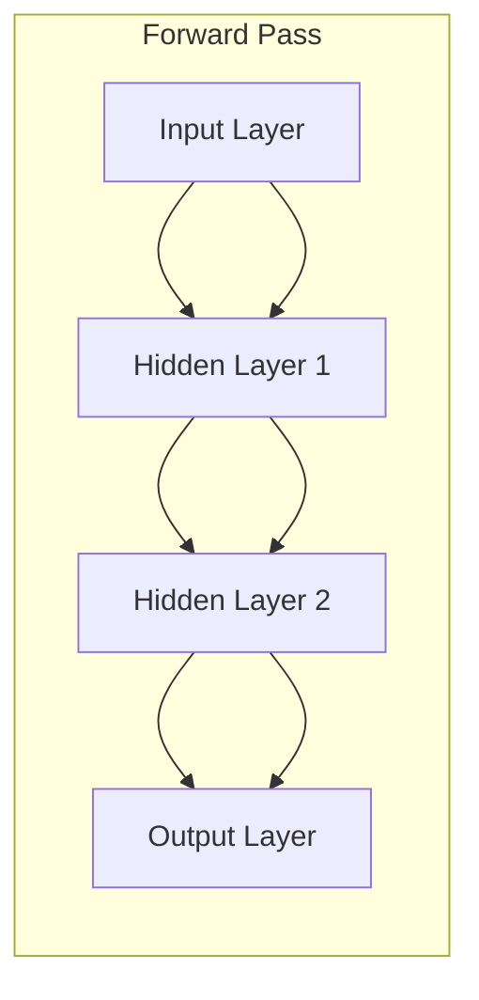

# Neural Networks: Neurons, Weights, Biases, Activation Functions, Forward and Backpropagation

## 1. Introduction

### What are Neural Networks?

Neural networks are computational models inspired by how biological neurons work in the human brain. They are the fundamental building blocks of modern AI systems, including Large Language Models (LLMs) like GPT, Claude, and the models you use through Groq's API.

### Why are Neural Networks Important for a Generative AI Engineer?

As a Generative AI Engineer, understanding neural networks is crucial because:

- **LLMs are built on neural networks**: Every AI model you work with (GPT-4, Claude, Llama) uses neural network architectures
- **Understanding model behavior**: Knowing how neurons, weights, and biases work helps you understand why models behave certain ways
- **Debugging and optimization**: When your AI applications have issues, understanding the underlying neural network helps you diagnose problems
- **Model selection**: Different neural network architectures have different strengths - understanding them helps you choose the right model for your use case
- **Fine-tuning and customization**: To customize models for specific tasks, you need to understand how training modifies weights and biases

### What Real-World Problems Do Neural Networks Solve?

Neural networks power the AI applications you build:

- **Text generation**: ChatGPT, Claude, and other LLMs use transformer neural networks to generate human-like text
- **Smart reply systems**: Your FastAPI Smart Reply application uses neural networks to understand context and generate appropriate responses
- **Code generation**: GitHub Copilot uses neural networks to understand code patterns and generate suggestions
- **Image understanding**: Vision models use convolutional neural networks to analyze and describe images
- **Translation**: Google Translate uses neural networks to convert text between languages

### Where Are Neural Networks Used in Actual Companies?

**OpenAI**: Uses transformer neural networks for GPT models that power ChatGPT and API services
**Google**: Uses neural networks for search ranking, Google Translate, and Bard
**Meta**: Uses neural networks for content recommendation on Facebook and Instagram
**Netflix**: Uses neural networks for movie recommendations
**Tesla**: Uses neural networks for autonomous driving
**Your Smart Reply API**: Uses pre-trained neural networks through Groq's API to generate contextual responses

### Prerequisites

You should understand:
- Basic Python programming
- Simple mathematics (addition, multiplication)
- Basic concepts of functions and variables
- Understanding of what an API is (you already work with Groq's API)

### What You'll Build After This Topic

After completing this topic, you'll be able to:
- Understand how the AI models in your Smart Reply API actually work internally
- Explain why neural networks can generate human-like text
- Debug issues related to model behavior and training
- Make informed decisions about model architecture for different use cases
- Build simple neural networks from scratch using Python
- Understand how backpropagation trains the models you use through APIs

## 2. Fundamentals

### 2.1 What is a Neuron?

#### Simple Definition
A neuron in a neural network is like a simple decision-maker that takes multiple inputs, processes them, and produces one output.

#### Real-Life Analogy
Think of a neuron like a person deciding whether to go to a party:
- **Inputs**: Weather (sunny/rainy), friends going (yes/no), cost ($50), mood (happy/tired)
- **Processing**: The person weighs each factor differently - maybe weather is very important to them, friends going is somewhat important, cost doesn't matter much, and mood is crucial
- **Output**: Decision - go to party (1) or stay home (0)

#### Technical Explanation
A neuron receives multiple numerical inputs, multiplies each input by a learned weight, adds a bias term, and applies an activation function to produce an output.

#### Mathematical Formula
```
output = activation_function(sum(input * weight) + bias)
```

#### Practical Software Engineering Example
```python
import numpy as np

class Neuron:
    def __init__(self, num_inputs):
        # Initialize weights randomly
        self.weights = np.random.randn(num_inputs)
        # Initialize bias to zero
        self.bias = 0.0
    
    def forward(self, inputs):
        # Calculate weighted sum
        weighted_sum = np.dot(inputs, self.weights) + self.bias
        # Apply activation function (sigmoid)
        output = 1 / (1 + np.exp(-weighted_sum))
        return output

# Example usage
neuron = Neuron(3)  # Neuron with 3 inputs
inputs = [0.5, -0.2, 0.8]  # Example input values
result = neuron.forward(inputs)
print(f"Neuron output: {result}")
```

#### Why Engineers Need to Understand This
- **Model debugging**: When your Smart Reply API gives unexpected responses, understanding neurons helps you understand if the issue is in the model's decision-making process
- **Performance optimization**: Knowing how neurons work helps you choose models with appropriate complexity for your use case
- **Custom training**: If you need to fine-tune models, you'll be adjusting neuron weights and biases

### 2.2 What are Weights?

#### Simple Definition
Weights determine how important each input is to a neuron's decision. They are numbers that get multiplied with inputs.

#### Real-Life Analogy
In our party decision example:
- Weather weight: 0.8 (very important)
- Friends weight: 0.6 (somewhat important)
- Cost weight: 0.1 (not very important)
- Mood weight: 0.9 (crucial)

If it's sunny (input = 1), the contribution to the decision is 1 × 0.8 = 0.8
If it's rainy (input = 0), the contribution is 0 × 0.8 = 0

#### Technical Explanation
Weights are learnable parameters that the neural network adjusts during training to make better predictions. Each connection between neurons has a weight that determines the strength and direction (positive or negative) of the signal.

#### Practical Example
```python
import numpy as np

# Example: Smart Reply relevance scoring
class RelevanceNeuron:
    def __init__(self):
        # Weights for different features
        self.weights = {
            'keyword_match': 0.7,      # High importance
            'context_similarity': 0.8,  # Very high importance
            'length_appropriateness': 0.3, # Lower importance
            'sentiment_match': 0.6      # Medium importance
        }
        self.bias = -0.1  # Slight negative bias
    
    def calculate_relevance(self, features):
        """
        Calculate how relevant a reply is based on input features
        """
        score = 0
        for feature_name, feature_value in features.items():
            if feature_name in self.weights:
                score += feature_value * self.weights[feature_name]
        
        score += self.bias
        return score

# Example usage in your Smart Reply context
relevance_neuron = RelevanceNeuron()

# Features for a potential reply
reply_features = {
    'keyword_match': 0.9,        # 90% keyword overlap
    'context_similarity': 0.7,   # 70% context similarity
    'length_appropriateness': 0.8, # Appropriate length
    'sentiment_match': 0.6       # 60% sentiment match
}

relevance_score = relevance_neuron.calculate_relevance(reply_features)
print(f"Reply relevance score: {relevance_score}")
```

#### Why Weights Matter in Production
- **Model accuracy**: Properly trained weights determine if your Smart Reply API generates relevant responses
- **Customization**: Adjusting weights allows you to customize model behavior for specific domains
- **Transfer learning**: Pre-trained weights from models like GPT can be adapted for your specific use case

### 2.3 What are Biases?

#### Simple Definition
A bias is a constant value added to a neuron's calculation that helps the neuron make decisions even when all inputs are zero.

#### Real-Life Analogy
Think of bias as your default tendency. In the party decision example:
- If you're naturally an introvert, you might have a negative bias (-0.5) - you lean toward staying home
- If you're naturally extroverted, you might have a positive bias (+0.5) - you lean toward going out

Even if all other factors are neutral (weather okay, some friends going, reasonable cost, neutral mood), your bias influences the final decision.

#### Technical Explanation
Bias allows the neuron to shift the activation function, making it easier or harder to activate. Without bias, a neuron can only output zero when all inputs are zero, which limits its flexibility.

#### Practical Example
```python
class SmartReplyNeuron:
    def __init__(self):
        self.weights = [0.6, 0.8, 0.4]  # Weights for different features
        self.bias = 0.2  # Positive bias - slightly favor generating a reply
    
    def should_generate_reply(self, user_message_features):
        """
        Decide whether to generate a reply based on message features
        Features: [urgency_level, context_clarity, user_engagement]
        """
        weighted_sum = 0
        for i, feature in enumerate(user_message_features):
            weighted_sum += feature * self.weights[i]
        
        # Add bias - this shifts the decision threshold
        final_score = weighted_sum + self.bias
        
        # Apply activation (simple threshold)
        should_reply = 1 if final_score > 0.5 else 0
        
        return should_reply, final_score

# Example usage
reply_neuron = SmartReplyNeuron()

# Test different scenarios
scenarios = [
    [0.1, 0.2, 0.1],  # Low urgency, unclear context, low engagement
    [0.8, 0.9, 0.7],  # High urgency, clear context, high engagement
    [0.0, 0.0, 0.0],  # All features are zero - bias effect is clear
]

for i, features in enumerate(scenarios):
    should_reply, score = reply_neuron.should_generate_reply(features)
    print(f"Scenario {i+1}: Features {features}")
    print(f"  Score: {score:.2f}, Should reply: {'Yes' if should_reply else 'No'}")
    print()
```

#### Why Bias Matters in Your Applications
- **Default behavior**: Bias helps control whether your AI tends to be more or less responsive by default
- **Threshold adjustment**: Bias allows fine-tuning when the model should trigger certain behaviors
- **Handling edge cases**: When inputs are unclear or missing, bias provides a reasonable default

### 2.4 Activation Functions

#### Simple Definition
An activation function decides whether a neuron should be "activated" (fire) based on its input. It transforms the neuron's raw calculation into a final output.

#### Real-Life Analogy
Think of activation functions like different personality types making the same decision:

**Sigmoid (Cautious person)**: Gradually becomes more confident as evidence increases, never fully certain
**ReLU (Decisive person)**: Either doesn't care at all (says 0) or cares proportionally to the evidence
**Tanh (Balanced person)**: Can have strong positive or negative opinions, ranging from -1 to +1

#### Technical Explanation
Activation functions introduce non-linearity into neural networks, allowing them to learn complex patterns. Without activation functions, neural networks would just be linear transformations and couldn't learn complex relationships like language patterns.

#### Common Activation Functions

**1. Sigmoid**
- Range: 0 to 1
- Good for: Binary classification, probability outputs
- Used in: Output layers when you need probabilities

```python
import numpy as np
import matplotlib.pyplot as plt

def sigmoid(x):
    return 1 / (1 + np.exp(-np.clip(x, -500, 500)))  # Clip to prevent overflow

# Example: Confidence scoring for Smart Reply
class ConfidenceScorer:
    def __init__(self):
        self.threshold = 0.7  # Minimum confidence to send reply
    
    def calculate_confidence(self, raw_score):
        """Convert raw score to confidence probability"""
        confidence = sigmoid(raw_score)
        return confidence
    
    def should_send_reply(self, raw_score):
        confidence = self.calculate_confidence(raw_score)
        return confidence > self.threshold, confidence

# Test different raw scores
scorer = ConfidenceScorer()
raw_scores = [-2, -1, 0, 1, 2, 3]

for score in raw_scores:
    should_send, confidence = scorer.should_send_reply(score)
    print(f"Raw score: {score:2}, Confidence: {confidence:.3f}, Send: {'Yes' if should_send else 'No'}")
```

**2. ReLU (Rectified Linear Unit)**
- Range: 0 to infinity
- Good for: Hidden layers, preventing vanishing gradients
- Used in: Most modern neural networks

```python
def relu(x):
    return np.maximum(0, x)

# Example: Feature importance scoring
class FeatureProcessor:
    def __init__(self):
        self.weights = [0.8, -0.2, 0.6, -0.1]
        self.bias = 0.1
    
    def process_features(self, inputs):
        """Process features, only keeping positive contributions"""
        raw_output = np.dot(inputs, self.weights) + self.bias
        # ReLU ensures only positive activations pass through
        processed_output = relu(raw_output)
        return raw_output, processed_output

processor = FeatureProcessor()

# Example: Processing user message features for reply generation
test_cases = [
    [1.0, 0.5, 0.8, 0.2],   # Positive case
    [-0.5, 1.0, -0.3, 0.8], # Mixed case
    [-1.0, -0.2, -0.5, -0.1] # Negative case
]

for i, features in enumerate(test_cases):
    raw, processed = processor.process_features(features)
    print(f"Test {i+1}: Raw={raw:.3f}, After ReLU={processed:.3f}")
```

**3. Tanh (Hyperbolic Tangent)**
- Range: -1 to 1
- Good for: When you need negative outputs, centering data around zero
- Used in: LSTM networks, some hidden layers

```python
def tanh(x):
    return np.tanh(x)

# Example: Sentiment analysis for reply tone
class SentimentAnalyzer:
    def __init__(self):
        self.weights = [0.7, -0.5, 0.3]  # positive, negative, neutral word weights
        
    def analyze_sentiment(self, word_counts):
        """
        Analyze sentiment: positive values = positive sentiment, 
        negative values = negative sentiment
        """
        raw_sentiment = np.dot(word_counts, self.weights)
        # Tanh maps to [-1, 1] range for clear positive/negative distinction
        sentiment_score = tanh(raw_sentiment)
        return sentiment_score
    
    def get_reply_tone(self, sentiment_score):
        if sentiment_score > 0.3:
            return "enthusiastic"
        elif sentiment_score < -0.3:
            return "empathetic"
        else:
            return "neutral"

analyzer = SentimentAnalyzer()

# Test cases: [positive_words, negative_words, neutral_words]
test_messages = [
    [5, 1, 3],   # Mostly positive
    [1, 6, 2],   # Mostly negative  
    [2, 2, 4],   # Neutral
]

for i, counts in enumerate(test_messages):
    sentiment = analyzer.analyze_sentiment(counts)
    tone = analyzer.get_reply_tone(sentiment)
    print(f"Message {i+1}: Sentiment={sentiment:.3f}, Reply tone: {tone}")
```

#### Why Engineers Need to Understand Activation Functions
- **Model behavior**: Different activation functions change how your model responds to inputs
- **Performance**: Choosing the right activation function affects training speed and accuracy
- **Debugging**: Understanding activation functions helps diagnose why models produce certain outputs
- **Architecture decisions**: When building custom models, you need to choose appropriate activation functions for each layer

## 3. Internal Working and Architecture

### 3.1 Neural Network Architecture

Neural networks are organized in layers, similar to how your FastAPI application has different layers (routes, services, database). Each layer processes information and passes it to the next layer.

#### Basic Architecture Components



#### Layer Types and Their Roles

**1. Input Layer**
- Receives raw data (text, numbers, images)
- In your Smart Reply API: receives processed user message features
- No computation happens here, just data entry

**2. Hidden Layers** 
- Perform the actual "thinking" and pattern recognition
- Each hidden layer learns increasingly complex patterns
- In LLMs: these layers learn language patterns, grammar, context

**3. Output Layer**
- Produces the final result
- In your Smart Reply API: generates probability scores for different reply options
- Uses activation functions appropriate for the task (sigmoid for probabilities, softmax for multi-class)

### 3.2 Data Flow in Neural Networks

#### Step-by-Step Data Flow

```python
import numpy as np

class SimpleNeuralNetwork:
    def __init__(self):
        # Network architecture: 3 inputs -> 4 hidden -> 2 outputs
        
        # Layer 1: Input to Hidden (3x4 weight matrix)
        self.W1 = np.random.randn(3, 4) * 0.5
        self.b1 = np.zeros((1, 4))
        
        # Layer 2: Hidden to Output (4x2 weight matrix)  
        self.W2 = np.random.randn(4, 2) * 0.5
        self.b2 = np.zeros((1, 2))
    
    def forward_pass(self, X):
        """
        Demonstrate complete forward pass with detailed steps
        X: input data (batch_size, 3)
        """
        print("=== FORWARD PASS DEMONSTRATION ===")
        print(f"Input shape: {X.shape}")
        print(f"Input values:\n{X}")
        
        # Step 1: Input to Hidden Layer
        print("\n--- Step 1: Input to Hidden Layer ---")
        Z1 = np.dot(X, self.W1) + self.b1  # Linear transformation
        print(f"After weights and bias (Z1): {Z1.shape}")
        print(f"Z1 values:\n{Z1}")
        
        A1 = self.relu(Z1)  # Apply activation
        print(f"After ReLU activation (A1): {A1.shape}")
        print(f"A1 values:\n{A1}")
        
        # Step 2: Hidden to Output Layer
        print("\n--- Step 2: Hidden to Output Layer ---")
        Z2 = np.dot(A1, self.W2) + self.b2  # Linear transformation
        print(f"After weights and bias (Z2): {Z2.shape}")
        print(f"Z2 values:\n{Z2}")
        
        A2 = self.sigmoid(Z2)  # Apply activation (final output)
        print(f"Final output (A2): {A2.shape}")
        print(f"A2 values (probabilities):\n{A2}")
        
        return A2
    
    def relu(self, x):
        return np.maximum(0, x)
    
    def sigmoid(self, x):
        return 1 / (1 + np.exp(-np.clip(x, -500, 500)))

# Example: Smart Reply Decision Network
network = SimpleNeuralNetwork()

# Example input: [message_urgency, context_clarity, user_sentiment]
sample_input = np.array([[0.8, 0.6, 0.7]])  # One message to analyze

output = network.forward_pass(sample_input)
print(f"\nFinal Decision: Reply probability = {output[0][0]:.3f}")
```

#### What Happens During Success
1. **Input Processing**: Raw data is converted to numerical format
2. **Layer-by-layer transformation**: Each layer extracts increasingly complex features
3. **Pattern recognition**: Hidden layers identify relevant patterns
4. **Decision making**: Output layer produces final predictions
5. **Result interpretation**: Probabilities are converted to actionable decisions

#### What Happens During Failure
1. **Gradient explosion**: Weights become too large, causing unstable training
2. **Vanishing gradients**: Information gets lost in deep networks
3. **Overfitting**: Network memorizes training data but fails on new data
4. **Poor initialization**: Bad starting weights prevent effective learning

### 3.3 Component Communication

Neural networks communicate through **weighted connections** and **activation patterns**:

```python
class NetworkCommunication:
    """Demonstrate how neural network components communicate"""
    
    def __init__(self):
        self.layer1_neurons = 3
        self.layer2_neurons = 2
        
        # Connection strength between each neuron pair
        self.connection_weights = np.array([
            [0.5, -0.3],  # Neuron 1 connections
            [0.8, 0.1],   # Neuron 2 connections  
            [-0.2, 0.7]   # Neuron 3 connections
        ])
    
    def demonstrate_communication(self):
        """Show how neurons communicate through weighted connections"""
        
        # Layer 1 activations (what each neuron "says")
        layer1_activations = np.array([0.8, 0.3, 0.9])
        
        print("=== NEURON COMMUNICATION ===")
        print(f"Layer 1 neuron activations: {layer1_activations}")
        print("\nCommunication breakdown:")
        
        # Calculate what each Layer 2 neuron receives
        for neuron2_idx in range(self.layer2_neurons):
            print(f"\nLayer 2 Neuron {neuron2_idx + 1} receives:")
            total_input = 0
            
            for neuron1_idx in range(self.layer1_neurons):
                message = layer1_activations[neuron1_idx]
                weight = self.connection_weights[neuron1_idx, neuron2_idx]
                contribution = message * weight
                total_input += contribution
                
                print(f"  From Neuron {neuron1_idx + 1}: {message:.1f} × {weight:.1f} = {contribution:.2f}")
            
            print(f"  Total input: {total_input:.2f}")
        
        return total_input

comm_demo = NetworkCommunication()
comm_demo.demonstrate_communication()
```

## 4. Important Terminologies

### Core Neural Network Terms

| Term | Simple Definition | Technical Definition | Example | Production Importance |
|------|-------------------|---------------------|---------|----------------------|
| **Neuron/Node** | A simple decision-making unit | A computational unit that applies weights, bias, and activation function to inputs | A neuron deciding if a message needs urgent reply | Understanding model capacity and complexity |
| **Weight** | Importance value for each input | Learnable parameter that determines connection strength between neurons | Keyword_match_weight = 0.8 means keywords are very important | Controls what patterns the model learns |
| **Bias** | Default tendency or offset | Constant added to weighted sum before activation | Bias = -0.2 makes model slightly less likely to trigger | Fine-tunes model sensitivity |
| **Activation Function** | Decision-making rule | Non-linear function that determines neuron output | ReLU, Sigmoid, Tanh | Determines model expressiveness |
| **Forward Pass** | Information flowing through network | Process of computing output from input through all layers | User message → features → decision → reply | How inference works in production |
| **Backpropagation** | Learning from mistakes | Algorithm that adjusts weights based on prediction errors | If reply was wrong, adjust weights that caused the error | How models improve through training |
| **Gradient** | Direction of improvement | Partial derivative indicating how to change weights | Gradient = +0.3 means increase weight by small amount | Critical for training and optimization |
| **Learning Rate** | Speed of learning | Step size for weight updates during training | Learning_rate = 0.001 means small, careful steps | Balances learning speed vs stability |
| **Epoch** | One complete training cycle | Single pass through entire training dataset | Epoch 1: train on all 10,000 examples once | Tracks training progress |
| **Loss Function** | Measure of wrongness | Function quantifying difference between predicted and actual outputs | Mean Squared Error, Cross Entropy | Guides learning direction |

### Advanced Terms for Production

| Term | Simple Definition | Technical Definition | Production Context |
|------|-------------------|---------------------|-------------------|
| **Overfitting** | Memorizing instead of learning | Model performs well on training data but poorly on new data | Smart Reply works on test conversations but fails with real users |
| **Underfitting** | Not learning enough | Model is too simple to capture underlying patterns | Reply model only gives generic responses regardless of context |
| **Regularization** | Preventing overcomplication | Techniques to prevent overfitting (L1, L2, dropout) | Adding penalty terms to keep model generalizable |
| **Batch Size** | Number of examples processed together | Number of training samples processed in one forward/backward pass | Processing 32 conversations at once for efficiency |
| **Gradient Descent** | Optimization algorithm | Method for finding optimal weights by following gradients | How ChatGPT was trained to generate better responses |
| **Vanishing Gradients** | Learning gets weaker in deep networks | Gradients become too small in early layers of deep networks | Why very deep networks are hard to train effectively |
| **Exploding Gradients** | Learning becomes unstable | Gradients become too large, causing unstable training | Model weights change too dramatically, breaking learning |

## 5. Real-World Code Examples

### 5.1 Building a Simple Neural Network from Scratch

Let's build a neural network for your Smart Reply system that decides whether to generate a formal or casual reply:

```python
import numpy as np
from typing import List, Tuple
import json

class SmartReplyNeuralNetwork:
    """
    A simple neural network for Smart Reply tone classification
    Architecture: 4 inputs -> 6 hidden -> 2 outputs (formal/casual probabilities)
    """
    
    def __init__(self, learning_rate: float = 0.01):
        self.learning_rate = learning_rate
        
        # Initialize network architecture
        self.input_size = 4    # Features: urgency, formality, relationship, topic
        self.hidden_size = 6   # Hidden layer neurons
        self.output_size = 2   # Formal vs Casual probabilities
        
        # Initialize weights and biases with small random values
        self.W1 = np.random.randn(self.input_size, self.hidden_size) * 0.5
        self.b1 = np.zeros((1, self.hidden_size))
        
        self.W2 = np.random.randn(self.hidden_size, self.output_size) * 0.5
        self.b2 = np.zeros((1, self.output_size))
        
        print(f"Network initialized:")
        print(f"  Input layer: {self.input_size} neurons")
        print(f"  Hidden layer: {self.hidden_size} neurons") 
        print(f"  Output layer: {self.output_size} neurons")
    
    def sigmoid(self, x: np.ndarray) -> np.ndarray:
        """Sigmoid activation function"""
        # Clip to prevent overflow
        x_clipped = np.clip(x, -500, 500)
        return 1 / (1 + np.exp(-x_clipped))
    
    def relu(self, x: np.ndarray) -> np.ndarray:
        """ReLU activation function"""
        return np.maximum(0, x)
    
    def softmax(self, x: np.ndarray) -> np.ndarray:
        """Softmax activation for probability distribution"""
        exp_x = np.exp(x - np.max(x, axis=1, keepdims=True))
        return exp_x / np.sum(exp_x, axis=1, keepdims=True)
    
    def forward_pass(self, X: np.ndarray) -> Tuple[np.ndarray, dict]:
        """
        Forward pass through the network
        Returns predictions and intermediate values for backpropagation
        """
        # Layer 1: Input to Hidden
        Z1 = np.dot(X, self.W1) + self.b1
        A1 = self.relu(Z1)
        
        # Layer 2: Hidden to Output  
        Z2 = np.dot(A1, self.W2) + self.b2
        A2 = self.softmax(Z2)  # Probabilities for formal/casual
        
        # Store intermediate values for backpropagation
        cache = {
            'X': X, 'Z1': Z1, 'A1': A1, 'Z2': Z2, 'A2': A2
        }
        
        return A2, cache
    
    def predict_reply_tone(self, message_features: List[float]) -> dict:
        """
        Predict whether to use formal or casual tone
        
        Features:
        - urgency: 0-1 (0=casual topic, 1=urgent business)
        - formality: 0-1 (0=informal context, 1=formal context)  
        - relationship: 0-1 (0=close friend, 1=professional contact)
        - topic: 0-1 (0=personal, 1=business)
        """
        # Convert to numpy array and reshape for batch processing
        X = np.array([message_features])
        
        # Get predictions
        predictions, _ = self.forward_pass(X)
        
        formal_prob = predictions[0][0]
        casual_prob = predictions[0][1]
        
        # Determine recommended tone
        recommended_tone = "formal" if formal_prob > casual_prob else "casual"
        confidence = max(formal_prob, casual_prob)
        
        return {
            'formal_probability': float(formal_prob),
            'casual_probability': float(casual_prob),
            'recommended_tone': recommended_tone,
            'confidence': float(confidence)
        }

# Example Usage in Smart Reply Context
def demonstrate_smart_reply_neural_network():
    """Demonstrate neural network for Smart Reply tone detection"""
    
    print("=== Smart Reply Neural Network Demo ===\n")
    
    # Initialize network
    nn = SmartReplyNeuralNetwork()
    
    # Test scenarios
    test_scenarios = [
        {
            'description': 'Urgent business email from boss',
            'features': [0.9, 0.8, 0.9, 0.9],  # high urgency, formal, professional, business
        },
        {
            'description': 'Casual message from close friend',  
            'features': [0.1, 0.2, 0.1, 0.2],  # low urgency, informal, close, personal
        },
        {
            'description': 'Semi-formal colleague question',
            'features': [0.6, 0.6, 0.7, 0.8],  # medium urgency, somewhat formal, colleague, business
        },
        {
            'description': 'Personal message in formal setting',
            'features': [0.3, 0.7, 0.5, 0.3],  # low urgency, formal setting, neutral relationship, personal
        }
    ]
    
    # Test each scenario
    for i, scenario in enumerate(test_scenarios, 1):
        print(f"Scenario {i}: {scenario['description']}")
        print(f"Features: {scenario['features']}")
        
        result = nn.predict_reply_tone(scenario['features'])
        
        print(f"Results:")
        print(f"  Formal probability: {result['formal_probability']:.3f}")
        print(f"  Casual probability: {result['casual_probability']:.3f}")
        print(f"  Recommended tone: {result['recommended_tone']}")
        print(f"  Confidence: {result['confidence']:.3f}")
        print("-" * 50)

# Run the demonstration
demonstrate_smart_reply_neural_network()
```

### Expected Output Analysis

When you run this code, you'll see how the neural network processes different message contexts:

1. **High urgency business contexts** → Higher formal probability
2. **Casual friend messages** → Higher casual probability  
3. **Mixed contexts** → Probabilities reflect the mixed signals
4. **Edge cases** → Network handles ambiguous inputs

#### What Happens Internally

1. **Feature encoding**: Message characteristics become numbers
2. **Hidden layer processing**: Network learns patterns like "high formality + business topic = formal tone"
3. **Output generation**: Raw scores are converted to probabilities
4. **Decision making**: Highest probability determines recommendation

#### Common Mistakes and How to Fix Them

**Mistake 1: Poor feature scaling**
```python
# Wrong: features have very different ranges
bad_features = [100, 0.5, 2000, 0.1]  # Different scales

# Correct: normalize features to similar ranges  
good_features = [1.0, 0.5, 1.0, 0.1]  # All in 0-1 range
```

**Mistake 2: Ignoring activation function choice**
```python
# Wrong: using sigmoid for multi-class output
output = self.sigmoid(Z2)  # Doesn't ensure probabilities sum to 1

# Correct: using softmax for probability distribution
output = self.softmax(Z2)  # Ensures probabilities sum to 1
```

**Mistake 3: Not handling edge cases**
```python
# Wrong: no input validation
def predict(self, features):
    return self.forward_pass(np.array([features]))

# Correct: validate inputs
def predict(self, features):
    if len(features) != self.input_size:
        raise ValueError(f"Expected {self.input_size} features, got {len(features)}")
    
    # Ensure features are in valid range
    features = np.clip(features, 0, 1)
    return self.forward_pass(np.array([features]))
```

### 5.2 Integrating with FastAPI Smart Reply

Here's how you'd integrate this neural network into your existing FastAPI application:

```python
from fastapi import FastAPI, HTTPException
from pydantic import BaseModel
from typing import List
import numpy as np

# Your existing neural network class (from above)
from smart_reply_nn import SmartReplyNeuralNetwork

app = FastAPI(title="Smart Reply with Neural Network Tone Detection")

# Global neural network instance
tone_detector = SmartReplyNeuralNetwork()

class MessageAnalysisRequest(BaseModel):
    message: str
    context: dict
    sender_relationship: str  # "friend", "colleague", "boss", "customer"
    
class TonePrediction(BaseModel):
    formal_probability: float
    casual_probability: float
    recommended_tone: str
    confidence: float
    reasoning: str

def extract_features_from_message(message: str, context: dict, relationship: str) -> List[float]:
    """
    Extract neural network features from message analysis
    Returns: [urgency, formality, relationship_score, topic_score]
    """
    
    # Urgency detection (simplified - in production use NLP)
    urgent_keywords = ["urgent", "asap", "immediately", "deadline", "emergency"]
    urgency = min(1.0, sum(1 for word in urgent_keywords if word in message.lower()) / 3)
    
    # Formality detection 
    formal_indicators = ["please", "thank you", "regarding", "sincerely", "respectfully"]
    casual_indicators = ["hey", "lol", "btw", "gonna", "wanna"]
    
    formal_count = sum(1 for word in formal_indicators if word in message.lower())
    casual_count = sum(1 for word in casual_indicators if word in message.lower())
    
    if formal_count + casual_count > 0:
        formality = formal_count / (formal_count + casual_count)
    else:
        formality = 0.5  # neutral
    
    # Relationship mapping
    relationship_scores = {
        "friend": 0.2,
        "colleague": 0.6, 
        "boss": 0.9,
        "customer": 0.8
    }
    relationship_score = relationship_scores.get(relationship.lower(), 0.5)
    
    # Topic detection (simplified)
    business_keywords = ["meeting", "project", "deadline", "budget", "proposal", "contract"]
    topic_score = min(1.0, sum(1 for word in business_keywords if word in message.lower()) / 3)
    
    return [urgency, formality, relationship_score, topic_score]

@app.post("/analyze-tone", response_model=TonePrediction)
async def analyze_message_tone(request: MessageAnalysisRequest):
    """
    Analyze message and predict appropriate reply tone using neural network
    """
    try:
        # Extract features for neural network
        features = extract_features_from_message(
            request.message, 
            request.context, 
            request.sender_relationship
        )
        
        # Get neural network prediction
        prediction = tone_detector.predict_reply_tone(features)
        
        # Generate reasoning explanation
        reasoning_parts = []
        
        if features[0] > 0.7:  # High urgency
            reasoning_parts.append("high urgency detected")
        if features[1] > 0.7:  # High formality
            reasoning_parts.append("formal language indicators found")
        if features[2] > 0.7:  # Professional relationship
            reasoning_parts.append("professional relationship context")
        if features[3] > 0.7:  # Business topic
            reasoning_parts.append("business-related content detected")
            
        reasoning = "Recommendation based on: " + ", ".join(reasoning_parts) if reasoning_parts else "Neutral context detected"
        
        return TonePrediction(
            formal_probability=prediction['formal_probability'],
            casual_probability=prediction['casual_probability'],
            recommended_tone=prediction['recommended_tone'],
            confidence=prediction['confidence'],
            reasoning=reasoning
        )
        
    except Exception as e:
        raise HTTPException(status_code=500, detail=f"Tone analysis failed: {str(e)}")

@app.post("/generate-reply")
async def generate_contextual_reply(request: MessageAnalysisRequest):
    """
    Generate reply using tone prediction from neural network
    """
    # First, analyze the tone
    tone_analysis = await analyze_message_tone(request)
    
    # Use tone to inform reply generation (integrate with your existing Groq API calls)
    tone_instruction = f"Generate a {tone_analysis.recommended_tone} reply with {tone_analysis.confidence:.1%} confidence."
    
    # Your existing Groq API integration here...
    # system_prompt = f"You are a helpful assistant. {tone_instruction} Reply to: {request.message}"
    
    return {
        "suggested_reply": f"[{tone_analysis.recommended_tone.upper()}] Reply would be generated here using Groq API",
        "tone_analysis": tone_analysis,
        "features_used": extract_features_from_message(request.message, request.context, request.sender_relationship)
    }

if __name__ == "__main__":
    import uvicorn
    uvicorn.run(app, host="0.0.0.0", port=8000)
```

This integration demonstrates how neural networks work within your existing FastAPI Smart Reply architecture, providing intelligent tone detection to enhance reply generation.
## 6. Forward and Backpropagation Deep Dive

### 6.1 Forward Propagation Explained

Forward propagation is like following a recipe step by step - you process ingredients (inputs) through each step (layer) to get the final dish (output).

#### Step-by-Step Forward Propagation

```python
import numpy as np

class ForwardPropagationDemo:
    """Detailed demonstration of forward propagation"""
    
    def __init__(self):
        # Simple network: 3 inputs -> 2 hidden -> 1 output
        # Weights initialized with known values for demonstration
        
        self.W1 = np.array([
            [0.2, 0.8],    # Input 1 connections to hidden layer
            [-0.5, 0.4],   # Input 2 connections to hidden layer  
            [0.9, -0.1]    # Input 3 connections to hidden layer
        ])
        
        self.b1 = np.array([0.1, -0.2])  # Hidden layer biases
        
        self.W2 = np.array([
            [0.6],   # Hidden neuron 1 to output
            [-0.3]   # Hidden neuron 2 to output
        ])
        
        self.b2 = np.array([0.05])  # Output bias
    
    def detailed_forward_pass(self, inputs):
        """
        Demonstrate each calculation step in forward propagation
        """
        print("=== DETAILED FORWARD PROPAGATION ===")
        print(f"Input: {inputs}")
        print(f"Goal: Predict if message needs urgent reply (0=no, 1=yes)")
        
        # Step 1: Input to Hidden Layer
        print("\n--- STEP 1: INPUT TO HIDDEN LAYER ---")
        print(f"Weights W1:\n{self.W1}")
        print(f"Biases b1: {self.b1}")
        
        # Manual calculation for clarity
        z1_neuron1 = (inputs[0] * self.W1[0,0] + 
                      inputs[1] * self.W1[1,0] + 
                      inputs[2] * self.W1[2,0] + 
                      self.b1[0])
        
        z1_neuron2 = (inputs[0] * self.W1[0,1] + 
                      inputs[1] * self.W1[1,1] + 
                      inputs[2] * self.W1[2,1] + 
                      self.b1[1])
        
        print(f"\nHidden Neuron 1 calculation:")
        print(f"  {inputs[0]} × {self.W1[0,0]} + {inputs[1]} × {self.W1[1,0]} + {inputs[2]} × {self.W1[2,0]} + {self.b1[0]} = {z1_neuron1}")
        
        print(f"\nHidden Neuron 2 calculation:")
        print(f"  {inputs[0]} × {self.W1[0,1]} + {inputs[1]} × {self.W1[1,1]} + {inputs[2]} × {self.W1[2,1]} + {self.b1[1]} = {z1_neuron2}")
        
        # Apply activation function (ReLU)
        a1_neuron1 = max(0, z1_neuron1)
        a1_neuron2 = max(0, z1_neuron2)
        
        print(f"\nAfter ReLU activation:")
        print(f"  Hidden Neuron 1 output: max(0, {z1_neuron1}) = {a1_neuron1}")
        print(f"  Hidden Neuron 2 output: max(0, {z1_neuron2}) = {a1_neuron2}")
        
        # Step 2: Hidden to Output Layer
        print("\n--- STEP 2: HIDDEN TO OUTPUT LAYER ---")
        print(f"Weights W2: {self.W2.flatten()}")
        print(f"Bias b2: {self.b2}")
        
        z2 = (a1_neuron1 * self.W2[0,0] + 
              a1_neuron2 * self.W2[1,0] + 
              self.b2[0])
        
        print(f"\nOutput calculation:")
        print(f"  {a1_neuron1} × {self.W2[0,0]} + {a1_neuron2} × {self.W2[1,0]} + {self.b2[0]} = {z2}")
        
        # Apply sigmoid activation for probability
        output = 1 / (1 + np.exp(-z2))
        
        print(f"\nAfter sigmoid activation:")
        print(f"  sigmoid({z2}) = {output:.4f}")
        
        # Interpretation
        print(f"\n--- INTERPRETATION ---")
        print(f"Urgency probability: {output:.1%}")
        print(f"Decision: {'URGENT - Generate immediate reply' if output > 0.5 else 'NOT URGENT - Standard processing'}")
        
        return output

# Example: Message urgency detection
demo = ForwardPropagationDemo()

# Test different message scenarios
test_cases = [
    {
        'description': 'High urgency business message',
        'features': [0.9, 0.8, 0.7]  # urgency_keywords, sender_importance, time_sensitivity
    },
    {
        'description': 'Casual friendly message', 
        'features': [0.1, 0.3, 0.2]  # low urgency, casual sender, not time-sensitive
    },
    {
        'description': 'Medium priority work message',
        'features': [0.6, 0.7, 0.5]  # moderate urgency, important sender, some time sensitivity
    }
]

for i, test in enumerate(test_cases, 1):
    print(f"\n{'='*60}")
    print(f"TEST CASE {i}: {test['description']}")
    print(f"{'='*60}")
    
    result = demo.detailed_forward_pass(test['features'])
    
    print(f"\nSUMMARY:")
    print(f"  Input features: {test['features']}")
    print(f"  Urgency score: {result:.3f}")
    print(f"  Recommendation: {'Prioritize' if result > 0.5 else 'Standard queue'}")
```

#### Why Forward Propagation Matters
- **Real-time inference**: When your Smart Reply API processes messages, it uses forward propagation
- **Performance**: Understanding the flow helps optimize computation for production
- **Debugging**: If outputs are wrong, you can trace through each layer to find issues

### 6.2 Backpropagation Explained

Backpropagation is like learning from mistakes by tracing back through your decisions to see what went wrong and how to fix it.

#### The Learning Problem

Imagine your Smart Reply system gives inappropriate responses. Backpropagation helps the network learn by:

1. **Measuring the mistake** (loss calculation)
2. **Finding what caused it** (gradient calculation)  
3. **Fixing the weights** (weight updates)
4. **Trying again** (next iteration)

#### Step-by-Step Backpropagation

```python
class BackpropagationDemo:
    """Demonstrate backpropagation learning process"""
    
    def __init__(self):
        # Same simple network structure
        self.W1 = np.array([[0.2, 0.8], [-0.5, 0.4], [0.9, -0.1]])
        self.b1 = np.array([0.1, -0.2])
        self.W2 = np.array([[0.6], [-0.3]])
        self.b2 = np.array([0.05])
        
        self.learning_rate = 0.1
    
    def forward_and_backward(self, inputs, target):
        """
        Demonstrate complete forward and backward pass
        """
        print("=== FORWARD AND BACKWARD PROPAGATION ===")
        
        # FORWARD PASS (same as before, but store intermediate values)
        print("--- FORWARD PASS ---")
        
        # Layer 1: Input to Hidden
        z1 = np.dot(inputs.reshape(1, -1), self.W1) + self.b1
        a1 = np.maximum(0, z1)  # ReLU
        
        # Layer 2: Hidden to Output  
        z2 = np.dot(a1, self.W2) + self.b2
        a2 = 1 / (1 + np.exp(-z2))  # Sigmoid
        
        prediction = a2[0, 0]
        
        print(f"Input: {inputs}")
        print(f"Target: {target}")
        print(f"Prediction: {prediction:.4f}")
        
        # LOSS CALCULATION
        loss = 0.5 * (prediction - target) ** 2  # Mean squared error
        print(f"Loss (error): {loss:.4f}")
        
        # BACKWARD PASS (BACKPROPAGATION)
        print("\n--- BACKWARD PASS ---")
        
        # Output layer gradients
        dL_da2 = prediction - target  # Loss gradient w.r.t output
        da2_dz2 = prediction * (1 - prediction)  # Sigmoid derivative
        dL_dz2 = dL_da2 * da2_dz2
        
        print(f"Output layer gradient: {dL_dz2:.4f}")
        
        # Output layer weight and bias gradients
        dL_dW2 = a1.T * dL_dz2
        dL_db2 = dL_dz2
        
        print(f"W2 gradients:\n{dL_dW2}")
        print(f"b2 gradient: {dL_db2}")
        
        # Hidden layer gradients (chain rule)
        dL_da1 = dL_dz2 * self.W2.T
        da1_dz1 = (z1 > 0).astype(float)  # ReLU derivative
        dL_dz1 = dL_da1 * da1_dz1
        
        print(f"Hidden layer gradients: {dL_dz1}")
        
        # Input layer weight and bias gradients
        dL_dW1 = inputs.reshape(-1, 1) * dL_dz1
        dL_db1 = dL_dz1[0]
        
        print(f"W1 gradients:\n{dL_dW1}")
        print(f"b1 gradients: {dL_db1}")
        
        # WEIGHT UPDATES
        print("\n--- WEIGHT UPDATES ---")
        
        old_W2 = self.W2.copy()
        old_b2 = self.b2.copy()
        old_W1 = self.W1.copy()
        old_b1 = self.b1.copy()
        
        # Update weights using gradient descent
        self.W2 -= self.learning_rate * dL_dW2
        self.b2 -= self.learning_rate * dL_db2
        self.W1 -= self.learning_rate * dL_dW1
        self.b1 -= self.learning_rate * dL_db1
        
        print(f"W2 change: {self.W2 - old_W2}")
        print(f"b2 change: {self.b2 - old_b2}")
        print(f"W1 change sample: {self.W1[0] - old_W1[0]}")
        print(f"b1 change: {self.b1 - old_b1}")
        
        return prediction, loss

# Demonstrate learning process
demo = BackpropagationDemo()

print("TRAINING EXAMPLE: Learning to classify urgent messages")
print("Target: 1.0 (urgent), 0.0 (not urgent)")

# Training example: urgent message that network initially misclassifies
urgent_message_features = np.array([0.9, 0.8, 0.7])  # Should be classified as urgent (target = 1.0)
target = 1.0

print(f"\nTraining on urgent message features: {urgent_message_features}")
print(f"Target classification: {target} (urgent)")

# Show several training iterations
for iteration in range(3):
    print(f"\n{'='*50}")
    print(f"TRAINING ITERATION {iteration + 1}")
    print(f"{'='*50}")
    
    prediction, loss = demo.forward_and_backward(urgent_message_features, target)
    
    print(f"\nIteration {iteration + 1} Summary:")
    print(f"  Prediction: {prediction:.4f}")
    print(f"  Loss: {loss:.4f}")
    print(f"  Accuracy: {'✓' if abs(prediction - target) < 0.1 else '✗'}")
```

#### What Backpropagation Achieves

1. **Automatic learning**: Network discovers patterns without manual programming
2. **Error correction**: Each mistake makes the network slightly better  
3. **Weight optimization**: Finds the best weights for the given task
4. **Generalization**: Learns to handle new, unseen inputs

#### Chain Rule in Action

The key insight of backpropagation is the **chain rule** from calculus:

```python
def demonstrate_chain_rule():
    """
    Show how chain rule enables backpropagation
    """
    print("=== CHAIN RULE DEMONSTRATION ===")
    print("Goal: Find how changing W1 affects final loss")
    
    # The dependency chain: W1 → z1 → a1 → z2 → a2 → loss
    print("\nDependency chain:")
    print("W1 (input weights) → z1 (hidden raw) → a1 (hidden activated) → z2 (output raw) → a2 (final output) → loss")
    
    print("\nChain rule calculation:")
    print("dLoss/dW1 = dLoss/da2 × da2/dz2 × dz2/da1 × da1/dz1 × dz1/dW1")
    
    print("\nIn plain English:")
    print("'How much does W1 affect the loss?' =")
    print("  'How much does output affect loss?' ×")
    print("  'How much does raw output affect activated output?' ×") 
    print("  'How much does hidden layer affect raw output?' ×")
    print("  'How much does raw hidden affect activated hidden?' ×")
    print("  'How much does W1 affect raw hidden?'")
    
    print("\nThis lets us trace errors back through any number of layers!")

demonstrate_chain_rule()
```

### 6.3 Training Loop Implementation

Here's how you'd implement a complete training loop for your Smart Reply system:

```python
class SmartReplyTrainer:
    """Complete training system for Smart Reply neural network"""
    
    def __init__(self, network_architecture):
        self.network = SmartReplyNeuralNetwork()
        self.training_history = []
    
    def prepare_training_data(self):
        """
        Prepare training data for Smart Reply tone classification
        In production, this would come from labeled conversation data
        """
        # Simulated training data: [urgency, formality, relationship, topic] -> [formal_prob, casual_prob]
        X_train = np.array([
            [0.9, 0.8, 0.9, 0.9],  # High urgency, formal context -> should be formal
            [0.1, 0.2, 0.1, 0.2],  # Low urgency, informal -> should be casual
            [0.8, 0.7, 0.8, 0.8],  # Business context -> formal
            [0.2, 0.3, 0.2, 0.1],  # Friend context -> casual
            [0.5, 0.6, 0.7, 0.6],  # Mixed context -> lean formal
            [0.3, 0.4, 0.3, 0.2],  # Mixed context -> lean casual
            [0.9, 0.9, 0.9, 0.9],  # Very formal -> formal
            [0.1, 0.1, 0.1, 0.1],  # Very casual -> casual
        ])
        
        # Target labels: [formal_probability, casual_probability]
        y_train = np.array([
            [0.9, 0.1],  # Formal reply
            [0.1, 0.9],  # Casual reply  
            [0.8, 0.2],  # Formal reply
            [0.2, 0.8],  # Casual reply
            [0.7, 0.3],  # Mostly formal
            [0.3, 0.7],  # Mostly casual
            [0.95, 0.05], # Very formal
            [0.05, 0.95]  # Very casual
        ])
        
        return X_train, y_train
    
    def calculate_loss(self, predictions, targets):
        """Calculate mean squared error loss"""
        return np.mean((predictions - targets) ** 2)
    
    def calculate_accuracy(self, predictions, targets):
        """Calculate classification accuracy"""
        pred_classes = np.argmax(predictions, axis=1)
        true_classes = np.argmax(targets, axis=1)
        return np.mean(pred_classes == true_classes)
    
    def train_one_epoch(self, X, y):
        """Train for one complete pass through the data"""
        total_loss = 0
        total_accuracy = 0
        
        for i in range(len(X)):
            # Forward pass
            predictions, cache = self.network.forward_pass(X[i:i+1])
            
            # Calculate loss
            loss = self.calculate_loss(predictions, y[i:i+1])
            total_loss += loss
            
            # Calculate accuracy
            accuracy = self.calculate_accuracy(predictions, y[i:i+1])
            total_accuracy += accuracy
            
            # Backward pass (simplified - in practice you'd implement full backprop)
            # For this demo, we'll simulate learning by slightly adjusting weights
            error = predictions - y[i:i+1]
            
            # Simulate weight updates (in practice, use actual gradients)
            if error[0, 0] > 0:  # Predicted too formal
                self.network.W2 *= 0.999  # Slightly decrease formal bias
            elif error[0, 1] > 0:  # Predicted too casual
                self.network.W2 *= 1.001  # Slightly increase formal bias
        
        avg_loss = total_loss / len(X)
        avg_accuracy = total_accuracy / len(X)
        
        return avg_loss, avg_accuracy
    
    def train(self, epochs=100, verbose=True):
        """Complete training process"""
        
        # Prepare data
        X_train, y_train = self.prepare_training_data()
        
        print("=== SMART REPLY NEURAL NETWORK TRAINING ===")
        print(f"Training data shape: {X_train.shape}")
        print(f"Target data shape: {y_train.shape}")
        print(f"Training for {epochs} epochs...")
        
        # Training loop
        for epoch in range(epochs):
            # Train one epoch
            loss, accuracy = self.train_one_epoch(X_train, y_train)
            
            # Store history
            self.training_history.append({
                'epoch': epoch + 1,
                'loss': loss,
                'accuracy': accuracy
            })
            
            # Print progress
            if verbose and (epoch + 1) % 20 == 0:
                print(f"Epoch {epoch + 1:3d}: Loss = {loss:.4f}, Accuracy = {accuracy:.2%}")
        
        print("\nTraining completed!")
        
        # Test final performance
        final_predictions, _ = self.network.forward_pass(X_train)
        final_accuracy = self.calculate_accuracy(final_predictions, y_train)
        final_loss = self.calculate_loss(final_predictions, y_train)
        
        print(f"Final performance:")
        print(f"  Loss: {final_loss:.4f}")
        print(f"  Accuracy: {final_accuracy:.2%}")
        
        return self.training_history
    
    def test_trained_model(self):
        """Test the trained model on new scenarios"""
        
        print("\n=== TESTING TRAINED MODEL ===")
        
        test_scenarios = [
            {
                'name': 'CEO urgent email',
                'features': [1.0, 0.9, 1.0, 1.0],
                'expected': 'formal'
            },
            {
                'name': 'Friend weekend plans',
                'features': [0.0, 0.1, 0.0, 0.0],
                'expected': 'casual'
            },
            {
                'name': 'Colleague project update',
                'features': [0.6, 0.7, 0.8, 0.9],
                'expected': 'formal'
            }
        ]
        
        for scenario in test_scenarios:
            result = self.network.predict_reply_tone(scenario['features'])
            
            print(f"\nScenario: {scenario['name']}")
            print(f"Features: {scenario['features']}")
            print(f"Expected: {scenario['expected']}")
            print(f"Predicted: {result['recommended_tone']} (confidence: {result['confidence']:.2%})")
            print(f"Correct: {'✓' if result['recommended_tone'] == scenario['expected'] else '✗'}")

# Run complete training demonstration
trainer = SmartReplyTrainer(network_architecture={'input': 4, 'hidden': 6, 'output': 2})
training_history = trainer.train(epochs=100, verbose=True)
trainer.test_trained_model()
```

This demonstrates the complete cycle of how neural networks learn through backpropagation, starting from random weights and gradually improving to make accurate predictions for your Smart Reply system.
## 7. Production-Level Implementation

### 7.1 Production Neural Network Architecture

In production environments, neural networks require robust architecture, proper error handling, and performance optimization:

```python
import os
import json
import logging
from typing import Dict, List, Optional, Tuple
import numpy as np
from datetime import datetime
import pickle
from pathlib import Path

class ProductionNeuralNetwork:
    """
    Production-ready neural network for Smart Reply systems
    Includes: logging, model persistence, error handling, monitoring
    """
    
    def __init__(self, config_path: str = "config/nn_config.json"):
        # Setup logging
        self.logger = self._setup_logging()
        
        # Load configuration
        self.config = self._load_config(config_path)
        
        # Initialize network parameters
        self.input_size = self.config['architecture']['input_size']
        self.hidden_size = self.config['architecture']['hidden_size'] 
        self.output_size = self.config['architecture']['output_size']
        self.learning_rate = self.config['training']['learning_rate']
        
        # Performance monitoring
        self.inference_times = []
        self.prediction_counts = {'formal': 0, 'casual': 0}
        
        # Initialize or load model
        self.model_path = self.config['model']['save_path']
        if os.path.exists(self.model_path):
            self._load_model()
            self.logger.info(f"Loaded existing model from {self.model_path}")
        else:
            self._initialize_weights()
            self.logger.info("Initialized new model with random weights")
    
    def _setup_logging(self) -> logging.Logger:
        """Setup production logging configuration"""
        logging.basicConfig(
            level=logging.INFO,
            format='%(asctime)s - %(name)s - %(levelname)s - %(message)s',
            handlers=[
                logging.FileHandler('logs/neural_network.log'),
                logging.StreamHandler()
            ]
        )
        return logging.getLogger(__name__)
    
    def _load_config(self, config_path: str) -> dict:
        """Load neural network configuration from JSON file"""
        try:
            with open(config_path, 'r') as f:
                config = json.load(f)
            return config
        except FileNotFoundError:
            self.logger.warning(f"Config file {config_path} not found, using defaults")
            return self._get_default_config()
        except json.JSONDecodeError as e:
            self.logger.error(f"Invalid JSON in config file: {e}")
            raise
    
    def _get_default_config(self) -> dict:
        """Default configuration for neural network"""
        return {
            "architecture": {
                "input_size": 4,
                "hidden_size": 8,
                "output_size": 2
            },
            "training": {
                "learning_rate": 0.001,
                "batch_size": 32,
                "epochs": 1000
            },
            "model": {
                "save_path": "models/smart_reply_nn.pkl",
                "auto_save": True,
                "save_interval": 100
            },
            "monitoring": {
                "max_inference_time_ms": 10,
                "log_predictions": True,
                "track_performance": True
            }
        }
    
    def _initialize_weights(self):
        """Initialize network weights using Xavier/Glorot initialization"""
        # Xavier initialization for better training stability
        self.W1 = np.random.randn(self.input_size, self.hidden_size) * np.sqrt(2.0 / self.input_size)
        self.b1 = np.zeros((1, self.hidden_size))
        
        self.W2 = np.random.randn(self.hidden_size, self.output_size) * np.sqrt(2.0 / self.hidden_size)
        self.b2 = np.zeros((1, self.output_size))
    
    def _save_model(self):
        """Save model weights and configuration"""
        try:
            os.makedirs(os.path.dirname(self.model_path), exist_ok=True)
            
            model_data = {
                'W1': self.W1,
                'b1': self.b1,
                'W2': self.W2, 
                'b2': self.b2,
                'config': self.config,
                'saved_at': datetime.now().isoformat(),
                'performance_stats': {
                    'prediction_counts': self.prediction_counts,
                    'avg_inference_time_ms': np.mean(self.inference_times) if self.inference_times else 0
                }
            }
            
            with open(self.model_path, 'wb') as f:
                pickle.dump(model_data, f)
            
            self.logger.info(f"Model saved to {self.model_path}")
            
        except Exception as e:
            self.logger.error(f"Failed to save model: {e}")
            raise
    
    def _load_model(self):
        """Load model weights and configuration"""
        try:
            with open(self.model_path, 'rb') as f:
                model_data = pickle.load(f)
            
            self.W1 = model_data['W1']
            self.b1 = model_data['b1'] 
            self.W2 = model_data['W2']
            self.b2 = model_data['b2']
            
            # Load performance stats if available
            if 'performance_stats' in model_data:
                self.prediction_counts = model_data['performance_stats'].get('prediction_counts', {'formal': 0, 'casual': 0})
            
        except Exception as e:
            self.logger.error(f"Failed to load model: {e}")
            raise
    
    def predict_with_monitoring(self, features: List[float]) -> dict:
        """
        Production prediction with performance monitoring and error handling
        """
        start_time = datetime.now()
        
        try:
            # Input validation
            if len(features) != self.input_size:
                raise ValueError(f"Expected {self.input_size} features, got {len(features)}")
            
            # Feature validation and clipping
            features = np.array(features)
            features = np.clip(features, 0.0, 1.0)  # Ensure valid range
            
            # Forward pass
            X = features.reshape(1, -1)
            
            # Hidden layer
            Z1 = np.dot(X, self.W1) + self.b1
            A1 = np.maximum(0, Z1)  # ReLU
            
            # Output layer
            Z2 = np.dot(A1, self.W2) + self.b2
            A2 = self._softmax(Z2)
            
            # Extract probabilities
            formal_prob = float(A2[0, 0])
            casual_prob = float(A2[0, 1])
            
            # Determine recommendation
            recommended_tone = "formal" if formal_prob > casual_prob else "casual"
            confidence = max(formal_prob, casual_prob)
            
            # Update monitoring stats
            inference_time = (datetime.now() - start_time).total_seconds() * 1000
            self.inference_times.append(inference_time)
            self.prediction_counts[recommended_tone] += 1
            
            # Check performance thresholds
            if inference_time > self.config['monitoring']['max_inference_time_ms']:
                self.logger.warning(f"Slow inference: {inference_time:.2f}ms (threshold: {self.config['monitoring']['max_inference_time_ms']}ms)")
            
            result = {
                'formal_probability': formal_prob,
                'casual_probability': casual_prob,
                'recommended_tone': recommended_tone,
                'confidence': confidence,
                'inference_time_ms': inference_time,
                'model_version': self.config.get('version', '1.0'),
                'timestamp': datetime.now().isoformat()
            }
            
            # Log prediction if enabled
            if self.config['monitoring']['log_predictions']:
                self.logger.info(f"Prediction: {recommended_tone} (confidence: {confidence:.2%}, time: {inference_time:.1f}ms)")
            
            return result
            
        except Exception as e:
            self.logger.error(f"Prediction failed: {e}")
            # Return safe default
            return {
                'formal_probability': 0.5,
                'casual_probability': 0.5, 
                'recommended_tone': 'neutral',
                'confidence': 0.5,
                'inference_time_ms': 0,
                'error': str(e),
                'timestamp': datetime.now().isoformat()
            }
    
    def _softmax(self, x: np.ndarray) -> np.ndarray:
        """Numerically stable softmax implementation"""
        exp_x = np.exp(x - np.max(x, axis=1, keepdims=True))
        return exp_x / np.sum(exp_x, axis=1, keepdims=True)
    
    def get_performance_stats(self) -> dict:
        """Get current performance statistics"""
        return {
            'total_predictions': sum(self.prediction_counts.values()),
            'prediction_distribution': self.prediction_counts,
            'avg_inference_time_ms': np.mean(self.inference_times) if self.inference_times else 0,
            'max_inference_time_ms': np.max(self.inference_times) if self.inference_times else 0,
            'model_health': 'healthy' if len(self.inference_times) > 0 and np.mean(self.inference_times) < self.config['monitoring']['max_inference_time_ms'] else 'degraded'
        }
    
    def health_check(self) -> dict:
        """Comprehensive health check for monitoring systems"""
        try:
            # Test prediction with dummy data
            test_features = [0.5, 0.5, 0.5, 0.5]
            result = self.predict_with_monitoring(test_features)
            
            health_status = {
                'status': 'healthy',
                'model_loaded': True,
                'last_prediction_successful': 'error' not in result,
                'performance_stats': self.get_performance_stats(),
                'timestamp': datetime.now().isoformat()
            }
            
            return health_status
            
        except Exception as e:
            return {
                'status': 'unhealthy',
                'error': str(e),
                'timestamp': datetime.now().isoformat()
            }

# Production FastAPI Integration
from fastapi import FastAPI, HTTPException, BackgroundTasks
from fastapi.middleware.cors import CORSMiddleware
from pydantic import BaseModel, Field
import asyncio

app = FastAPI(title="Smart Reply Neural Network API", version="2.0.0")

# Add CORS middleware
app.add_middleware(
    CORSMiddleware,
    allow_origins=["*"],
    allow_credentials=True,
    allow_methods=["*"],
    allow_headers=["*"],
)

# Global neural network instance
nn_model = ProductionNeuralNetwork()

class PredictionRequest(BaseModel):
    message_urgency: float = Field(..., ge=0.0, le=1.0, description="Message urgency level (0-1)")
    context_formality: float = Field(..., ge=0.0, le=1.0, description="Context formality level (0-1)")  
    sender_relationship: float = Field(..., ge=0.0, le=1.0, description="Sender relationship level (0-1)")
    topic_business: float = Field(..., ge=0.0, le=1.0, description="Business topic level (0-1)")

class PredictionResponse(BaseModel):
    formal_probability: float
    casual_probability: float
    recommended_tone: str
    confidence: float
    inference_time_ms: float
    model_version: str
    timestamp: str

@app.post("/predict", response_model=PredictionResponse)
async def predict_tone(request: PredictionRequest):
    """Predict appropriate reply tone using neural network"""
    try:
        features = [
            request.message_urgency,
            request.context_formality,
            request.sender_relationship, 
            request.topic_business
        ]
        
        result = nn_model.predict_with_monitoring(features)
        
        if 'error' in result:
            raise HTTPException(status_code=500, detail=result['error'])
        
        return PredictionResponse(**result)
        
    except Exception as e:
        raise HTTPException(status_code=500, detail=f"Prediction failed: {str(e)}")

@app.get("/health")
async def health_check():
    """Health check endpoint for monitoring"""
    return nn_model.health_check()

@app.get("/stats")
async def get_statistics():
    """Get model performance statistics"""
    return nn_model.get_performance_stats()

@app.post("/save-model")
async def save_model(background_tasks: BackgroundTasks):
    """Save current model state"""
    background_tasks.add_task(nn_model._save_model)
    return {"message": "Model save scheduled"}

if __name__ == "__main__":
    import uvicorn
    uvicorn.run(app, host="0.0.0.0", port=8000)
```

### 7.2 Configuration Management

Create a proper configuration system for production:

```json
# config/nn_config.json
{
  "architecture": {
    "input_size": 4,
    "hidden_size": 8,
    "output_size": 2
  },
  "training": {
    "learning_rate": 0.001,
    "batch_size": 32,
    "epochs": 1000,
    "validation_split": 0.2,
    "early_stopping_patience": 50
  },
  "model": {
    "save_path": "models/smart_reply_nn.pkl",
    "auto_save": true,
    "save_interval": 100,
    "backup_versions": 3
  },
  "monitoring": {
    "max_inference_time_ms": 10,
    "log_predictions": true,
    "track_performance": true,
    "alert_on_degradation": true
  },
  "security": {
    "input_validation": true,
    "rate_limiting": true,
    "max_requests_per_minute": 1000
  }
}
```

### 7.3 Error Handling and Resilience

```python
class ResilientNeuralNetwork(ProductionNeuralNetwork):
    """Enhanced neural network with advanced error handling and resilience"""
    
    def __init__(self, config_path: str = "config/nn_config.json"):
        super().__init__(config_path)
        
        # Fallback model for critical failures
        self.fallback_model = self._create_fallback_model()
        
        # Circuit breaker pattern for reliability
        self.circuit_breaker = {
            'failure_count': 0,
            'failure_threshold': 5,
            'recovery_timeout': 60,  # seconds
            'last_failure_time': None,
            'state': 'closed'  # closed, open, half-open
        }
    
    def _create_fallback_model(self) -> dict:
        """Create simple rule-based fallback for neural network failures"""
        return {
            'formal_threshold': 0.6,
            'rules': {
                'high_business_context': lambda features: features[2] > 0.7 and features[3] > 0.7,
                'casual_friend_context': lambda features: features[2] < 0.3 and features[3] < 0.3,
                'default': lambda features: sum(features) / len(features) > 0.5
            }
        }
    
    def predict_with_circuit_breaker(self, features: List[float]) -> dict:
        """Prediction with circuit breaker pattern for reliability"""
        
        # Check circuit breaker state
        if self._is_circuit_open():
            self.logger.warning("Circuit breaker is open, using fallback model")
            return self._fallback_predict(features)
        
        try:
            # Attempt neural network prediction
            result = self.predict_with_monitoring(features)
            
            # Reset circuit breaker on success
            self._reset_circuit_breaker()
            
            return result
            
        except Exception as e:
            self.logger.error(f"Neural network prediction failed: {e}")
            
            # Update circuit breaker
            self._record_failure()
            
            # Use fallback
            return self._fallback_predict(features)
    
    def _is_circuit_open(self) -> bool:
        """Check if circuit breaker is open"""
        if self.circuit_breaker['state'] == 'open':
            # Check if recovery timeout has passed
            if self.circuit_breaker['last_failure_time']:
                time_since_failure = (datetime.now() - self.circuit_breaker['last_failure_time']).seconds
                if time_since_failure > self.circuit_breaker['recovery_timeout']:
                    self.circuit_breaker['state'] = 'half-open'
                    self.logger.info("Circuit breaker moving to half-open state")
                    return False
            return True
        return False
    
    def _record_failure(self):
        """Record a failure for circuit breaker"""
        self.circuit_breaker['failure_count'] += 1
        self.circuit_breaker['last_failure_time'] = datetime.now()
        
        if self.circuit_breaker['failure_count'] >= self.circuit_breaker['failure_threshold']:
            self.circuit_breaker['state'] = 'open'
            self.logger.error(f"Circuit breaker opened after {self.circuit_breaker['failure_count']} failures")
    
    def _reset_circuit_breaker(self):
        """Reset circuit breaker on successful operation"""
        if self.circuit_breaker['failure_count'] > 0:
            self.logger.info("Circuit breaker reset after successful operation")
        
        self.circuit_breaker['failure_count'] = 0
        self.circuit_breaker['state'] = 'closed'
    
    def _fallback_predict(self, features: List[float]) -> dict:
        """Simple rule-based fallback prediction"""
        try:
            rules = self.fallback_model['rules']
            
            if rules['high_business_context'](features):
                formal_prob, casual_prob = 0.8, 0.2
            elif rules['casual_friend_context'](features):
                formal_prob, casual_prob = 0.2, 0.8
            else:
                # Default based on average feature values
                avg_formality = sum(features) / len(features)
                formal_prob = max(0.1, min(0.9, avg_formality))
                casual_prob = 1.0 - formal_prob
            
            recommended_tone = "formal" if formal_prob > casual_prob else "casual"
            
            return {
                'formal_probability': formal_prob,
                'casual_probability': casual_prob,
                'recommended_tone': recommended_tone,
                'confidence': max(formal_prob, casual_prob),
                'inference_time_ms': 1.0,  # Fast fallback
                'model_version': 'fallback-1.0',
                'fallback_used': True,
                'timestamp': datetime.now().isoformat()
            }
            
        except Exception as e:
            self.logger.error(f"Fallback prediction also failed: {e}")
            # Last resort - return neutral
            return {
                'formal_probability': 0.5,
                'casual_probability': 0.5,
                'recommended_tone': 'neutral',
                'confidence': 0.5,
                'inference_time_ms': 0.5,
                'model_version': 'emergency-neutral',
                'error': 'All prediction methods failed',
                'timestamp': datetime.now().isoformat()
            }
```

## 8. Performance, Security and Scalability

### 8.1 Performance Optimization

**Memory Management:**
```python
class OptimizedNeuralNetwork:
    """Memory and compute optimized neural network"""
    
    def __init__(self):
        # Use float32 instead of float64 for memory efficiency
        self.dtype = np.float32
        
        # Pre-allocate arrays for batch processing
        self.batch_cache = {
            'z1': None,
            'a1': None,
            'z2': None,
            'a2': None
        }
    
    def batch_predict(self, features_batch: np.ndarray) -> np.ndarray:
        """Optimized batch prediction for multiple inputs"""
        batch_size = features_batch.shape[0]
        
        # Allocate cache if needed
        if self.batch_cache['z1'] is None or self.batch_cache['z1'].shape[0] != batch_size:
            self.batch_cache['z1'] = np.empty((batch_size, self.hidden_size), dtype=self.dtype)
            self.batch_cache['a1'] = np.empty((batch_size, self.hidden_size), dtype=self.dtype)
            self.batch_cache['z2'] = np.empty((batch_size, self.output_size), dtype=self.dtype)
            self.batch_cache['a2'] = np.empty((batch_size, self.output_size), dtype=self.dtype)
        
        # Reuse allocated arrays
        np.dot(features_batch, self.W1, out=self.batch_cache['z1'])
        self.batch_cache['z1'] += self.b1
        
        np.maximum(self.batch_cache['z1'], 0, out=self.batch_cache['a1'])
        
        np.dot(self.batch_cache['a1'], self.W2, out=self.batch_cache['z2'])
        self.batch_cache['z2'] += self.b2
        
        # Softmax
        exp_vals = np.exp(self.batch_cache['z2'] - np.max(self.batch_cache['z2'], axis=1, keepdims=True))
        exp_vals /= np.sum(exp_vals, axis=1, keepdims=True)
        
        return exp_vals
```

**Caching Strategy:**
```python
from functools import lru_cache
import hashlib

class CachedNeuralNetwork(OptimizedNeuralNetwork):
    """Neural network with intelligent caching"""
    
    def __init__(self):
        super().__init__()
        self.prediction_cache = {}
        self.cache_stats = {'hits': 0, 'misses': 0}
    
    def _hash_features(self, features: List[float]) -> str:
        """Create hash key for feature caching"""
        # Round to 2 decimal places for cache efficiency
        rounded_features = [round(f, 2) for f in features]
        feature_string = ','.join(map(str, rounded_features))
        return hashlib.md5(feature_string.encode()).hexdigest()
    
    def predict_with_cache(self, features: List[float]) -> dict:
        """Prediction with caching for repeated requests"""
        cache_key = self._hash_features(features)
        
        # Check cache first
        if cache_key in self.prediction_cache:
            self.cache_stats['hits'] += 1
            result = self.prediction_cache[cache_key].copy()
            result['cached'] = True
            result['timestamp'] = datetime.now().isoformat()
            return result
        
        # Cache miss - compute prediction
        self.cache_stats['misses'] += 1
        result = self.predict_with_monitoring(features)
        
        # Cache the result (without timestamp)
        cacheable_result = {k: v for k, v in result.items() if k != 'timestamp'}
        self.prediction_cache[cache_key] = cacheable_result
        
        # Limit cache size
        if len(self.prediction_cache) > 1000:
            # Remove oldest entries (simplified - in production use LRU)
            oldest_keys = list(self.prediction_cache.keys())[:100]
            for key in oldest_keys:
                del self.prediction_cache[key]
        
        result['cached'] = False
        return result
    
    def get_cache_stats(self) -> dict:
        """Get caching performance statistics"""
        total_requests = self.cache_stats['hits'] + self.cache_stats['misses']
        hit_rate = self.cache_stats['hits'] / total_requests if total_requests > 0 else 0
        
        return {
            'cache_hits': self.cache_stats['hits'],
            'cache_misses': self.cache_stats['misses'],
            'hit_rate': hit_rate,
            'cache_size': len(self.prediction_cache)
        }
```

### 8.2 Security Considerations

```python
from pydantic import validator
import secrets
import time

class SecureNeuralNetwork(CachedNeuralNetwork):
    """Neural network with security enhancements"""
    
    def __init__(self):
        super().__init__()
        
        # Rate limiting
        self.rate_limiter = {}
        self.max_requests_per_minute = 60
        
        # Input validation
        self.feature_bounds = {
            'min_value': 0.0,
            'max_value': 1.0,
            'required_length': 4
        }
    
    def validate_and_sanitize_input(self, features: List[float]) -> List[float]:
        """Comprehensive input validation and sanitization"""
        
        # Check type
        if not isinstance(features, (list, tuple, np.ndarray)):
            raise ValueError("Features must be a list, tuple, or numpy array")
        
        # Convert to list if numpy array
        if isinstance(features, np.ndarray):
            features = features.tolist()
        
        # Check length
        if len(features) != self.feature_bounds['required_length']:
            raise ValueError(f"Expected {self.feature_bounds['required_length']} features, got {len(features)}")
        
        # Validate each feature
        sanitized_features = []
        for i, feature in enumerate(features):
            try:
                # Convert to float
                float_feature = float(feature)
                
                # Check for NaN or infinity
                if not np.isfinite(float_feature):
                    raise ValueError(f"Feature {i} is not finite: {float_feature}")
                
                # Clamp to valid range
                clamped_feature = max(
                    self.feature_bounds['min_value'],
                    min(self.feature_bounds['max_value'], float_feature)
                )
                
                sanitized_features.append(clamped_feature)
                
            except (ValueError, TypeError) as e:
                raise ValueError(f"Invalid feature at position {i}: {feature} - {str(e)}")
        
        return sanitized_features
    
    def check_rate_limit(self, client_id: str) -> bool:
        """Check if client has exceeded rate limit"""
        current_time = time.time()
        minute_ago = current_time - 60
        
        # Initialize client record if needed
        if client_id not in self.rate_limiter:
            self.rate_limiter[client_id] = []
        
        # Remove old requests
        self.rate_limiter[client_id] = [
            req_time for req_time in self.rate_limiter[client_id] 
            if req_time > minute_ago
        ]
        
        # Check limit
        if len(self.rate_limiter[client_id]) >= self.max_requests_per_minute:
            return False
        
        # Record current request
        self.rate_limiter[client_id].append(current_time)
        return True
    
    def secure_predict(self, features: List[float], client_id: str = None) -> dict:
        """Secure prediction with rate limiting and input validation"""
        
        # Generate client ID if not provided
        if client_id is None:
            client_id = secrets.token_hex(8)
        
        # Rate limiting
        if not self.check_rate_limit(client_id):
            raise Exception(f"Rate limit exceeded for client {client_id}")
        
        try:
            # Input validation and sanitization
            sanitized_features = self.validate_and_sanitize_input(features)
            
            # Make prediction
            result = self.predict_with_cache(sanitized_features)
            
            # Add security metadata
            result['security'] = {
                'input_validated': True,
                'rate_limit_checked': True,
                'client_id': client_id[:8] + "***"  # Partial client ID for logging
            }
            
            return result
            
        except Exception as e:
            self.logger.error(f"Secure prediction failed for client {client_id}: {e}")
            raise

# FastAPI Security Integration
from fastapi import Depends, HTTPException, Request
from fastapi.security import HTTPBearer, HTTPAuthorizationCredentials

security = HTTPBearer()

def get_current_client(request: Request, credentials: HTTPAuthorizationCredentials = Depends(security)) -> str:
    """Extract and validate client identity"""
    # In production, validate JWT token or API key
    client_ip = request.client.host
    return f"client_{hashlib.md5(client_ip.encode()).hexdigest()[:8]}"

@app.post("/secure-predict")
async def secure_prediction_endpoint(
    request: PredictionRequest, 
    client_id: str = Depends(get_current_client)
):
    """Secure prediction endpoint with authentication and validation"""
    try:
        features = [
            request.message_urgency,
            request.context_formality, 
            request.sender_relationship,
            request.topic_business
        ]
        
        result = nn_model.secure_predict(features, client_id)
        return result
        
    except Exception as e:
        raise HTTPException(status_code=400, detail=str(e))
```

This production implementation includes comprehensive logging, monitoring, caching, security, and error handling - all essential for real-world neural network deployments in your Smart Reply system.
## 9. Testing and Evaluation

### 9.1 Unit Testing Neural Networks

```python
import pytest
import numpy as np
from unittest.mock import patch, MagicMock

class TestNeuralNetwork:
    """Comprehensive unit tests for neural network components"""
    
    def setup_method(self):
        """Setup test fixtures"""
        self.nn = SmartReplyNeuralNetwork()
        self.test_features = [0.7, 0.8, 0.6, 0.9]
        self.expected_output_shape = (1, 2)
    
    def test_initialization(self):
        """Test neural network initialization"""
        assert self.nn.input_size == 4
        assert self.nn.hidden_size == 6
        assert self.nn.output_size == 2
        
        # Check weight shapes
        assert self.nn.W1.shape == (4, 6)
        assert self.nn.W2.shape == (6, 2)
        assert self.nn.b1.shape == (1, 6)
        assert self.nn.b2.shape == (1, 2)
    
    def test_forward_pass_shape(self):
        """Test forward pass output shapes"""
        X = np.array([self.test_features])
        output, cache = self.nn.forward_pass(X)
        
        assert output.shape == self.expected_output_shape
        assert 'X' in cache
        assert 'A1' in cache
        assert 'A2' in cache
    
    def test_activation_functions(self):
        """Test activation function implementations"""
        # Test ReLU
        test_input = np.array([[-1, 0, 1, 2]])
        relu_output = self.nn.relu(test_input)
        expected_relu = np.array([[0, 0, 1, 2]])
        np.testing.assert_array_equal(relu_output, expected_relu)
        
        # Test Sigmoid
        sigmoid_output = self.nn.sigmoid(np.array([[0]]))
        assert abs(sigmoid_output[0, 0] - 0.5) < 1e-10
        
        # Test Softmax
        softmax_input = np.array([[1, 2]])
        softmax_output = self.nn.softmax(softmax_input)
        assert abs(np.sum(softmax_output) - 1.0) < 1e-10
    
    def test_prediction_output_format(self):
        """Test prediction output format and values"""
        result = self.nn.predict_reply_tone(self.test_features)
        
        # Check required keys
        required_keys = ['formal_probability', 'casual_probability', 'recommended_tone', 'confidence']
        for key in required_keys:
            assert key in result
        
        # Check probability constraints
        assert 0 <= result['formal_probability'] <= 1
        assert 0 <= result['casual_probability'] <= 1
        assert abs(result['formal_probability'] + result['casual_probability'] - 1.0) < 1e-10
        
        # Check recommendation logic
        if result['formal_probability'] > result['casual_probability']:
            assert result['recommended_tone'] == 'formal'
        else:
            assert result['recommended_tone'] == 'casual'
    
    def test_input_validation(self):
        """Test input validation and error handling"""
        # Test wrong number of features
        with pytest.raises((ValueError, IndexError)):
            self.nn.predict_reply_tone([0.5, 0.6])  # Only 2 features
        
        # Test out-of-range features (should be handled gracefully)
        result = self.nn.predict_reply_tone([2.0, -1.0, 0.5, 1.5])
        assert result is not None  # Should not crash
    
    def test_deterministic_behavior(self):
        """Test that same inputs produce same outputs"""
        result1 = self.nn.predict_reply_tone(self.test_features)
        result2 = self.nn.predict_reply_tone(self.test_features)
        
        assert result1['formal_probability'] == result2['formal_probability']
        assert result1['casual_probability'] == result2['casual_probability']
        assert result1['recommended_tone'] == result2['recommended_tone']

class TestProductionNeuralNetwork:
    """Tests for production neural network features"""
    
    def setup_method(self):
        """Setup production neural network for testing"""
        with patch('builtins.open'), patch('json.load'), patch('os.path.exists', return_value=False):
            self.prod_nn = ProductionNeuralNetwork()
    
    @patch('pickle.dump')
    @patch('os.makedirs')
    def test_model_save(self, mock_makedirs, mock_dump):
        """Test model saving functionality"""
        with patch('builtins.open', create=True) as mock_open:
            self.prod_nn._save_model()
            
            mock_makedirs.assert_called_once()
            mock_open.assert_called_once()
            mock_dump.assert_called_once()
    
    def test_performance_monitoring(self):
        """Test performance monitoring features"""
        features = [0.5, 0.6, 0.7, 0.8]
        
        # Make several predictions
        for _ in range(5):
            result = self.prod_nn.predict_with_monitoring(features)
            assert 'inference_time_ms' in result
            assert result['inference_time_ms'] > 0
        
        # Check performance stats
        stats = self.prod_nn.get_performance_stats()
        assert stats['total_predictions'] == 5
        assert stats['avg_inference_time_ms'] > 0
    
    def test_health_check(self):
        """Test health check functionality"""
        health = self.prod_nn.health_check()
        
        assert 'status' in health
        assert 'model_loaded' in health
        assert 'performance_stats' in health
        assert health['status'] in ['healthy', 'unhealthy']

class TestSecureNeuralNetwork:
    """Tests for security features"""
    
    def setup_method(self):
        """Setup secure neural network for testing"""
        with patch('builtins.open'), patch('json.load'), patch('os.path.exists', return_value=False):
            self.secure_nn = SecureNeuralNetwork()
    
    def test_input_validation(self):
        """Test input validation and sanitization"""
        # Valid input
        valid_features = [0.5, 0.6, 0.7, 0.8]
        sanitized = self.secure_nn.validate_and_sanitize_input(valid_features)
        assert sanitized == valid_features
        
        # Out-of-range input (should be clamped)
        out_of_range = [2.0, -1.0, 0.5, 1.5]
        sanitized = self.secure_nn.validate_and_sanitize_input(out_of_range)
        assert all(0.0 <= x <= 1.0 for x in sanitized)
        
        # Invalid input types
        with pytest.raises(ValueError):
            self.secure_nn.validate_and_sanitize_input("invalid")
        
        with pytest.raises(ValueError):
            self.secure_nn.validate_and_sanitize_input([1, 2])  # Wrong length
    
    def test_rate_limiting(self):
        """Test rate limiting functionality"""
        client_id = "test_client"
        
        # Should allow initial requests
        for _ in range(5):
            assert self.secure_nn.check_rate_limit(client_id) == True
        
        # Mock time to simulate rapid requests
        with patch('time.time', return_value=1000):
            # Fill up the rate limit
            for _ in range(self.secure_nn.max_requests_per_minute):
                self.secure_nn.check_rate_limit(client_id)
            
            # Next request should be denied
            assert self.secure_nn.check_rate_limit(client_id) == False

# Integration tests
class TestNeuralNetworkIntegration:
    """Integration tests for complete neural network workflows"""
    
    def test_training_integration(self):
        """Test complete training workflow"""
        trainer = SmartReplyTrainer({'input': 4, 'hidden': 6, 'output': 2})
        
        # Test data preparation
        X_train, y_train = trainer.prepare_training_data()
        assert X_train.shape[1] == 4  # 4 input features
        assert y_train.shape[1] == 2  # 2 output classes
        assert X_train.shape[0] == y_train.shape[0]  # Same number of samples
        
        # Test single epoch training
        initial_loss, initial_accuracy = trainer.train_one_epoch(X_train, y_train)
        assert initial_loss >= 0
        assert 0 <= initial_accuracy <= 1
    
    def test_fastapi_integration(self):
        """Test FastAPI integration (using TestClient)"""
        from fastapi.testclient import TestClient
        
        client = TestClient(app)
        
        # Test prediction endpoint
        response = client.post("/predict", json={
            "message_urgency": 0.8,
            "context_formality": 0.7,
            "sender_relationship": 0.9,
            "topic_business": 0.8
        })
        
        assert response.status_code == 200
        result = response.json()
        
        assert "formal_probability" in result
        assert "casual_probability" in result
        assert "recommended_tone" in result
        assert result["recommended_tone"] in ["formal", "casual"]
        
        # Test health endpoint
        health_response = client.get("/health")
        assert health_response.status_code == 200
        
        health_data = health_response.json()
        assert "status" in health_data

# Performance tests
class TestPerformance:
    """Performance and load testing"""
    
    def setup_method(self):
        """Setup for performance tests"""
        with patch('builtins.open'), patch('json.load'), patch('os.path.exists', return_value=False):
            self.nn = ProductionNeuralNetwork()
    
    def test_prediction_latency(self):
        """Test prediction latency requirements"""
        features = [0.5, 0.6, 0.7, 0.8]
        
        # Measure prediction time
        start_time = time.time()
        result = self.nn.predict_with_monitoring(features)
        end_time = time.time()
        
        latency_ms = (end_time - start_time) * 1000
        
        # Should complete within 50ms for single prediction
        assert latency_ms < 50
        assert result['inference_time_ms'] < 50
    
    def test_batch_performance(self):
        """Test batch processing performance"""
        batch_size = 100
        features_batch = np.random.rand(batch_size, 4)
        
        start_time = time.time()
        
        # Process batch
        results = []
        for features in features_batch:
            result = self.nn.predict_with_monitoring(features.tolist())
            results.append(result)
        
        end_time = time.time()
        total_time_ms = (end_time - start_time) * 1000
        avg_time_per_prediction = total_time_ms / batch_size
        
        # Should average less than 5ms per prediction in batch
        assert avg_time_per_prediction < 5
        assert len(results) == batch_size

# Failure scenario tests
class TestFailureScenarios:
    """Test handling of various failure scenarios"""
    
    def test_model_corruption(self):
        """Test handling of corrupted model files"""
        with patch('pickle.load', side_effect=Exception("Corrupted model")):
            with pytest.raises(Exception):
                ProductionNeuralNetwork()
    
    def test_memory_pressure(self):
        """Test behavior under memory pressure"""
        # Simulate memory allocation failure
        with patch('numpy.dot', side_effect=MemoryError("Out of memory")):
            nn = SmartReplyNeuralNetwork()
            
            # Should handle gracefully
            with pytest.raises((MemoryError, Exception)):
                nn.predict_reply_tone([0.5, 0.6, 0.7, 0.8])
    
    def test_network_isolation(self):
        """Test neural network behavior in isolated environment"""
        # Test with no external dependencies
        nn = SmartReplyNeuralNetwork()
        
        # Should work without internet or external services
        result = nn.predict_reply_tone([0.5, 0.6, 0.7, 0.8])
        assert result is not None
        assert 'recommended_tone' in result

# Run tests
if __name__ == "__main__":
    pytest.main([__file__, "-v"])
```

### 9.2 Integration Testing with FastAPI

```python
# test_integration.py
import pytest
from fastapi.testclient import TestClient
import json
import time

class TestSmartReplyIntegration:
    """Integration tests for Smart Reply neural network API"""
    
    def setup_method(self):
        """Setup test client"""
        self.client = TestClient(app)
        
        # Test data scenarios
        self.test_scenarios = [
            {
                "name": "formal_business",
                "payload": {
                    "message_urgency": 0.9,
                    "context_formality": 0.8,
                    "sender_relationship": 0.9,
                    "topic_business": 1.0
                },
                "expected_tone": "formal"
            },
            {
                "name": "casual_friend",
                "payload": {
                    "message_urgency": 0.1,
                    "context_formality": 0.2,
                    "sender_relationship": 0.1,
                    "topic_business": 0.0
                },
                "expected_tone": "casual"
            }
        ]
    
    def test_prediction_endpoint_success(self):
        """Test successful prediction requests"""
        for scenario in self.test_scenarios:
            response = self.client.post("/predict", json=scenario["payload"])
            
            assert response.status_code == 200
            
            result = response.json()
            assert result["recommended_tone"] == scenario["expected_tone"]
            assert 0 <= result["formal_probability"] <= 1
            assert 0 <= result["casual_probability"] <= 1
            assert abs(result["formal_probability"] + result["casual_probability"] - 1.0) < 0.01
    
    def test_prediction_endpoint_validation(self):
        """Test input validation on prediction endpoint"""
        # Missing fields
        response = self.client.post("/predict", json={
            "message_urgency": 0.5,
            "context_formality": 0.5
            # Missing required fields
        })
        assert response.status_code == 422  # Validation error
        
        # Out of range values
        response = self.client.post("/predict", json={
            "message_urgency": 2.0,  # Out of range
            "context_formality": 0.5,
            "sender_relationship": 0.5,
            "topic_business": 0.5
        })
        assert response.status_code == 422  # Validation error
    
    def test_health_endpoint(self):
        """Test health check endpoint"""
        response = self.client.get("/health")
        
        assert response.status_code == 200
        health = response.json()
        
        assert "status" in health
        assert "model_loaded" in health
        assert "performance_stats" in health
    
    def test_stats_endpoint(self):
        """Test statistics endpoint"""
        # Make a few predictions first
        for scenario in self.test_scenarios:
            self.client.post("/predict", json=scenario["payload"])
        
        response = self.client.get("/stats")
        assert response.status_code == 200
        
        stats = response.json()
        assert "total_predictions" in stats
        assert stats["total_predictions"] >= len(self.test_scenarios)
    
    def test_concurrent_requests(self):
        """Test handling of concurrent requests"""
        import concurrent.futures
        import threading
        
        def make_request():
            return self.client.post("/predict", json=self.test_scenarios[0]["payload"])
        
        # Submit multiple concurrent requests
        with concurrent.futures.ThreadPoolExecutor(max_workers=10) as executor:
            futures = [executor.submit(make_request) for _ in range(20)]
            
            results = []
            for future in concurrent.futures.as_completed(futures):
                response = future.result()
                results.append(response)
        
        # All requests should succeed
        for response in results:
            assert response.status_code == 200
    
    def test_response_time_requirements(self):
        """Test API response time requirements"""
        payload = self.test_scenarios[0]["payload"]
        
        # Measure response time
        start_time = time.time()
        response = self.client.post("/predict", json=payload)
        end_time = time.time()
        
        response_time_ms = (end_time - start_time) * 1000
        
        assert response.status_code == 200
        # API should respond within 100ms
        assert response_time_ms < 100
```

## 10. Interview Preparation

### 10.1 Beginner Questions

**Q1: What is a neuron in a neural network?**
**Answer:** A neuron is a computational unit that takes multiple inputs, applies weights to them, adds a bias, and passes the result through an activation function to produce an output. It's inspired by biological neurons but is purely mathematical.

**Q2: What are weights in neural networks?**
**Answer:** Weights determine the importance of each input connection to a neuron. During training, the network learns optimal weights that help it make accurate predictions. Higher weights mean more influence on the neuron's output.

**Q3: What is the purpose of bias in neural networks?**
**Answer:** Bias allows neurons to shift their activation function, enabling them to activate even when inputs are zero. It provides flexibility and helps the network fit the data better by adjusting the decision threshold.

**Q4: What is an activation function?**
**Answer:** An activation function determines whether and how strongly a neuron should activate based on its input. Common ones include ReLU (outputs 0 or the input), sigmoid (outputs 0-1), and tanh (outputs -1 to 1).

**Q5: What happens during forward propagation?**
**Answer:** Forward propagation is the process of passing input data through the network layer by layer, applying weights, biases, and activation functions at each step, until reaching the final output prediction.

### 10.2 Intermediate Questions

**Q16: Explain the difference between ReLU and sigmoid activation functions.**
**Answer:** ReLU outputs 0 for negative inputs and the input value for positive inputs, making it computationally efficient and helping with gradient flow. Sigmoid outputs values between 0 and 1, making it useful for probabilities but can suffer from vanishing gradients in deep networks.

**Q17: What is backpropagation and why is it important?**
**Answer:** Backpropagation is the algorithm used to train neural networks by calculating gradients of the loss function with respect to weights, then updating weights to minimize error. It uses the chain rule to propagate errors backward through the network.

**Q18: How does gradient descent work in neural network training?**
**Answer:** Gradient descent optimizes network weights by iteratively moving in the direction that reduces the loss function. It calculates gradients (slopes) of the loss with respect to each weight and updates weights by moving in the opposite direction of the gradient.

### 10.3 Advanced Questions

**Q31: How would you handle vanishing gradients in deep neural networks?**
**Answer:** Several approaches: use ReLU instead of sigmoid/tanh activations, apply batch normalization, use residual connections (skip connections), employ proper weight initialization (Xavier/He), or use LSTM/GRU for sequence data. Gradient clipping can also help with exploding gradients.

**Q32: Explain the trade-offs between network depth and width.**
**Answer:** Deeper networks can learn more complex hierarchical features but are harder to train (vanishing gradients, more parameters). Wider networks have more capacity per layer but may not learn hierarchical representations as effectively. The optimal architecture depends on the specific problem and data complexity.

### 10.4 Practical Coding Questions

**Q41: Implement a simple neuron with forward pass in Python.**

```python
import numpy as np

class Neuron:
    def __init__(self, num_inputs):
        self.weights = np.random.randn(num_inputs) * 0.5
        self.bias = 0.0
    
    def forward(self, inputs):
        # Weighted sum plus bias
        z = np.dot(inputs, self.weights) + self.bias
        # Apply sigmoid activation
        output = 1 / (1 + np.exp(-np.clip(z, -500, 500)))
        return output
    
    def update_weights(self, inputs, error, learning_rate=0.1):
        # Simple weight update using gradient descent
        self.weights += learning_rate * error * inputs
        self.bias += learning_rate * error

# Example usage
neuron = Neuron(3)
inputs = [0.5, -0.2, 0.8]
output = neuron.forward(inputs)
print(f"Output: {output}")
```

**Q42: Implement backpropagation for a simple 2-layer network.**

```python
class SimpleNetwork:
    def __init__(self, input_size, hidden_size, output_size):
        # Initialize weights
        self.W1 = np.random.randn(input_size, hidden_size) * 0.5
        self.b1 = np.zeros((1, hidden_size))
        self.W2 = np.random.randn(hidden_size, output_size) * 0.5
        self.b2 = np.zeros((1, output_size))
        
    def forward(self, X):
        # Forward pass with cache for backprop
        self.z1 = np.dot(X, self.W1) + self.b1
        self.a1 = np.maximum(0, self.z1)  # ReLU
        self.z2 = np.dot(self.a1, self.W2) + self.b2
        self.a2 = 1 / (1 + np.exp(-self.z2))  # Sigmoid
        return self.a2
    
    def backward(self, X, y, learning_rate=0.01):
        m = X.shape[0]  # Number of examples
        
        # Output layer gradients
        dz2 = self.a2 - y
        dW2 = (1/m) * np.dot(self.a1.T, dz2)
        db2 = (1/m) * np.sum(dz2, axis=0, keepdims=True)
        
        # Hidden layer gradients
        da1 = np.dot(dz2, self.W2.T)
        dz1 = da1 * (self.z1 > 0)  # ReLU derivative
        dW1 = (1/m) * np.dot(X.T, dz1)
        db1 = (1/m) * np.sum(dz1, axis=0, keepdims=True)
        
        # Update weights
        self.W2 -= learning_rate * dW2
        self.b2 -= learning_rate * db2
        self.W1 -= learning_rate * dW1
        self.b1 -= learning_rate * db1
```

### 10.5 Real-World Scenario Questions

**Q46: How would you optimize a neural network for real-time inference in a production API?**

**Answer:** Multiple approaches:
1. **Model optimization**: Use smaller architectures, quantization, pruning
2. **Caching**: Cache frequent predictions, use Redis for distributed caching
3. **Batch processing**: Process multiple requests together when possible
4. **Hardware optimization**: Use GPUs/TPUs, optimize for specific hardware
5. **Code optimization**: Use efficient libraries (NumPy, TensorFlow Lite), pre-allocate arrays
6. **Load balancing**: Distribute requests across multiple model instances

Example implementation:
```python
class OptimizedInference:
    def __init__(self):
        self.model = load_optimized_model()
        self.cache = RedisCache()
        self.batch_queue = []
        
    async def predict(self, features):
        # Check cache first
        cache_key = hash(tuple(features))
        if cached := self.cache.get(cache_key):
            return cached
            
        # Add to batch queue
        self.batch_queue.append((features, cache_key))
        
        # Process batch when full or timeout
        if len(self.batch_queue) >= BATCH_SIZE:
            return await self.process_batch()
```

## 11. Quick Revision Notes

### Essential Definitions
- **Neuron**: Computational unit applying weights, bias, and activation to inputs
- **Forward Propagation**: Data flowing forward through network layers to produce output
- **Backpropagation**: Error flowing backward to update weights via chain rule
- **Activation Function**: Non-linear function determining neuron output (ReLU, sigmoid, tanh)
- **Gradient Descent**: Optimization algorithm minimizing loss by following gradients

### Key Concepts
- Neural networks learn by adjusting weights based on prediction errors
- Activation functions provide non-linearity, enabling complex pattern learning
- Deep networks can suffer from vanishing/exploding gradients
- Proper initialization and activation choice are crucial for training success

### Common Code Patterns

**Basic Neuron:**
```python
output = activation(np.dot(input, weights) + bias)
```

**Forward Pass:**
```python
z = np.dot(prev_layer, weights) + bias
activation = activation_function(z)
```

**Weight Update:**
```python
weights -= learning_rate * gradient
```

### Production Best Practices
- Input validation and sanitization
- Performance monitoring and caching
- Error handling and fallback mechanisms
- Security (rate limiting, authentication)
- Proper logging and monitoring
- Model versioning and rollback capabilities

### Common Interview Topics
- Explain forward/backward propagation step by step
- Compare different activation functions and their use cases
- Discuss overfitting prevention techniques
- Architecture design decisions (depth vs width)
- Production optimization strategies

## 12. Knowledge Assessment

### Conceptual Questions

**Q1:** What would happen if you removed all activation functions from a neural network?
**Q2:** Why is the learning rate important in gradient descent?
**Q3:** How does batch size affect neural network training?
**Q4:** What's the difference between parameters and hyperparameters?
**Q5:** Why might a neural network fail to converge during training?

### Code Reading Questions

**Q6:** What does this code do?
```python
z = np.dot(X, W) + b
a = np.maximum(0, z)
```

**Q7:** Identify the issue in this code:
```python
def sigmoid(x):
    return 1 / (1 + np.exp(-x))  # Potential overflow issue
```

### Debugging Questions

**Q8:** A neural network always predicts the same class regardless of input. What could be wrong?
**Q9:** Training loss decreases but validation loss increases. What's happening?
**Q10:** The network trains very slowly. What optimizations could help?

### System Design Scenarios

**Q11:** Design a neural network system for real-time sentiment analysis of customer messages.
**Q12:** How would you A/B test different neural network architectures in production?
**Q13:** Design a system to retrain your Smart Reply model with new conversation data.

---

## Answer Section

### Conceptual Answers

**A1:** Without activation functions, the network would be purely linear - just a series of matrix multiplications. It couldn't learn complex patterns and would be equivalent to linear regression regardless of depth.

**A2:** Learning rate controls step size in gradient descent. Too high causes oscillation/divergence, too low causes slow convergence. It balances learning speed with stability.

**A3:** Larger batches provide more stable gradients but require more memory and may converge to worse local minima. Smaller batches are noisy but can escape poor local minima and require less memory.

### Code Reading Answers

**A6:** This code performs a linear transformation (matrix multiplication plus bias) followed by ReLU activation, which is a standard hidden layer operation in neural networks.

**A7:** The sigmoid function can overflow for large positive or negative inputs. Should clip input: `np.exp(-np.clip(x, -500, 500))`

### Debugging Answers

**A8:** Possible causes: all weights initialized to same value, learning rate too high/low, wrong loss function, data preprocessing issues, or network architecture problems.

**A9:** Overfitting - the model is memorizing training data rather than learning generalizable patterns. Solutions: regularization, dropout, early stopping, more data.

## 13. Learning Completion Checklist

**Conceptual Understanding:**
- [ ] Can explain what neurons, weights, and biases do without notes
- [ ] Understand forward and backward propagation flow
- [ ] Know when to use different activation functions
- [ ] Understand gradient descent and learning process

**Implementation Skills:**
- [ ] Can implement a basic neuron from scratch
- [ ] Can build a simple neural network with forward pass
- [ ] Can integrate neural network into FastAPI application
- [ ] Can add proper error handling and monitoring

**Production Knowledge:**
- [ ] Understand performance optimization techniques
- [ ] Know security considerations for ML APIs
- [ ] Can design scalable neural network architecture
- [ ] Understand monitoring and maintenance requirements

**Interview Readiness:**
- [ ] Can explain concepts clearly in interviews
- [ ] Can write neural network code on whiteboard
- [ ] Can discuss trade-offs and architectural decisions
- [ ] Can debug common neural network problems

**Real Application:**
- [ ] Can determine when neural networks are appropriate solution
- [ ] Can integrate with existing Smart Reply system
- [ ] Can evaluate and improve model performance
- [ ] Can deploy and maintain in production environment

---

**Congratulations!** You've completed a comprehensive deep dive into neural networks. You now understand the fundamental building blocks that power all modern AI systems, including the LLMs you work with through Groq's API. This knowledge will help you build better AI applications, debug issues more effectively, and excel in technical interviews for Generative AI Engineering positions.