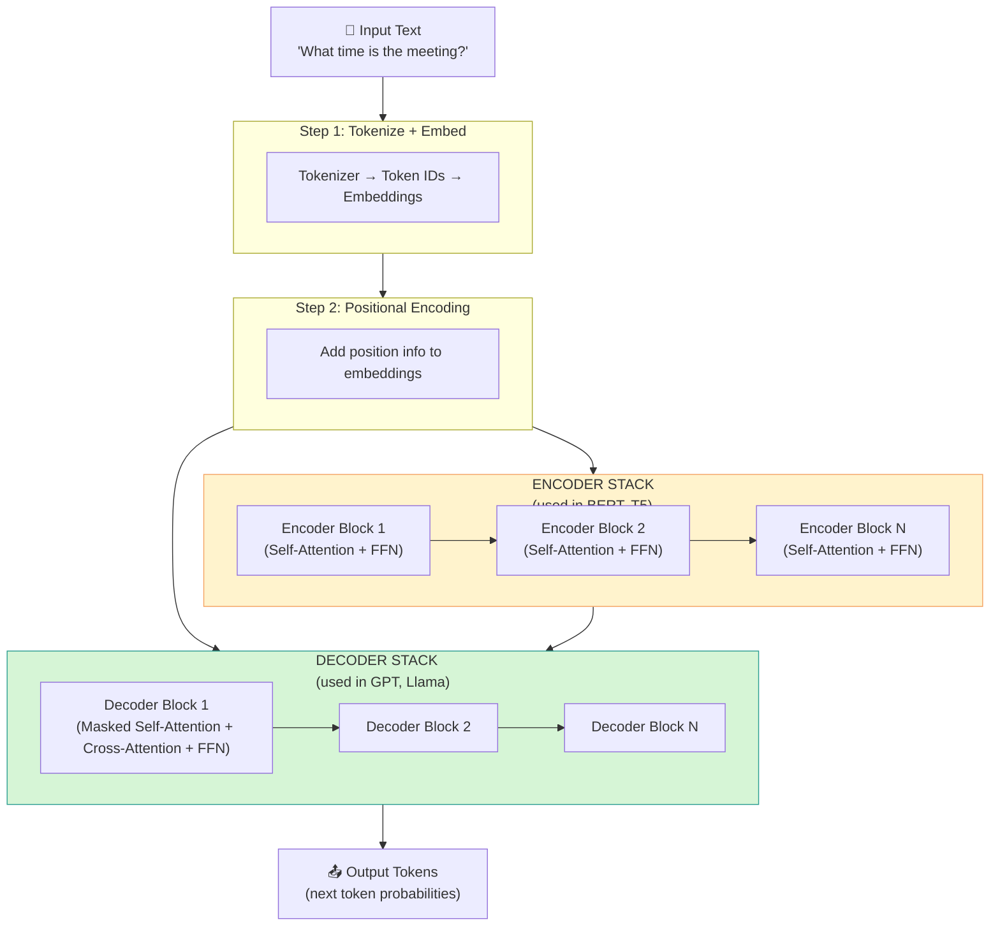

# Transformer Architecture: Encoder, Decoder, Self-Attention, Multi-Head Attention, Positional Encoding

## 1. Introduction

### What is the Transformer Architecture?

The Transformer is the neural network architecture that powers every modern Large Language Model you work with — GPT-4, Claude, Llama, Mixtral. When you call `groq.chat.completions.create(...)` in your Smart Reply API, the model processing your request is a Transformer.

It was introduced in the 2017 paper **"Attention Is All You Need"** by Google researchers, and it completely replaced older sequence-processing architectures (RNNs, LSTMs) for language tasks.

The Transformer's key innovation is the **attention mechanism** — a way for a model to focus on relevant parts of the input when producing each part of the output, regardless of how far apart they are in the sequence.

### Why Is This Important for a Generative AI Engineer?

Understanding transformers helps you:

- **Explain model behavior**: Know why the model "understands" context across long conversations
- **Optimize prompts**: Understand what information the model actually attends to
- **Debug issues**: Recognize why models struggle with very long inputs or specific patterns
- **Make architecture decisions**: Choose between encoder-only, decoder-only, and encoder-decoder models
- **Discuss intelligently in interviews**: Transformer architecture is a top-tier interview topic

### What Real-World Problems Do Transformers Solve?

Before transformers, processing long text sequences was the biggest bottleneck in NLP:
- **RNNs** processed text word-by-word left-to-right — slow, and early words "fade" from memory
- **LSTMs** improved memory retention but still had sequential limits
- **Transformers** process the entire sequence at once, with every word able to directly attend to every other word

This made transformers the foundation for:
- Your Smart Reply API's underlying LLMs (Llama, Mixtral on Groq)
- Google Translate (T5)
- GitHub Copilot (Codex)
- BERT for search and NLP classification tasks

### Prerequisites

You should understand:
- Neural networks, weights, biases, and forward propagation (file 14)
- Basic Python and NumPy
- What tokens and embeddings are (introduced here, deepened in file 17)

### What You'll Build After This Topic

- A working (simplified) attention mechanism in Python
- Clear mental model of how your Groq API calls are processed internally
- Ability to explain transformer architecture in interviews
- Understanding of encoder vs decoder and when each is used

---

## 2. Fundamentals

### 2.1 The Core Problem: Understanding Context

Before transformers, language models processed text sequentially. Consider this sentence:

> *"The bank by the river had a beautiful **bank** account."*

The second "bank" means a financial institution, but the first means a riverbank. To understand this, you need to connect the word "bank" to its surrounding context — words both before and after it.

Traditional RNNs struggled with this because:
1. They processed tokens left-to-right, one at a time
2. Long-distance context faded as more words were processed
3. They couldn't be parallelized — each token waited for the previous one

**Transformers solve this with attention** — every token looks at every other token simultaneously.

### 2.2 High-Level Architecture Overview



### 2.3 The Three Transformer Variants

| Variant | Architecture | Key Models | Best For |
|---------|-------------|-----------|---------|
| **Encoder-only** | Encoder stack only | BERT, RoBERTa | Understanding text: classification, search, NER |
| **Decoder-only** | Decoder stack only | GPT, Llama, Mixtral | Generating text: chat, code, completion |
| **Encoder-Decoder** | Both stacks | T5, BART, mT5 | Transformation tasks: translation, summarization |

**For your Smart Reply API**: You use **decoder-only** models (Llama 3, Mixtral) via Groq. These are optimized for generating text token by token.

---

## 3. Embeddings and Positional Encoding

### 3.1 What Are Embeddings?

Before the transformer can process text, each token must be converted to a vector of numbers. This is the **embedding layer**.

#### Simple Analogy
Think of embedding as mapping words to coordinates in a multi-dimensional space where semantically similar words cluster together:
- "king" and "queen" are close to each other
- "cat" and "kitten" are close
- "bank (river)" and "bank (finance)" would be far apart

#### Code Example

```python
import numpy as np

class TokenEmbedding:
    """
    Simplified token embedding layer
    Real transformers use learned embeddings (trained on data)
    """
    
    def __init__(self, vocab_size: int, embedding_dim: int):
        """
        vocab_size: Number of unique tokens in vocabulary
        embedding_dim: Size of each embedding vector (e.g., 512, 768, 4096)
        """
        self.vocab_size = vocab_size
        self.embedding_dim = embedding_dim
        
        # Each token gets a unique learnable vector
        # Shape: (vocab_size, embedding_dim)
        self.embedding_matrix = np.random.randn(vocab_size, embedding_dim) * 0.1
        
        print(f"Embedding matrix shape: {self.embedding_matrix.shape}")
        print(f"Each of the {vocab_size} tokens maps to a {embedding_dim}-dim vector")
    
    def embed(self, token_ids: list) -> np.ndarray:
        """
        Convert token IDs to embedding vectors
        
        token_ids: List of integer token IDs (from tokenizer)
        Returns: Matrix of shape (num_tokens, embedding_dim)
        """
        # Simply look up each token's row in the embedding matrix
        embeddings = self.embedding_matrix[token_ids]
        return embeddings
    
    def demonstrate(self):
        """Show how token IDs become vectors"""
        # Simulated tokenization of "Hello world"
        # In reality: tokenizer produces these IDs
        token_ids = [15496, 995]  # "Hello", " world" token IDs (GPT-2 style)
        
        print("\n=== EMBEDDING DEMONSTRATION ===")
        print(f"Token IDs: {token_ids}")
        
        embeddings = self.embed(token_ids)
        
        print(f"Embedding shape: {embeddings.shape}")
        print(f"Token 'Hello' vector (first 5 dims): {embeddings[0][:5].round(4)}")
        print(f"Token 'world' vector (first 5 dims): {embeddings[1][:5].round(4)}")
        print("\nNote: Each token is now a point in {}-dimensional space".format(self.embedding_dim))

# Example: Small vocabulary, 8-dim embeddings (real models use 4096-dim+)
embedding_layer = TokenEmbedding(vocab_size=50000, embedding_dim=8)
embedding_layer.demonstrate()
```

### 3.2 Positional Encoding: Teaching the Model Word Order

**The Problem:** Attention processes all tokens simultaneously (in parallel). This means it has no built-in notion of order — "dog bites man" and "man bites dog" would look the same without positional information.

**The Solution:** Add a positional signal to each token's embedding before processing.

#### Simple Analogy
Imagine writing row numbers in the margin of a page before photocopying it. The photocopy now carries both the content (word embedding) and the position (positional encoding).

#### Sinusoidal Positional Encoding (Original Paper)

```python
import numpy as np

class PositionalEncoding:
    """
    Sinusoidal positional encoding as in the original 'Attention is All You Need' paper.
    
    The idea: for each position, create a unique pattern using sine and cosine
    waves of different frequencies. Like a clock with multiple hands — each
    combination of hand positions uniquely identifies a moment in time.
    """
    
    def __init__(self, max_seq_length: int, embedding_dim: int):
        """
        max_seq_length: Maximum number of tokens in a sequence
        embedding_dim: Must match the embedding dimension
        """
        self.max_seq_length = max_seq_length
        self.embedding_dim = embedding_dim
        
        # Pre-compute positional encodings for all positions
        self.pe = self._compute_positional_encoding()
    
    def _compute_positional_encoding(self) -> np.ndarray:
        """
        For each position pos and each dimension i:
        PE(pos, 2i)   = sin(pos / 10000^(2i/d_model))
        PE(pos, 2i+1) = cos(pos / 10000^(2i/d_model))
        
        Even dimensions use sine, odd dimensions use cosine.
        Different dimensions use different frequencies.
        """
        pe = np.zeros((self.max_seq_length, self.embedding_dim))
        
        positions = np.arange(self.max_seq_length).reshape(-1, 1)  # Shape: (seq_len, 1)
        
        # Create dimension indices for frequency calculation
        # Only need half the dimensions (half for sin, half for cos)
        dim_indices = np.arange(0, self.embedding_dim, 2)
        
        # Frequency scaling: 1/10000^(2i/d_model)
        frequencies = 1.0 / (10000 ** (dim_indices / self.embedding_dim))
        
        # Apply sin to even dimensions, cos to odd dimensions
        pe[:, 0::2] = np.sin(positions * frequencies)  # Even dims
        pe[:, 1::2] = np.cos(positions * frequencies)  # Odd dims
        
        return pe
    
    def add_positional_encoding(self, embeddings: np.ndarray) -> np.ndarray:
        """
        Add positional encoding to token embeddings
        
        embeddings shape: (seq_length, embedding_dim)
        Returns: Same shape — embeddings now contain position information
        """
        seq_length = embeddings.shape[0]
        
        # Simply add the pre-computed positional vectors
        return embeddings + self.pe[:seq_length]
    
    def demonstrate(self):
        """Show how positional encoding works"""
        print("=== POSITIONAL ENCODING DEMONSTRATION ===\n")
        
        # Create sample embeddings (normally from embedding layer)
        seq_length = 5
        embedding_dim = 8
        
        # Simulate identical embeddings for the same word "the" appearing twice
        same_word_embeddings = np.ones((seq_length, embedding_dim)) * 0.5
        same_word_embeddings[:] = same_word_embeddings[0]  # All identical
        
        print("Problem: Without positional encoding, same word has same representation")
        print(f"Token at position 0: {same_word_embeddings[0][:4].round(3)}")
        print(f"Token at position 1: {same_word_embeddings[1][:4].round(3)}")
        print("(Identical! Model can't tell them apart)")
        
        print("\nSolution: Adding positional encoding makes each position unique")
        
        # Add positional encoding
        positioned_embeddings = self.add_positional_encoding(same_word_embeddings)
        
        print(f"\nAfter positional encoding:")
        for pos in range(seq_length):
            print(f"  Position {pos}: {positioned_embeddings[pos][:4].round(3)}")
        
        print("\nEach position now has a unique representation!")
        print("Two identical tokens at different positions look different to the model.")

# Demonstrate
pe = PositionalEncoding(max_seq_length=512, embedding_dim=8)
pe.demonstrate()
```

---

## 4. The Attention Mechanism: The Heart of the Transformer

### 4.1 What Is Attention?

**Attention** is a mechanism that lets each token in a sequence "look at" all other tokens and decide which ones are most relevant to understanding its own meaning.

#### Simple Analogy: The Spotlight
Imagine a stage with 10 actors (tokens). When actor "bank" is speaking its line, it shines a spotlight on other actors to decide how to interpret its own role:
- If "river" is brightly lit → "bank" means riverbank
- If "account" is brightly lit → "bank" means financial institution

The spotlight brightness on each actor is the **attention weight**.

### 4.2 Query, Key, and Value (Q, K, V)

This is the most important concept in transformers. Every token creates three vectors:

| Vector | Role | Analogy |
|--------|------|---------|
| **Query (Q)** | "What am I looking for?" | A search query you type into Google |
| **Key (K)** | "What do I contain?" | A document's index keywords |
| **Value (V)** | "What information do I hold?" | The document's actual content |

**The process:**
1. Each token's Query is compared against all Keys → produces attention scores
2. Scores are normalized with softmax → attention weights (sum to 1)
3. Values are weighted-summed using the attention weights → output

```
Attention(Q, K, V) = softmax(QK^T / √d_k) × V
```

### 4.3 Self-Attention Step by Step

```python
import numpy as np

class SelfAttention:
    """
    Single-head self-attention mechanism.
    The core building block of the Transformer.
    
    'Self' means: queries, keys, AND values all come from the SAME sequence.
    Each token attends to all other tokens in the same sequence.
    """
    
    def __init__(self, embedding_dim: int, attention_dim: int):
        """
        embedding_dim: Size of input token embeddings
        attention_dim: Size of Q, K, V vectors (often embedding_dim / num_heads)
        """
        self.embedding_dim = embedding_dim
        self.attention_dim = attention_dim  # d_k in the paper
        
        # Learned weight matrices that project embeddings into Q, K, V spaces
        # These are what the model "learns" during training
        self.W_q = np.random.randn(embedding_dim, attention_dim) * 0.1  # Query projection
        self.W_k = np.random.randn(embedding_dim, attention_dim) * 0.1  # Key projection
        self.W_v = np.random.randn(embedding_dim, attention_dim) * 0.1  # Value projection
    
    def compute_attention(self, embeddings: np.ndarray, mask: np.ndarray = None) -> dict:
        """
        Compute self-attention for a sequence of token embeddings.
        
        embeddings: shape (seq_length, embedding_dim)
        mask: Optional mask for decoder (prevents attending to future tokens)
        
        Returns: dict with attention output and attention weights
        """
        seq_length = embeddings.shape[0]
        
        # Step 1: Project embeddings into Q, K, V vectors
        Q = embeddings @ self.W_q  # (seq_len, attention_dim)
        K = embeddings @ self.W_k  # (seq_len, attention_dim)
        V = embeddings @ self.W_v  # (seq_len, attention_dim)
        
        # Step 2: Compute attention scores
        # Each query dot-producted with all keys
        # scores[i][j] = "how much should token i attend to token j?"
        scores = Q @ K.T  # (seq_len, seq_len)
        
        # Step 3: Scale scores (prevents vanishing gradients with large d_k)
        # Without scaling, dot products grow large → softmax becomes too "peaked"
        scale = np.sqrt(self.attention_dim)
        scores = scores / scale
        
        # Step 4: Apply mask (for decoder — don't attend to future tokens)
        if mask is not None:
            # Set masked positions to -infinity → softmax produces ~0 weight
            scores = scores + mask * -1e9
        
        # Step 5: Softmax → attention weights
        # Each row sums to 1: how much attention each token pays to each other token
        attention_weights = self._softmax(scores)  # (seq_len, seq_len)
        
        # Step 6: Weighted sum of values
        # Output token i = weighted combination of all value vectors
        output = attention_weights @ V  # (seq_len, attention_dim)
        
        return {
            "output": output,
            "attention_weights": attention_weights,
            "Q": Q, "K": K, "V": V
        }
    
    def _softmax(self, x: np.ndarray) -> np.ndarray:
        """Row-wise softmax"""
        exp_x = np.exp(x - np.max(x, axis=-1, keepdims=True))
        return exp_x / np.sum(exp_x, axis=-1, keepdims=True)
    
    def demonstrate_with_sentence(self):
        """
        Show attention on a real example using simplified embeddings
        Sentence: "The bank near the river"
        """
        print("=== SELF-ATTENTION DEMONSTRATION ===")
        print('Sentence: "The bank near the river"\n')
        
        tokens = ["The", "bank", "near", "the", "river"]
        
        # Simulate embeddings (in reality, from embedding layer)
        # We manually set "bank" and "river" to have some shared dimensions
        # to show how attention discovers their relationship
        np.random.seed(42)
        embeddings = np.random.randn(5, self.embedding_dim) * 0.5
        
        # Run self-attention
        result = self.compute_attention(embeddings)
        
        weights = result["attention_weights"]
        
        print("Attention weights matrix (rows=query token, cols=key token):")
        print("(Higher value = more attention paid)\n")
        
        # Print header
        header = "       " + "  ".join(f"{t:>7}" for t in tokens)
        print(header)
        print("-" * len(header))
        
        for i, query_token in enumerate(tokens):
            row = f"{query_token:>7}: " + "  ".join(f"{weights[i][j]:>7.3f}" for j in range(len(tokens)))
            print(row)
        
        print("\nInterpretation:")
        for i, token in enumerate(tokens):
            top_attention_idx = np.argmax(weights[i])
            print(f"  '{token}' attends most to '{tokens[top_attention_idx]}' ({weights[i][top_attention_idx]:.3f})")
        
        return result


# Run demonstration
attention = SelfAttention(embedding_dim=16, attention_dim=8)
result = attention.demonstrate_with_sentence()
```

### 4.4 Masked Self-Attention (Decoder's Causal Masking)

In the decoder (GPT, Llama), the model generates text **left-to-right, one token at a time**. During training, to prevent "cheating" (attending to future tokens), a **causal mask** is applied.

```python
def create_causal_mask(seq_length: int) -> np.ndarray:
    """
    Creates a causal (lower-triangular) mask.
    
    Position i can only attend to positions 0..i (not future positions).
    
    Returns mask where 1 = "block this attention" (will be set to -inf)
    """
    # Upper triangle (above diagonal) = 1 = blocked
    mask = np.triu(np.ones((seq_length, seq_length)), k=1)
    return mask

def demonstrate_causal_masking():
    """Show how causal masking prevents future token attention"""
    seq_len = 5
    tokens = ["I", "love", "building", "AI", "apps"]
    
    mask = create_causal_mask(seq_len)
    
    print("=== CAUSAL MASK DEMONSTRATION ===")
    print(f"Tokens: {tokens}")
    print("\nMask (1 = blocked, 0 = allowed):")
    
    header = "          " + "  ".join(f"{t:>8}" for t in tokens)
    print(header)
    
    for i, token in enumerate(tokens):
        row = f"{token:>9}: " + "  ".join(f"{'BLOCK' if mask[i][j] else 'allow':>8}" for j in range(seq_len))
        print(row)
    
    print("\nKey point for decoder-only models (Llama, GPT):")
    print("  When generating token 3 ('AI'), the model can see:")
    print("  'I', 'love', 'building' — but NOT 'apps' (future token)")
    print("  This forces the model to predict next tokens, not copy them.")

demonstrate_causal_masking()
```

---

## 5. Multi-Head Attention

### 5.1 What Is Multi-Head Attention?

Single-head attention lets each token attend to all others — but through one "perspective." **Multi-head attention** runs attention multiple times in parallel, each with **different learned projections (different W_q, W_k, W_v matrices)**.

#### Simple Analogy
Reading a document with multiple reviewers simultaneously:
- **Head 1** might focus on grammatical dependencies ("subject → verb")
- **Head 2** might focus on coreference ("she → Sarah")
- **Head 3** might focus on semantic relationships ("bank → financial / river")
- **Head 4** might focus on position relationships ("nearby words")

Each head captures a different "type" of relationship. Their outputs are concatenated and projected, giving a richer representation than any single head could.

### 5.2 Multi-Head Attention Code

```python
import numpy as np

class MultiHeadAttention:
    """
    Multi-head attention: run H attention heads in parallel,
    each with independent W_q, W_k, W_v projections.
    
    Concatenate all head outputs → project back to embedding_dim.
    """
    
    def __init__(self, embedding_dim: int, num_heads: int):
        """
        embedding_dim: Full model dimension (e.g., 512)
        num_heads: Number of parallel attention heads (e.g., 8)
        
        Each head works in dimension: embedding_dim / num_heads
        e.g., 512 / 8 = 64 dims per head
        """
        assert embedding_dim % num_heads == 0, \
            f"embedding_dim ({embedding_dim}) must be divisible by num_heads ({num_heads})"
        
        self.embedding_dim = embedding_dim
        self.num_heads = num_heads
        self.head_dim = embedding_dim // num_heads  # Dimension per head
        
        # Each head has its own Q, K, V projection matrices
        # We store them stacked for efficiency
        self.W_q = np.random.randn(num_heads, embedding_dim, self.head_dim) * 0.1
        self.W_k = np.random.randn(num_heads, embedding_dim, self.head_dim) * 0.1
        self.W_v = np.random.randn(num_heads, embedding_dim, self.head_dim) * 0.1
        
        # Final output projection: concatenated heads → embedding_dim
        self.W_o = np.random.randn(embedding_dim, embedding_dim) * 0.1
        
        print(f"Multi-Head Attention initialized:")
        print(f"  embedding_dim = {embedding_dim}")
        print(f"  num_heads = {num_heads}")
        print(f"  head_dim = {self.head_dim}")
        print(f"  Total params: {self._count_params():,}")
    
    def _count_params(self) -> int:
        total = 0
        total += self.W_q.size
        total += self.W_k.size
        total += self.W_v.size
        total += self.W_o.size
        return total
    
    def _softmax(self, x):
        exp_x = np.exp(x - np.max(x, axis=-1, keepdims=True))
        return exp_x / (np.sum(exp_x, axis=-1, keepdims=True) + 1e-9)
    
    def forward(self, embeddings: np.ndarray, mask: np.ndarray = None) -> dict:
        """
        Run all attention heads in parallel, concatenate, then project.
        
        embeddings: (seq_length, embedding_dim)
        Returns: (seq_length, embedding_dim) — same shape as input
        """
        seq_length = embeddings.shape[0]
        head_outputs = []
        all_weights = []
        
        # Run each head independently
        for h in range(self.num_heads):
            # Project to this head's Q, K, V space
            Q_h = embeddings @ self.W_q[h]   # (seq_len, head_dim)
            K_h = embeddings @ self.W_k[h]   # (seq_len, head_dim)
            V_h = embeddings @ self.W_v[h]   # (seq_len, head_dim)
            
            # Compute attention scores for this head
            scores_h = Q_h @ K_h.T / np.sqrt(self.head_dim)  # (seq_len, seq_len)
            
            if mask is not None:
                scores_h = scores_h + mask * -1e9
            
            weights_h = self._softmax(scores_h)   # (seq_len, seq_len)
            output_h  = weights_h @ V_h            # (seq_len, head_dim)
            
            head_outputs.append(output_h)
            all_weights.append(weights_h)
        
        # Concatenate all head outputs along the feature dimension
        # Shape: (seq_len, num_heads * head_dim) = (seq_len, embedding_dim)
        concat = np.concatenate(head_outputs, axis=-1)
        
        # Final linear projection
        output = concat @ self.W_o   # (seq_len, embedding_dim)
        
        return {
            "output": output,
            "attention_weights_per_head": all_weights,  # H × (seq_len, seq_len)
            "head_outputs": head_outputs
        }
    
    def demonstrate_head_diversity(self):
        """
        Show that different heads capture different patterns
        """
        print("\n=== MULTI-HEAD ATTENTION DEMONSTRATION ===")
        
        tokens = ["The", "meeting", "was", "rescheduled"]
        seq_length = len(tokens)
        
        # Simulate embeddings
        np.random.seed(7)
        embeddings = np.random.randn(seq_length, self.embedding_dim) * 0.5
        
        result = self.forward(embeddings)
        
        print(f"\nTokens: {tokens}")
        print(f"\nAttention weights per head (which tokens each word focuses on):\n")
        
        for h, weights_h in enumerate(result["attention_weights_per_head"]):
            dominant = np.argmax(weights_h, axis=1)
            print(f"Head {h+1}: ", end="")
            for i, token in enumerate(tokens):
                print(f"'{token}'→'{tokens[dominant[i]]}'", end="  ")
            print()
        
        print(f"\nKey insight: Each head captures different relationships!")
        print(f"Output shape: {result['output'].shape} (same as input — information enriched)")
        return result

# Demonstrate
mha = MultiHeadAttention(embedding_dim=32, num_heads=4)
mha.demonstrate_head_diversity()
```

---

## 6. Feed-Forward Network and Layer Normalization

### 6.1 Feed-Forward Network (FFN)

After attention, each token passes through a **position-wise feed-forward network** — two linear layers with a ReLU/GELU in between.

```
FFN(x) = max(0, xW_1 + b_1)W_2 + b_2
```

Think of it as: attention decides **which tokens to gather information from**, and the FFN decides **what to do with that information**.

```python
import numpy as np

class FeedForwardNetwork:
    """
    Position-wise FFN applied identically to each token position.
    
    Typical expansion: d_model → 4*d_model → d_model
    e.g., 512 → 2048 → 512
    """
    
    def __init__(self, embedding_dim: int, expansion_factor: int = 4):
        self.d_model = embedding_dim
        self.d_ff = embedding_dim * expansion_factor  # Inner dimension
        
        # Two learned weight matrices
        self.W1 = np.random.randn(embedding_dim, self.d_ff) * 0.1
        self.b1 = np.zeros(self.d_ff)
        self.W2 = np.random.randn(self.d_ff, embedding_dim) * 0.1
        self.b2 = np.zeros(embedding_dim)
        
        print(f"FFN: {embedding_dim} → {self.d_ff} → {embedding_dim}")
        print(f"  Params: {self.W1.size + self.W2.size + self.b1.size + self.b2.size:,}")
    
    def gelu(self, x):
        """GELU activation (used by GPT, Llama) — smoother than ReLU"""
        return 0.5 * x * (1 + np.tanh(np.sqrt(2 / np.pi) * (x + 0.044715 * x**3)))
    
    def forward(self, x: np.ndarray) -> np.ndarray:
        """
        Apply FFN to each token independently.
        x shape: (seq_length, embedding_dim)
        Output shape: (seq_length, embedding_dim)
        """
        # Layer 1: expand
        hidden = x @ self.W1 + self.b1      # (seq_len, d_ff)
        activated = self.gelu(hidden)         # Apply non-linearity
        
        # Layer 2: project back
        output = activated @ self.W2 + self.b2  # (seq_len, d_model)
        
        return output

### 6.2 Layer Normalization

class LayerNorm:
    """
    Layer normalization: normalize across the embedding dimension.
    
    Why: Stabilizes training by keeping activations in a healthy range.
    Applied BEFORE each sub-layer in modern transformers (Pre-LN).
    """
    
    def __init__(self, embedding_dim: int, eps: float = 1e-6):
        self.embedding_dim = embedding_dim
        self.eps = eps
        
        # Learnable scale (gamma) and shift (beta) parameters
        self.gamma = np.ones(embedding_dim)   # Scale
        self.beta  = np.zeros(embedding_dim)  # Shift
    
    def forward(self, x: np.ndarray) -> np.ndarray:
        """
        Normalize each token's embedding independently.
        x: (seq_length, embedding_dim)
        """
        # Calculate mean and variance across embedding dimensions (not across tokens)
        mean = np.mean(x, axis=-1, keepdims=True)   # Per-token mean
        var  = np.var(x, axis=-1, keepdims=True)    # Per-token variance
        
        # Normalize
        x_norm = (x - mean) / np.sqrt(var + self.eps)
        
        # Scale and shift with learned parameters
        return self.gamma * x_norm + self.beta
```

---

## 7. Complete Transformer Block

### 7.1 The Encoder Block

```python
class EncoderBlock:
    """
    A single transformer encoder block.
    
    Architecture:
      Input → LayerNorm → Multi-Head Self-Attention → Residual → 
              LayerNorm → FFN → Residual → Output
    
    The residual connections ("x + sublayer(x)") are critical:
    They allow gradients to flow unchanged through deep networks,
    solving the vanishing gradient problem.
    """
    
    def __init__(self, embedding_dim: int, num_heads: int):
        self.mha = MultiHeadAttention(embedding_dim, num_heads)
        self.ffn = FeedForwardNetwork(embedding_dim)
        self.norm1 = LayerNorm(embedding_dim)
        self.norm2 = LayerNorm(embedding_dim)
    
    def forward(self, x: np.ndarray) -> np.ndarray:
        """
        Pre-LN architecture (used in modern transformers):
        normalize before each sub-layer, then add residual.
        """
        # Sub-layer 1: Self-Attention with residual
        normed = self.norm1.forward(x)
        attn_out = self.mha.forward(normed)["output"]
        x = x + attn_out   # Residual connection
        
        # Sub-layer 2: FFN with residual  
        normed = self.norm2.forward(x)
        ffn_out = self.ffn.forward(normed)
        x = x + ffn_out    # Residual connection
        
        return x

class EncoderStack:
    """Stack of N encoder blocks (e.g., BERT has 12, RoBERTa-Large has 24)"""
    
    def __init__(self, num_layers: int, embedding_dim: int, num_heads: int):
        self.blocks = [EncoderBlock(embedding_dim, num_heads) for _ in range(num_layers)]
        self.final_norm = LayerNorm(embedding_dim)
        print(f"Encoder: {num_layers} blocks × ({embedding_dim} dim, {num_heads} heads)")
    
    def forward(self, x: np.ndarray) -> np.ndarray:
        for block in self.blocks:
            x = block.forward(x)
        return self.final_norm.forward(x)
```

### 7.2 The Decoder Block

```python
class DecoderBlock:
    """
    A single transformer decoder block.
    
    Architecture:
      Input → LayerNorm → MASKED Self-Attention → Residual →
              LayerNorm → Cross-Attention(encoder output) → Residual →
              LayerNorm → FFN → Residual → Output
    
    Key difference from encoder:
    1. Masked self-attention: can only attend to past tokens (causal)
    2. Cross-attention: attends to encoder output (for encoder-decoder models)
    
    For decoder-ONLY models (GPT, Llama): cross-attention is removed.
    """
    
    def __init__(self, embedding_dim: int, num_heads: int, is_decoder_only: bool = True):
        self.is_decoder_only = is_decoder_only
        
        # Masked self-attention (always present)
        self.masked_self_attn = MultiHeadAttention(embedding_dim, num_heads)
        self.norm1 = LayerNorm(embedding_dim)
        
        # Cross-attention (only for encoder-decoder models like T5)
        if not is_decoder_only:
            self.cross_attn = MultiHeadAttention(embedding_dim, num_heads)
            self.norm2 = LayerNorm(embedding_dim)
        
        # FFN
        self.ffn = FeedForwardNetwork(embedding_dim)
        self.norm_ffn = LayerNorm(embedding_dim)
    
    def forward(self, x: np.ndarray, encoder_output: np.ndarray = None) -> np.ndarray:
        seq_length = x.shape[0]
        
        # Create causal mask: prevent attending to future tokens
        causal_mask = np.triu(np.ones((seq_length, seq_length)), k=1)
        
        # Sub-layer 1: MASKED self-attention
        normed = self.norm1.forward(x)
        attn_out = self.masked_self_attn.forward(normed, mask=causal_mask)["output"]
        x = x + attn_out
        
        # Sub-layer 2: Cross-attention (only for T5/BART-style encoder-decoder)
        if not self.is_decoder_only and encoder_output is not None:
            normed = self.norm2.forward(x)
            # Q from decoder, K and V from encoder output
            cross_out = self.masked_self_attn.forward(normed)["output"]
            x = x + cross_out
        
        # Sub-layer 3: FFN
        normed = self.norm_ffn.forward(x)
        ffn_out = self.ffn.forward(normed)
        x = x + ffn_out
        
        return x
```

---

## 8. The Full Picture: How Your Groq API Call Works

```python
class DecoderOnlyTransformer:
    """
    Simplified decoder-only transformer — the architecture of Llama, GPT, Mixtral.
    This is what runs behind your groq.chat.completions.create() calls.
    """
    
    def __init__(self, vocab_size: int, embedding_dim: int, num_heads: int,
                 num_layers: int, max_seq_length: int):
        
        # 1. Embedding layer: token IDs → vectors
        self.embedding = TokenEmbedding(vocab_size, embedding_dim)
        
        # 2. Positional encoding: add position info
        self.pos_encoding = PositionalEncoding(max_seq_length, embedding_dim)
        
        # 3. Stack of decoder blocks
        self.decoder_blocks = [
            DecoderBlock(embedding_dim, num_heads, is_decoder_only=True)
            for _ in range(num_layers)
        ]
        
        # 4. Final layer norm
        self.final_norm = LayerNorm(embedding_dim)
        
        # 5. Language model head: embedding_dim → vocab_size (logits)
        self.lm_head = np.random.randn(embedding_dim, vocab_size) * 0.01
        
        print(f"\nDecoder-Only Transformer:")
        print(f"  Vocab size:    {vocab_size:,}")
        print(f"  Embedding dim: {embedding_dim}")
        print(f"  Attention heads: {num_heads}")
        print(f"  Layers:        {num_layers}")
        print(f"  Max seq length: {max_seq_length}")
    
    def _softmax(self, x):
        exp_x = np.exp(x - np.max(x))
        return exp_x / np.sum(exp_x)
    
    def forward(self, token_ids: list, verbose: bool = False) -> dict:
        """
        Full forward pass: token IDs → next token probabilities
        """
        if verbose:
            print(f"\n=== TRANSFORMER FORWARD PASS ===")
            print(f"Input token IDs: {token_ids}")
        
        # Step 1: Embed tokens
        x = self.embedding.embed(token_ids)       # (seq_len, d_model)
        if verbose: print(f"After embedding: {x.shape}")
        
        # Step 2: Add positional encoding
        x = self.pos_encoding.add_positional_encoding(x)  # (seq_len, d_model)
        if verbose: print(f"After positional encoding: {x.shape}")
        
        # Step 3: Pass through all decoder blocks
        for i, block in enumerate(self.decoder_blocks):
            x = block.forward(x)
            if verbose: print(f"After decoder block {i+1}: {x.shape}")
        
        # Step 4: Final layer norm
        x = self.final_norm.forward(x)
        
        # Step 5: Project to vocabulary logits (only care about last token for generation)
        last_token_hidden = x[-1]                       # (d_model,)
        logits = last_token_hidden @ self.lm_head       # (vocab_size,)
        probabilities = self._softmax(logits)           # (vocab_size,) — sum to 1
        
        # The predicted next token = argmax over vocabulary
        next_token_id = int(np.argmax(probabilities))
        
        if verbose:
            print(f"\nNext token logits shape: {logits.shape}")
            print(f"Predicted next token ID: {next_token_id}")
            print(f"Top 3 probabilities: {sorted(probabilities, reverse=True)[:3]}")
        
        return {
            "next_token_id": next_token_id,
            "probabilities": probabilities,
            "hidden_states": x
        }

# Create a tiny transformer (real Llama 3 8B: 32 layers, 4096 dim, 32 heads)
tiny_transformer = DecoderOnlyTransformer(
    vocab_size=1000,
    embedding_dim=32,
    num_heads=4,
    num_layers=2,
    max_seq_length=128
)

# Simulate processing a Smart Reply prompt
token_ids = [42, 17, 83, 51, 9]  # Simulated tokenized message
result = tiny_transformer.forward(token_ids, verbose=True)
print(f"\nNext predicted token ID: {result['next_token_id']}")
```

### 8.1 What Happens When You Call the Groq API

```python
"""
When your Smart Reply API calls:

    response = groq_client.chat.completions.create(
        model="llama3-8b-8192",
        messages=[
            {"role": "system", "content": "You are a smart reply assistant..."},
            {"role": "user",   "content": "Can we reschedule the meeting?"}
        ],
        max_tokens=100
    )

Here is what Groq does internally (simplified):

1. TOKENIZE:  "Can we reschedule..." → [5355, 356, 1124, 6341, ...]
              (Llama uses BPE tokenizer with ~32K vocab)

2. EMBED:     Token IDs → vectors of 4096 dimensions
              (Llama 3 8B embedding dim = 4096)

3. POSITIONAL ENCODING: Add position info to each token vector

4. FORWARD THROUGH 32 DECODER BLOCKS:
   Each block:
   a. LayerNorm
   b. Grouped Query Attention (32 heads queries, 8 heads keys/values)
   c. Residual connection
   d. LayerNorm
   e. SwiGLU FFN (d_model=4096 → d_ff=14336 → 4096)
   f. Residual connection

5. FINAL LAYER NORM

6. LM HEAD: 4096 → 32000 vocabulary logits

7. SAMPLE from logits using temperature, top-p settings
   → next token ID

8. REPEAT steps 2-7, appending each new token, until:
   - max_tokens reached
   - EOS (end-of-sequence) token generated
   - stop sequence matched

9. DETOKENIZE: [5355, 890, 748, ...] → "Of course! How about Thursday?"

10. RETURN via HTTP response to your FastAPI application
"""

print("Each token in your reply is generated one at a time through this full pipeline.")
print("Groq's LPU (Language Processing Unit) hardware makes this extremely fast.")
```

---

## 9. Important Terminologies

| Term | Simple Meaning | Technical Definition | Why It Matters |
|------|---------------|---------------------|----------------|
| **Token** | Unit of text | Sub-word chunk from BPE tokenizer | Affects cost, context window |
| **Embedding** | Word as numbers | Dense vector representation in high-dimensional space | Captures semantic meaning |
| **Query (Q)** | "What am I looking for?" | Linear projection of token embedding for matching | Drives attention computation |
| **Key (K)** | "What do I contain?" | Linear projection of token embedding for being matched | Paired with Q for score |
| **Value (V)** | "What info do I hold?" | Linear projection used to compute weighted output | The content actually retrieved |
| **Attention Score** | Relevance rating | Dot product of Q and K, scaled by √d_k | Determines attention focus |
| **Attention Weight** | Final focus amount | Softmax-normalized attention scores | Row-sums to 1, interpretable |
| **Self-Attention** | Attending to own sequence | Q, K, V all from same input sequence | Enables contextual understanding |
| **Cross-Attention** | Attending to another sequence | Q from decoder, K/V from encoder | Enables seq2seq tasks |
| **Causal Mask** | Prevent future peeking | Upper-triangular mask set to -∞ before softmax | Required for autoregressive generation |
| **Multi-Head Attention** | Multiple attention perspectives | H parallel attention heads, concatenated | Captures diverse relationship types |
| **Residual Connection** | Skip connection | x + sublayer(x) | Solves vanishing gradient in deep nets |
| **Layer Normalization** | Stabilize activations | Normalize over embedding dimension | Stabilizes and speeds training |
| **FFN** | Per-token MLP | Two-layer MLP applied at each position | Stores factual knowledge |
| **Positional Encoding** | Token position signal | Sinusoidal or learned vectors added to embeddings | Gives the model word order |
| **d_model** | Model width | Embedding dimension (e.g., 512, 4096) | Core size parameter |
| **d_ff** | FFN inner width | Typically 4× d_model | Determines FFN capacity |
| **Encoder-Only** | Bidirectional understanding | Attends to full context (no causal mask) | BERT: classification, search |
| **Decoder-Only** | Left-to-right generation | Causal masked attention | GPT/Llama: text generation |
| **Autoregressive** | One token at a time | Generates output sequentially, each token conditions on prior | How LLMs generate text |
| **KV Cache** | Reuse past computations | Cached K, V matrices from previous tokens | Critical for generation speed |

---

## 10. Production Scenarios

### Scenario 1: Optimizing Latency with KV Cache

**The Problem:** Every new token Groq generates requires running the full transformer over the entire conversation. Without caching, generating 100 tokens costs 100 full forward passes.

**The Solution:** KV Cache — store K and V tensors from all previous tokens, only compute for the new token.

```python
"""
KV Cache impact on latency:

WITHOUT KV cache (naive):
  Token 1: Process 1 token   → 1 forward pass
  Token 2: Process 2 tokens  → 1 forward pass (includes token 1 again!)
  Token 3: Process 3 tokens  → 1 forward pass
  ... 
  Token N: Process N tokens  → O(N²) total work

WITH KV cache:
  Token 1: Process 1 token, store K1, V1
  Token 2: Use cached K1/V1, only compute K2/V2 → O(1) per new token
  Token N: O(N) total work (linear, not quadratic)

For your Smart Reply API generating 100-token responses:
  Without cache: 100² = 10,000 effective token operations
  With cache:    ~100 token operations
  Speedup:       ~100x

All production LLM inference servers (vLLM, TGI, Groq LPU) implement KV cache.
This is why increasing max_tokens increases latency approximately linearly,
not quadratically.
"""

# Practical implications for your Smart Reply API:

def estimate_generation_latency(num_tokens: int, time_per_token_ms: float = 20) -> dict:
    """
    Estimate generation latency with and without KV cache
    """
    # With KV cache (what Groq actually does)
    with_cache_ms = num_tokens * time_per_token_ms
    
    # Without KV cache (naive implementation)
    # Each token processes the growing context
    without_cache_ms = sum(i * time_per_token_ms for i in range(1, num_tokens + 1))
    
    return {
        "tokens": num_tokens,
        "with_kv_cache_ms": with_cache_ms,
        "without_kv_cache_ms": without_cache_ms,
        "speedup_factor": round(without_cache_ms / with_cache_ms, 1)
    }

for n in [10, 50, 100, 500]:
    result = estimate_generation_latency(n)
    print(f"{result['tokens']:3d} tokens: with cache={result['with_kv_cache_ms']:5.0f}ms "
          f"| without={result['without_kv_cache_ms']:8.0f}ms "
          f"| speedup={result['speedup_factor']}x")
```

### Scenario 2: Context Window Management in Smart Reply

**Problem:** Long conversation histories exceed the model's context window (e.g., 8K tokens for Llama 3 8B).

**Solution:** Implement smart context truncation

```python
from typing import List

def manage_context_window(
    messages: List[dict],
    system_prompt: str,
    max_context_tokens: int = 7000,  # Leave headroom for response
    avg_tokens_per_char: float = 0.25
) -> List[dict]:
    """
    Fit conversation history within context window.
    
    Strategy: Keep system prompt + recent messages, 
    drop oldest messages when limit approached.
    """
    def estimate_tokens(text: str) -> int:
        return max(1, int(len(text) * avg_tokens_per_char))
    
    # System prompt always stays (critical context)
    system_tokens = estimate_tokens(system_prompt)
    remaining_budget = max_context_tokens - system_tokens
    
    # Work backwards from most recent message
    selected_messages = []
    used_tokens = 0
    
    for msg in reversed(messages):
        msg_tokens = estimate_tokens(msg["content"])
        
        if used_tokens + msg_tokens <= remaining_budget:
            selected_messages.insert(0, msg)
            used_tokens += msg_tokens
        else:
            # Context window full — drop older messages
            print(f"⚠️  Context window: dropped {len(messages) - len(selected_messages)} old messages")
            break
    
    return selected_messages

# Integration into your existing conversations.py
def build_groq_messages(system_prompt: str, history: List[dict], new_message: str) -> List[dict]:
    """Build message list for Groq API with context management"""
    
    # Add new message to history
    all_history = history + [{"role": "user", "content": new_message}]
    
    # Trim to fit context window
    trimmed = manage_context_window(
        messages=all_history,
        system_prompt=system_prompt,
        max_context_tokens=7500
    )
    
    return [{"role": "system", "content": system_prompt}] + trimmed
```

---

## 11. Common Mistakes and Debugging

### Mistake 1: Confusing Encoder-Only and Decoder-Only Models

```python
# ❌ Wrong: Using BERT (encoder-only) for text generation
# BERT cannot generate text — it's not autoregressive
# bert_model.generate("Write a reply to: ...") — THIS DOESN'T WORK

# ✅ Correct: Use the right model family for the task
"""
Task                         |  Model Family   |  Examples
-----------------------------|-----------------|---------------------------
Text classification          |  Encoder-only   |  BERT, RoBERTa
Semantic search/embeddings   |  Encoder-only   |  all-MiniLM, text-embed-3
Text generation/chat         |  Decoder-only   |  GPT, Llama, Mixtral, Groq
Translation/summarization    |  Enc-Decoder    |  T5, BART, mT5
Your Smart Reply API         |  Decoder-only   |  Llama 3 via Groq ✓
"""
```

### Mistake 2: Ignoring Context Window Limits

```python
# ❌ Wrong: Sending unlimited conversation history
def send_reply(conversation_history, new_message):
    all_messages = conversation_history + [{"role": "user", "content": new_message}]
    
    # If total tokens > 8192, the API will error or silently truncate!
    response = groq_client.chat.completions.create(
        model="llama3-8b-8192",
        messages=all_messages  # Danger: no context window check
    )

# ✅ Correct: Always manage context
def send_reply_safe(conversation_history, new_message, system_prompt):
    managed = build_groq_messages(system_prompt, conversation_history, new_message)
    
    response = groq_client.chat.completions.create(
        model="llama3-8b-8192",
        messages=managed,
        max_tokens=500
    )
    return response
```

### Mistake 3: Assuming Attention = Explainability

```python
"""
❌ Misconception: "I can look at attention weights to understand why the model said X"

Reality: Attention weights show WHAT the model attended to, 
not WHY it produced a specific output. Research has shown
attention weights are unreliable for interpretation.

✅ Correct understanding:
Attention weights are one component in a complex pipeline.
The FFN layers (which store factual knowledge) and residual 
connections also heavily influence output.

For explainability, use dedicated tools like:
- Integrated Gradients
- SHAP values for LLMs
- Probing classifiers
"""
```

---

## 12. Interview Preparation

### Beginner Questions

**Q1: What is the transformer architecture and why was it important?**
> The transformer is a neural network architecture that processes entire sequences in parallel using attention mechanisms, rather than sequentially like RNNs. It was important because it solved the long-range dependency problem, enabled massive parallelization (making large-scale training feasible), and achieved state-of-the-art results on every NLP task. Every modern LLM is a transformer.

**Q2: What is attention in the context of transformers?**
> Attention is a mechanism that allows each token to dynamically weight how much it focuses on every other token when building its representation. For each token, it computes scores against all other tokens, normalizes them with softmax, then takes a weighted sum of value vectors. This lets "bank" in "river bank" attend more strongly to "river" than to "account."

**Q3: What is the difference between the encoder and decoder in a transformer?**
> The encoder processes the full input with bidirectional attention (each token can see all other tokens). The decoder uses causal (unidirectional) attention — each token can only see past tokens. Encoder-only (BERT) is for understanding. Decoder-only (GPT, Llama) is for generation. Encoder-decoder (T5) is for sequence-to-sequence tasks like translation.

**Q4: Why is positional encoding needed?**
> Attention processes all tokens simultaneously (no sequential order), so without positional encoding, "dog bites man" and "man bites dog" would produce identical representations. Positional encoding injects position information by adding unique vectors (sinusoidal or learned) to token embeddings, giving the model word-order awareness.

**Q5: What is a causal mask and why is it needed?**
> During training of decoder-only models, the model sees the full target sequence and must predict each position's next token. Without a causal mask, it could "cheat" by attending to future tokens. The upper-triangular mask sets future positions to -∞ before softmax, making their attention weights ≈ 0, forcing the model to predict autoregressively.

### Intermediate Questions

**Q6: Explain Query, Key, and Value in self-attention.**
> Each token creates three projections: Q (query = "what am I searching for"), K (key = "what do I match against"), V (value = "what information I contribute"). Attention computes dot(Q, K^T)/√d_k, normalizes with softmax to get weights, then returns weighted sum of V vectors. The learned W_q, W_k, W_v matrices are what allow the model to learn different types of attention.

**Q7: Why does multi-head attention use multiple heads instead of one large one?**
> Different heads can specialize in capturing different relationship types simultaneously — syntactic dependencies, semantic similarity, coreference, positional patterns. One large head would average these into a single perspective. Multiple smaller heads with independent projections, then concatenated, give the model richer representational capacity for the same parameter count.

**Q8: What is a residual connection and why is it critical?**
> A residual connection adds the input directly to the output: `output = x + sublayer(x)`. In very deep networks, gradients vanish as they backpropagate through many layers. Residual connections provide a "gradient highway" — gradients can flow unchanged from output to input, enabling training of very deep transformers (32, 80, 128 layers).

**Q9: What is the role of the FFN layer in a transformer block?**
> The FFN applies an MLP to each token position independently after attention. Attention decides which tokens to gather information from; the FFN decides what to do with that information. Research suggests FFN layers function as key-value memories that store factual associations (e.g., "Paris → France capital"). The inner dimension (4× d_model) gives them large storage capacity.

**Q10: What is KV cache and why does it matter for production?**
> KV cache stores the computed Key and Value tensors from all previous tokens so they don't need to be recomputed for each new generated token. Without it, generating N tokens costs O(N²) computation. With it, O(N). For a 100-token reply on Llama 3 8B, KV cache provides ~100x speedup. Every production inference system (Groq, vLLM, TGI) implements this.

### Advanced Questions

**Q11: How does Grouped Query Attention (GQA) differ from standard multi-head attention, and why does Llama 3 use it?**
> Standard MHA has H query, key, and value heads. GQA uses H query heads but only G groups (G < H) of key-value heads, with multiple query heads sharing each KV head. This dramatically reduces KV cache memory (which scales with H) while preserving most of the expressiveness. Llama 3 8B uses 32 query heads but only 8 KV heads — 4x KV cache reduction, enabling longer contexts and faster inference.

**Q12: Explain how the transformer scales with sequence length.**
> Self-attention has O(n²) memory and compute complexity with respect to sequence length n, because every token attends to every other token (n×n attention matrix). This is why processing very long contexts is expensive. Alternative architectures like FlashAttention optimize this computationally, and architectures like Mamba replace attention with O(n) state-space models, though with different trade-offs in long-context performance.

**Q13: Why do modern LLMs (Llama, Mistral) use RoPE instead of sinusoidal positional encoding?**
> Rotary Position Embedding (RoPE) encodes position by rotating the query and key vectors by an angle proportional to their absolute position. This means the dot-product Q·K naturally incorporates relative position distance, not just absolute position. Benefits: better length generalization (can extrapolate beyond training length), more directly encodes relative position which is what attention primarily needs, and works well with attention patterns. Sinusoidal PE adds position to the embedding and is position-unaware after projection.

### Practical Coding Questions

**Q14: Implement scaled dot-product attention in Python.**

```python
def scaled_dot_product_attention(Q, K, V, mask=None):
    """
    Q: (batch, heads, seq_len, d_k)
    K: (batch, heads, seq_len, d_k)
    V: (batch, heads, seq_len, d_v)
    """
    import numpy as np
    d_k = Q.shape[-1]
    
    # Attention scores
    scores = Q @ K.transpose(0, 1, 3, 2) / np.sqrt(d_k)
    
    # Apply mask
    if mask is not None:
        scores = scores + mask * -1e9
    
    # Normalize
    weights = np.exp(scores - np.max(scores, axis=-1, keepdims=True))
    weights = weights / weights.sum(axis=-1, keepdims=True)
    
    # Weighted sum of values
    return weights @ V, weights
```

**Q15: What is the shape of the attention weight matrix and what does each value represent?**

```python
"""
Shape: (batch_size, num_heads, seq_length, seq_length)

attention_weights[b, h, i, j] represents:
  In batch b, head h, how much does token i attend to token j?
  
  - Row i sums to 1.0 (softmax)
  - Higher value = more attention from token i to token j
  - Diagonal (i==j) = self-attention
  - For causal decoder: upper triangle is always 0
"""
```

---

## 13. Quick Revision Notes

**Core Formula:**
```
Attention(Q, K, V) = softmax(QKᵀ / √d_k) × V
```

**Three Model Variants:**
- Encoder-only (BERT): bidirectional, understanding tasks
- Decoder-only (Llama, GPT): causal, generation tasks ← your Groq models
- Encoder-decoder (T5): both, seq2seq tasks

**Transformer Block Structure:**
```
Input
 → LayerNorm → (Masked) Multi-Head Self-Attention → + Residual
 → LayerNorm → Feed-Forward Network               → + Residual
Output
```

**Key Numbers for Llama 3 8B (what Groq runs):**
- d_model = 4096
- num_heads = 32 (query), 8 (key-value, GQA)
- num_layers = 32
- d_ff = 14336
- Context window = 8192 tokens

**Production Rules of Thumb:**
- KV cache makes generation O(n) instead of O(n²) — always enabled in production
- Context window limit is hard: manage conversation history explicitly
- More layers → richer representations, more compute, more memory
- Bigger d_model → more parameters, more knowledge capacity, slower inference

**Common Interview One-liners:**
- "Q is the search query, K is the document index, V is the document content"
- "Residual connections are the gradient highway that makes deep transformers trainable"
- "Causal masking makes training autoregressive — the model learns to predict, not copy"
- "Multi-head attention lets the model attend to multiple relationship types simultaneously"
- "KV cache is the most impactful optimization for LLM generation speed"

---

## 14. Learning Completion Checklist

- [ ] Can explain what attention is using the Q/K/V analogy
- [ ] Can describe the data flow through a full transformer block
- [ ] Can explain why positional encoding is needed
- [ ] Understand the difference between encoder-only, decoder-only, and encoder-decoder
- [ ] Know that Llama/GPT/Mixtral are decoder-only
- [ ] Can explain causal masking and why decoders need it
- [ ] Can explain why multi-head attention is better than single-head
- [ ] Understand residual connections and their role in deep networks
- [ ] Can explain KV cache and its production impact
- [ ] Can write scaled dot-product attention from scratch in Python
- [ ] Can explain what happens inside Groq when your API call is processed
- [ ] Can discuss encoder vs decoder trade-offs in an interview
