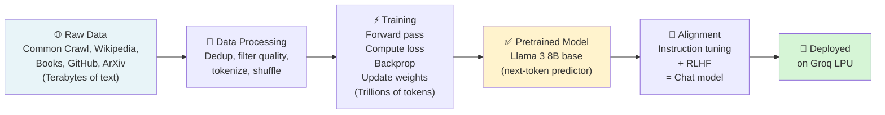

# LLM Fundamentals: Tokens, Embeddings, Context Windows, Parameters, Inference, Pretraining

## 1. Introduction

### What Are LLM Fundamentals?

Large Language Models (LLMs) are the AI systems you interact with every day through your Smart Reply API. When you call `groq.chat.completions.create(model="llama3-8b-8192", ...)`, you're using an LLM. But to use them well in production — to control costs, debug behavior, optimize performance, and make good architectural decisions — you need to understand how they actually work.

This document covers the six core concepts every Generative AI Engineer must know deeply:

- **Tokens**: The fundamental unit of text that LLMs process
- **Embeddings**: How text becomes mathematical representations
- **Context Windows**: The model's "working memory" limit
- **Parameters**: The model's learned knowledge, stored as numbers
- **Inference**: Using a trained model to generate outputs
- **Pretraining**: How LLMs acquire their knowledge

### Why Are These Fundamentals Important?

Every practical decision you make in your Smart Reply API connects to these fundamentals:

| Your Code | Underlying Fundamental |
|-----------|----------------------|
| `max_tokens=500` | Token limits → affects cost and latency |
| Conversation history in messages | Context window → affects what model "remembers" |
| `model="llama3-8b-8192"` | Parameters → 8B parameters = model knowledge capacity |
| `temperature=0.7` | Inference sampling → affects output creativity |
| "The model knows about events until..." | Pretraining cutoff → knowledge boundary |

### What Real-World Problems Do These Concepts Solve?

- **Cost control**: Token counting lets you estimate and cap API spend
- **Context management**: Understanding context windows prevents API errors and ensures relevant responses
- **Model selection**: Understanding parameters helps choose the right model size for your use case
- **Debugging**: When models give unexpected outputs, these concepts help you diagnose why
- **Architecture**: Building RAG, agents, and multi-turn systems requires deep knowledge of all six

### What You'll Build After This Topic

- A token counter and cost estimator for your Smart Reply API
- A context window manager that never exceeds token limits
- A model selection guide based on parameter counts
- Practical understanding to discuss any LLM concept confidently in interviews

---

## 2. Tokens: The Atomic Unit of LLMs

### 2.1 What Is a Token?

A token is the smallest unit of text that an LLM processes. Tokens are not words — they are **sub-word chunks** produced by a tokenizer algorithm.

#### Simple Analogy
Think of tokens like syllables in speech. "Unbelievable" might be split into: "Un", "believ", "able" — three chunks that are each meaningful sub-units. Similarly, "tokenization" might become "token", "ization" — two tokens.

#### Why Sub-Words Instead of Words?

| Approach | Problem |
|----------|---------|
| Character-level | Too many steps; "hello" = 5 tokens → slow, expensive |
| Word-level | Rare/new words become `[UNKNOWN]` → model can't handle them |
| **Sub-word (BPE)** | Common words are single tokens; rare words split into known parts |

With sub-word tokenization:
- Common words: "the", "is", "and" → 1 token each
- Uncommon words: "hyperparameter" → ["hyper", "parameter"] → 2 tokens
- New words: "ChatGPT" → ["Chat", "G", "PT"] → 3 tokens
- Numbers: "2024" → ["2024"] → 1 token; "19876" → ["198", "76"] → 2 tokens

### 2.2 How Tokenization Works (BPE)

**Byte-Pair Encoding (BPE)** is the most common tokenizer algorithm (used by GPT, Llama, Mistral):

1. Start with individual characters as the vocabulary
2. Count all adjacent character pairs in the training corpus
3. Merge the most frequent pair into a new token
4. Repeat until vocabulary size is reached (e.g., 32,000 tokens)

```python
# Simple BPE demonstration (conceptual, not production-grade)
class SimpleBPEDemo:
    """Illustrate the BPE tokenization concept"""
    
    def __init__(self):
        # Pre-built merge rules (simplified example)
        # In reality: Llama uses 32,000 merges learned from web-scale data
        self.merges = [
            ("t", "h"),     # th
            ("th", "e"),    # the
            ("i", "n"),     # in
            ("in", "g"),    # ing
            ("m", "e"),     # me
            ("me", "et"),   # meet
            ("me", "et"),
        ]
        
    def demonstrate_bpe_concept(self):
        print("=== BPE TOKENIZATION CONCEPT ===\n")
        
        print("BPE Training Process:")
        print("1. Start: corpus = 'the meeting the thing'")
        print("   Characters: t h e  m e e t i n g  t h e  t h i n g")
        print()
        print("2. Most frequent pair: ('t','h') → merge to 'th'")
        print("   After: th e  m e e th i n g  th e  th i n g")
        print()
        print("3. Most frequent pair: ('th','e') → merge to 'the'")
        print("   After: the  m e e the i n g  the  the i n g")
        print()
        print("4. Most frequent pair: ('i','n') → merge to 'in'")
        print("   After: the  m e e the in g  the  the in g")
        print()
        print("5. Most frequent pair: ('in','g') → merge to 'ing'")
        print("   After: the  m e e the ing  the  the ing")
        print()
        print("Final vocabulary includes: 'the', 'ing', 'th', 'in', 'm', 'e', ...")
        print("Rare words split into these learned sub-units — no unknown tokens!\n")

demo = SimpleBPEDemo()
demo.demonstrate_bpe_concept()
```

### 2.3 Token Counting in Practice

```python
# Install: pip install tiktoken
# tiktoken is OpenAI's fast tokenizer — also approximate for Llama/Mixtral

import tiktoken
from typing import List

class TokenCounter:
    """
    Production-ready token counter for LLM cost and context management.
    Uses cl100k_base encoding (GPT-4, Claude compatible).
    For Llama models on Groq, this is approximate but useful.
    """
    
    def __init__(self, model: str = "gpt-4"):
        try:
            self.enc = tiktoken.encoding_for_model(model)
        except KeyError:
            # Fallback to cl100k_base for unknown models (e.g., Llama)
            self.enc = tiktoken.get_encoding("cl100k_base")
        
        # Groq pricing as of 2025 (verify current pricing at console.groq.com)
        self.pricing = {
            "llama3-8b-8192":     {"input": 0.05, "output": 0.08},   # $ per 1M tokens
            "llama3-70b-8192":    {"input": 0.59, "output": 0.79},
            "mixtral-8x7b-32768": {"input": 0.24, "output": 0.24},
            "gemma2-9b-it":       {"input": 0.20, "output": 0.20},
        }
    
    def count_tokens(self, text: str) -> int:
        """Count tokens in a string"""
        return len(self.enc.encode(text))
    
    def count_message_tokens(self, messages: List[dict]) -> int:
        """
        Count tokens in a full messages array (like you send to Groq).
        Each message has per-message overhead (~4 tokens for role/format).
        """
        total = 0
        for message in messages:
            total += 4  # Per-message overhead
            total += self.count_tokens(message.get("content", ""))
            total += self.count_tokens(message.get("role", ""))
        total += 2  # Conversation priming tokens
        return total
    
    def tokenize_with_ids(self, text: str) -> dict:
        """Show text split into tokens with their IDs"""
        token_ids = self.enc.encode(text)
        tokens = [self.enc.decode([tid]) for tid in token_ids]
        
        return {
            "text": text,
            "token_count": len(token_ids),
            "token_ids": token_ids,
            "tokens": tokens,
            "chars_per_token": len(text) / max(len(token_ids), 1)
        }
    
    def estimate_cost(self, input_text: str, output_tokens: int,
                      model: str = "llama3-8b-8192") -> dict:
        """Estimate API cost for a request"""
        input_tokens = self.count_tokens(input_text)
        
        pricing = self.pricing.get(model, {"input": 0.5, "output": 0.5})
        
        input_cost  = (input_tokens  / 1_000_000) * pricing["input"]
        output_cost = (output_tokens / 1_000_000) * pricing["output"]
        
        return {
            "model": model,
            "input_tokens": input_tokens,
            "output_tokens": output_tokens,
            "total_tokens": input_tokens + output_tokens,
            "input_cost_usd":  round(input_cost,  8),
            "output_cost_usd": round(output_cost, 8),
            "total_cost_usd":  round(input_cost + output_cost, 8),
            "cost_per_1k_calls": round((input_cost + output_cost) * 1000, 4)
        }
    
    def demonstrate(self):
        """Show tokenization behavior on real examples"""
        print("=== TOKEN COUNTING DEMONSTRATION ===\n")
        
        examples = [
            "Hello",
            "Hello, how are you?",
            "Can we reschedule the meeting to Thursday?",
            "ChatGPT",
            "hyperparameter",
            "2024",
            "19876543",
            "Hello! 你好! Bonjour!",  # Multilingual
        ]
        
        print(f"{'Text':<40} {'Tokens':>7} {'Chars':>7} {'Ch/Tok':>7}")
        print("-" * 65)
        
        for text in examples:
            result = self.tokenize_with_ids(text)
            print(f"{text:<40} {result['token_count']:>7} {len(text):>7} {result['chars_per_token']:>7.1f}")
        
        print("\n--- TOKENIZATION BREAKDOWN ---")
        text = "tokenization is fascinating"
        result = self.tokenize_with_ids(text)
        print(f"\nText: '{text}'")
        print(f"Tokens ({result['token_count']}): {result['tokens']}")
        print(f"IDs:   {result['token_ids']}")
        
        print("\n--- COST ESTIMATION FOR SMART REPLY ---")
        system_prompt = "You are a professional smart reply assistant. Generate concise, contextual replies."
        user_message  = "Can we reschedule our 3pm meeting to Thursday afternoon?"
        full_prompt   = system_prompt + user_message
        
        cost = self.estimate_cost(full_prompt, output_tokens=80, model="llama3-8b-8192")
        
        print(f"Model: {cost['model']}")
        print(f"Input tokens:  {cost['input_tokens']}")
        print(f"Output tokens: {cost['output_tokens']}")
        print(f"Cost per call: ${cost['total_cost_usd']}")
        print(f"Cost per 1K calls: ${cost['cost_per_1k_calls']}")
        print(f"Cost per 1M calls: ${cost['cost_per_1k_calls'] * 1000:.2f}")

counter = TokenCounter()
counter.demonstrate()
```

### 2.4 Token Rules Every Engineer Must Know

```python
class TokenRules:
    """Common token patterns every engineer should internalize"""
    
    RULES = {
        "1 token ≈ 4 chars":        "Rough average for English text",
        "1 token ≈ 0.75 words":     "100 tokens ≈ 75 words",
        "1 page ≈ 500 tokens":      "Standard document page",
        "Code is token-expensive":  "Variable names, syntax chars cost tokens",
        "Whitespace counts":        "Spaces and newlines are tokens",
        "Numbers split strangely":  "'1234567' may be 3+ tokens",
        "Non-English costs more":   "Chinese/Arabic tokens cover fewer chars",
        "JSON/HTML is expensive":   "Markup syntax tokens add up quickly",
    }
    
    PRACTICAL_LIMITS = {
        "llama3-8b-8192":        8_192,
        "llama3-70b-8192":       8_192,
        "mixtral-8x7b-32768":   32_768,
        "llama3-groq-8b-8192":   8_192,
        "gemma2-9b-it":          8_192,
    }
    
    def print_guidelines(self):
        print("=== TOKEN RULES FOR PRODUCTION ===\n")
        for rule, explanation in self.RULES.items():
            print(f"  • {rule:<35} → {explanation}")
        
        print("\n=== GROQ MODEL CONTEXT LIMITS ===\n")
        for model, limit in self.PRACTICAL_LIMITS.items():
            print(f"  {model:<30}: {limit:,} tokens")

rules = TokenRules()
rules.print_guidelines()
```

---

## 3. Embeddings: Text as Mathematical Vectors

### 3.1 What Are Embeddings?

An embedding is a dense vector of numbers that represents the **meaning** of a piece of text. It captures semantic information so that similar meanings produce similar vectors.

#### Simple Analogy
Think of a library where every book is assigned a location in a 3D building:
- Floor = Topic (AI, History, Fiction...)
- Row = Subtopic
- Shelf = Specific subject

Books on similar topics end up near each other. Embeddings do the same thing but in hundreds or thousands of dimensions, and the "position" captures meaning rather than physical location.

#### The Key Property: Semantic Similarity

```
embedding("The meeting was rescheduled") 
    ≈ embedding("Our appointment was moved")     ← Very similar meaning

embedding("The meeting was rescheduled")
    ≠ embedding("I love eating pizza")            ← Very different meaning
```

This is what makes semantic search, RAG, and clustering possible.

### 3.2 Two Types of Embeddings in LLMs

| Type | What It Is | Where It Lives | Used For |
|------|-----------|----------------|---------|
| **Token Embeddings** | Each token → vector (learned in training) | Inside every LLM | Internal representation |
| **Text Embeddings** | Full sentence/document → single vector | Embedding model API | Search, RAG, similarity |

When you call Groq for chat, the model internally uses **token embeddings**.
When you use a tool like `text-embedding-3-small` or `nomic-embed-text`, you're getting **text embeddings** for a full string.

### 3.3 Text Embeddings: Practical Code

```python
import numpy as np
from typing import List

class EmbeddingDemo:
    """
    Demonstrate text embeddings conceptually.
    Real usage: call an embedding API (OpenAI, Groq, local model)
    """
    
    def __init__(self, embedding_dim: int = 8):
        """Using tiny 8-dim embeddings for illustration. Real models: 384–3072 dims"""
        self.dim = embedding_dim
        
        # Simulate pre-trained embeddings (in reality: dense vectors from a model)
        np.random.seed(42)
        self._vocab = {
            "meeting":    np.array([0.9, 0.8, 0.1, 0.2, 0.7, 0.3, 0.1, 0.5]),
            "schedule":   np.array([0.8, 0.7, 0.1, 0.3, 0.8, 0.2, 0.2, 0.4]),
            "appointment":np.array([0.8, 0.6, 0.1, 0.2, 0.7, 0.3, 0.1, 0.4]),
            "pizza":      np.array([0.1, 0.1, 0.9, 0.8, 0.1, 0.7, 0.9, 0.2]),
            "lunch":      np.array([0.2, 0.1, 0.8, 0.7, 0.2, 0.8, 0.8, 0.3]),
            "urgent":     np.array([0.7, 0.5, 0.1, 0.1, 0.9, 0.1, 0.1, 0.8]),
            "reschedule": np.array([0.9, 0.8, 0.1, 0.3, 0.7, 0.2, 0.1, 0.5]),
        }
    
    def embed_text(self, text: str) -> np.ndarray:
        """
        Simulate text embedding by averaging word embeddings.
        Real embedding models use a transformer encoder to produce one vector.
        """
        words = text.lower().split()
        vectors = []
        
        for word in words:
            # Use known word vector or random for unknown words
            if word in self._vocab:
                vectors.append(self._vocab[word])
            else:
                # Unknown words: generate deterministic random vector
                rng = np.random.RandomState(hash(word) % (2**31))
                vectors.append(rng.randn(self.dim) * 0.3)
        
        if not vectors:
            return np.zeros(self.dim)
        
        return np.mean(vectors, axis=0)
    
    def cosine_similarity(self, vec_a: np.ndarray, vec_b: np.ndarray) -> float:
        """
        Cosine similarity: measures angle between vectors.
        Range: -1 (opposite) to +1 (identical direction)
        1.0 = same meaning, 0.0 = unrelated, -1.0 = opposite
        """
        norm_a = np.linalg.norm(vec_a)
        norm_b = np.linalg.norm(vec_b)
        
        if norm_a == 0 or norm_b == 0:
            return 0.0
        
        return float(np.dot(vec_a, vec_b) / (norm_a * norm_b))
    
    def find_most_similar(self, query: str, candidates: List[str]) -> List[dict]:
        """Find most semantically similar candidate to a query"""
        query_vec = self.embed_text(query)
        
        results = []
        for candidate in candidates:
            cand_vec = self.embed_text(candidate)
            sim = self.cosine_similarity(query_vec, cand_vec)
            results.append({"text": candidate, "similarity": round(sim, 4)})
        
        return sorted(results, key=lambda x: x["similarity"], reverse=True)
    
    def demonstrate(self):
        print("=== EMBEDDING SIMILARITY DEMONSTRATION ===\n")
        
        # Show that semantically similar sentences cluster together
        sentences = [
            "Can we reschedule the meeting?",
            "Please move our appointment to Friday",
            "The meeting needs to be postponed",
            "I love eating pizza for lunch",
            "What is your favorite food?",
            "This is an urgent matter requiring attention",
        ]
        
        query = "Can we change the time of our meeting?"
        print(f"Query: '{query}'\n")
        
        results = self.find_most_similar(query, sentences)
        
        print(f"{'Sentence':<50} {'Similarity':>10}")
        print("-" * 65)
        for r in results:
            bar = "█" * int(r["similarity"] * 20)
            print(f"{r['text']:<50} {r['similarity']:>10.4f}  {bar}")
        
        print("\n💡 Notice: scheduling-related sentences score high,")
        print("   food/unrelated sentences score low — the model understands meaning!")

demo = EmbeddingDemo()
demo.demonstrate()
```

### 3.4 Embeddings in Production: RAG for Smart Reply

The most common production use of embeddings in your work is **Retrieval Augmented Generation (RAG)**:

```python
import numpy as np
from typing import List, Tuple

class SimpleRAGSystem:
    """
    Minimal RAG implementation for Smart Reply.
    In production: use a vector database (Pinecone, Chroma, pgvector).
    """
    
    def __init__(self, embedding_model):
        self.embedding_model = embedding_model
        self.knowledge_base: List[Tuple[str, np.ndarray]] = []
    
    def index_document(self, text: str):
        """Add a document to the knowledge base"""
        embedding = self.embedding_model.embed_text(text)
        self.knowledge_base.append((text, embedding))
    
    def retrieve(self, query: str, top_k: int = 3) -> List[dict]:
        """Find most relevant documents for a query"""
        query_embedding = self.embedding_model.embed_text(query)
        
        results = []
        for doc_text, doc_embedding in self.knowledge_base:
            sim = self.embedding_model.cosine_similarity(query_embedding, doc_embedding)
            results.append({"document": doc_text, "similarity": sim})
        
        return sorted(results, key=lambda x: x["similarity"], reverse=True)[:top_k]
    
    def retrieve_and_format_context(self, query: str, top_k: int = 3) -> str:
        """Retrieve relevant docs and format as context for LLM prompt"""
        docs = self.retrieve(query, top_k)
        
        if not docs:
            return ""
        
        context_parts = [f"[{i+1}] {doc['document']}" for i, doc in enumerate(docs)]
        return "\n".join(context_parts)

# Example: Smart Reply with company knowledge base
def demo_rag_smart_reply():
    embed_model = EmbeddingDemo()
    rag = SimpleRAGSystem(embed_model)
    
    # Index company-specific knowledge
    company_docs = [
        "Our meeting room policy: all rooms must be booked 24h in advance via the portal.",
        "Rescheduling policy: give at least 4 hours notice for meeting changes.",
        "Contact IT support at it@company.com for urgent technical issues.",
        "The quarterly review is scheduled for the last Friday of each quarter.",
        "Vacation requests must be submitted 2 weeks in advance through HR portal.",
    ]
    
    for doc in company_docs:
        rag.index_document(doc)
    
    # User sends a message
    user_message = "What's the policy for rescheduling meetings?"
    
    # Retrieve relevant context
    context = rag.retrieve_and_format_context(user_message, top_k=2)
    
    # Build grounded prompt for Groq API
    grounded_prompt = f"""Answer based ONLY on the following company information:

{context}

Question: {user_message}"""
    
    print("=== RAG SMART REPLY DEMO ===\n")
    print(f"User message: '{user_message}'\n")
    print("Retrieved context:")
    for doc in rag.retrieve(user_message, top_k=2):
        print(f"  [{doc['similarity']:.3f}] {doc['document']}")
    print(f"\nGrounded prompt sent to Groq:\n{grounded_prompt}")
    print("\n(Groq API would then generate a grounded, accurate reply)")

demo_rag_smart_reply()
```

---

## 4. Context Windows: The Model's Working Memory

### 4.1 What Is a Context Window?

The context window is the **maximum number of tokens** an LLM can process in a single forward pass — it includes everything: system prompt, conversation history, user message, and the generated response.

Think of it as the model's **short-term working memory**. Everything inside the context window the model "sees." Everything outside it, the model has no access to.

#### Simple Analogy
Imagine you can only look at a 10-page window of a 500-page book at any time. You must use those 10 pages to answer questions. If the answer is on page 450 but your window only covers pages 1–10, you cannot answer — even if you've read the whole book before.

### 4.2 What Goes Inside the Context Window?

```
Total Context Window (e.g., 8,192 tokens)
├── System Prompt         (200–500 tokens typically)
├── Conversation History  (variable — grows with each turn)
│   ├── Turn 1: user + assistant messages
│   ├── Turn 2: user + assistant messages
│   └── Turn N: user + assistant messages
├── Current User Message  (variable)
└── Model's Response      (max_tokens you set)
```

If `system prompt + history + user message + max_tokens > 8192`, you will get an API error or silent truncation.

### 4.3 Context Window Management

```python
from typing import List, Optional
import os

class ContextWindowManager:
    """
    Production context window manager for multi-turn conversations.
    Ensures you never exceed the model's token limit.
    Integrates with your existing Smart Reply conversations.py.
    """
    
    # Model context limits (subtract ~500 for safety margin)
    MODEL_LIMITS = {
        "llama3-8b-8192":        7_500,
        "llama3-70b-8192":       7_500,
        "mixtral-8x7b-32768":   31_500,
        "gemma2-9b-it":          7_500,
    }
    
    def __init__(self, model: str = "llama3-8b-8192", token_counter=None):
        self.model = model
        self.max_tokens = self.MODEL_LIMITS.get(model, 7_500)
        
        # Use tiktoken for counting (approximate for Llama, accurate for GPT)
        try:
            import tiktoken
            self.enc = tiktoken.get_encoding("cl100k_base")
        except ImportError:
            self.enc = None
    
    def _count_tokens(self, text: str) -> int:
        """Count tokens — fallback to character estimate if tiktoken unavailable"""
        if self.enc:
            return len(self.enc.encode(text))
        return max(1, len(text) // 4)   # ≈ 4 chars per token
    
    def _count_message_tokens(self, message: dict) -> int:
        """Count tokens for a single message dict"""
        content_tokens = self._count_tokens(message.get("content", ""))
        return content_tokens + 4   # Role + formatting overhead
    
    def _count_messages_tokens(self, messages: List[dict]) -> int:
        """Count total tokens for a messages array"""
        return sum(self._count_message_tokens(m) for m in messages) + 2
    
    def fit_messages_to_context(
        self,
        system_prompt: str,
        history: List[dict],
        new_user_message: str,
        max_response_tokens: int = 500
    ) -> dict:
        """
        Fit all messages within context window.
        
        Strategy:
        1. Always keep: system prompt + new user message
        2. Fill remaining budget with recent history (newest first)
        3. Warn if significant history is dropped
        
        Returns the messages array to send to Groq.
        """
        
        # Calculate fixed token costs
        system_tokens   = self._count_tokens(system_prompt) + 4
        user_msg_tokens = self._count_tokens(new_user_message) + 4
        overhead_tokens = max_response_tokens + 10  # Reserve for response + buffer
        
        fixed_tokens = system_tokens + user_msg_tokens + overhead_tokens
        available_for_history = self.max_tokens - fixed_tokens
        
        if available_for_history < 0:
            raise ValueError(
                f"System prompt + user message already exceeds context window. "
                f"Fixed: {fixed_tokens}, Limit: {self.max_tokens}"
            )
        
        # Greedily add history from most recent
        included_history = []
        used_history_tokens = 0
        dropped_count = 0
        
        for message in reversed(history):
            msg_tokens = self._count_message_tokens(message)
            
            if used_history_tokens + msg_tokens <= available_for_history:
                included_history.insert(0, message)  # Prepend to maintain order
                used_history_tokens += msg_tokens
            else:
                dropped_count += 1
        
        # Build final messages array
        messages = [{"role": "system", "content": system_prompt}]
        messages.extend(included_history)
        messages.append({"role": "user", "content": new_user_message})
        
        total_tokens = self._count_messages_tokens(messages)
        
        return {
            "messages": messages,
            "stats": {
                "total_tokens_estimate": total_tokens,
                "context_limit": self.max_tokens,
                "history_messages_included": len(included_history),
                "history_messages_dropped": dropped_count,
                "available_for_response": self.max_tokens - total_tokens,
                "context_utilization": f"{(total_tokens / self.max_tokens) * 100:.1f}%"
            }
        }
    
    def demonstrate(self):
        """Show context management in action"""
        print("=== CONTEXT WINDOW MANAGEMENT ===\n")
        
        system_prompt = "You are a professional smart reply assistant. Generate concise, helpful replies."
        
        # Simulate a long conversation
        long_history = []
        for i in range(20):
            long_history.append({"role": "user", "content": f"Turn {i+1}: User message asking about topic {i+1}. This is a realistic length message."})
            long_history.append({"role": "assistant", "content": f"Turn {i+1}: Assistant response providing helpful information about topic {i+1}. This is a typical reply length."})
        
        new_message = "Can you summarize what we've discussed so far?"
        
        result = self.fit_messages_to_context(
            system_prompt=system_prompt,
            history=long_history,
            new_user_message=new_message,
            max_response_tokens=300
        )
        
        stats = result["stats"]
        
        print(f"Model: {self.model}")
        print(f"Context limit: {stats['context_limit']:,} tokens")
        print(f"Conversation history: {len(long_history)} messages total")
        print(f"History included: {stats['history_messages_included']} messages")
        print(f"History dropped: {stats['history_messages_dropped']} messages (too old)")
        print(f"Estimated total tokens: {stats['total_tokens_estimate']:,}")
        print(f"Context utilization: {stats['context_utilization']}")
        print(f"Available for response: {stats['available_for_response']} tokens")
        
        if stats["history_messages_dropped"] > 0:
            print(f"\n⚠️  {stats['history_messages_dropped']} old messages dropped — consider summarizing history")
        else:
            print(f"\n✅ All history fits within context window")

manager = ContextWindowManager(model="llama3-8b-8192")
manager.demonstrate()
```

### 4.4 Context Window Strategies

```python
class ContextStrategies:
    """Different strategies for handling long conversations"""
    
    @staticmethod
    def strategy_1_truncate(history: List[dict], max_messages: int) -> List[dict]:
        """
        Simplest: keep only the N most recent messages.
        Pro: Simple, predictable.
        Con: Loses all early context entirely.
        """
        return history[-max_messages:]
    
    @staticmethod
    def strategy_2_summarize_then_append(
        old_history: List[dict],
        summary: str,
        recent_history: List[dict]
    ) -> List[dict]:
        """
        Better: Summarize old history → keep summary as system message + recent turns.
        Pro: Preserves key context economically.
        Con: Requires an extra LLM call to generate the summary.
        """
        summary_message = {
            "role": "system",
            "content": f"Summary of previous conversation: {summary}"
        }
        return [summary_message] + recent_history
    
    @staticmethod
    def strategy_3_sliding_window(
        history: List[dict],
        window_size: int,
        overlap: int = 2
    ) -> List[dict]:
        """
        Sliding window: keep last N messages but always include first K (for context).
        Pro: Preserves important early context + recent turns.
        Con: More complex logic.
        """
        if len(history) <= window_size:
            return history
        
        # Always include first `overlap` messages (may contain important context)
        first_messages = history[:overlap]
        # Plus the most recent messages
        recent_messages = history[-(window_size - overlap):]
        
        # Add a marker to signal the gap
        gap_marker = {
            "role": "system",
            "content": f"[{len(history) - window_size} earlier messages omitted]"
        }
        
        return first_messages + [gap_marker] + recent_messages

# Production recommendation for Smart Reply API:
print("=== CONTEXT STRATEGY RECOMMENDATION ===\n")
print("For Smart Reply (short conversations, < 20 turns):")
print("  → Strategy 1 (truncate) is usually sufficient")
print("  → Keep last 10 turns (20 messages)")
print()
print("For long-running chat assistants:")
print("  → Strategy 2 (summarize) every 20 turns")
print("  → Use a cheap/fast model for summarization (llama3-8b)")
print()
print("For complex agentic conversations:")
print("  → Strategy 3 (sliding window) with overlap")
print("  → Or use a model with large context (mixtral-8x7b-32768)")
```

---

## 5. Parameters: The Model's Stored Knowledge

### 5.1 What Are Parameters?

Parameters are the numbers inside a neural network — specifically, all the **weights and biases** across every layer. They are what gets adjusted during training and what encodes the model's "knowledge" after training.

When you see "Llama 3 8B", the **8B means 8 billion parameters**. Each parameter is a single floating-point number.

#### Simple Analogy
Think of parameters like synaptic connections in a brain. Each connection has a strength (the parameter value). The pattern of all connection strengths encodes everything the brain "knows." Training is like learning — it strengthens some connections and weakens others until the brain can perform the task.

### 5.2 Parameter Count and What It Means

```python
class ModelParameters:
    """Understanding parameter counts in LLMs"""
    
    MODELS = {
        # (parameters, context_window, memory_gb_fp16, memory_gb_int8, typical_use)
        "llama3-8b-8192":      (8_000_000_000,   8_192,  16,  8,  "fast chat, simple tasks"),
        "llama3-70b-8192":     (70_000_000_000,  8_192, 140, 70,  "complex reasoning, nuanced tasks"),
        "mixtral-8x7b-32768":  (47_000_000_000, 32_768,  94, 47,  "long context, balanced quality"),
        "gpt-4o":             (200_000_000_000, 128_000, 400, 200, "highest quality, most expensive"),
        "claude-3-haiku":     (20_000_000_000, 200_000,  40,  20, "fast, long context"),
    }
    
    def print_comparison(self):
        print("=== LLM PARAMETER COMPARISON ===\n")
        print(f"{'Model':<28} {'Params':>12} {'VRAM (FP16)':>12} {'Context':>10}  Use Case")
        print("-" * 100)
        
        for model, (params, ctx, vram_fp16, vram_int8, use) in self.MODELS.items():
            params_str = f"{params/1e9:.0f}B"
            vram_str   = f"{vram_fp16}GB"
            ctx_str    = f"{ctx:,}"
            print(f"{model:<28} {params_str:>12} {vram_str:>12} {ctx_str:>10}  {use}")
    
    def explain_param_memory(self):
        print("\n=== MEMORY REQUIREMENTS ===\n")
        print("Each parameter is a number. Memory depends on precision (data type):")
        print()
        print(f"  FP32 (full precision):  4 bytes/param  → 8B model = 32 GB")
        print(f"  FP16 (half precision):  2 bytes/param  → 8B model = 16 GB  ← Common inference")
        print(f"  INT8 (8-bit quantized): 1 byte/param   → 8B model =  8 GB  ← Efficient inference")
        print(f"  INT4 (4-bit quantized): 0.5 bytes/param → 8B model = 4 GB  ← Edge/mobile")
        print()
        print("This is why you can't run Llama 70B on a 16GB GPU in FP16.")
        print("Groq handles all hardware requirements — you just call the API.")
    
    def explain_params_vs_quality(self):
        print("\n=== PARAMETERS vs QUALITY ===\n")
        insights = [
            "More params ≠ always better. Fine-tuning a smaller model beats prompting a larger one for specific tasks.",
            "8B models handle most Smart Reply use cases at 10x lower cost than 70B.",
            "Larger models have more 'memorized' knowledge but aren't always more accurate.",
            "Beyond ~70B, quality gains plateau for typical NLP tasks.",
            "The best model for production = best quality/cost/latency ratio for YOUR task.",
        ]
        for i, insight in enumerate(insights, 1):
            print(f"  {i}. {insight}")

mp = ModelParameters()
mp.print_comparison()
mp.explain_param_memory()
mp.explain_params_vs_quality()
```

### 5.3 Parameters and Model Selection for Smart Reply

```python
def select_model_for_task(task_description: str) -> dict:
    """
    Model selection guide based on task characteristics
    """
    
    decision_tree = {
        "simple_reply":   {
            "model": "llama3-8b-8192",
            "reason": "Simple short replies need fast inference, low cost. 8B is sufficient.",
            "cost_relative": 1.0
        },
        "complex_analysis": {
            "model": "llama3-70b-8192",
            "reason": "Multi-step reasoning, nuanced understanding. Worth extra cost.",
            "cost_relative": 12.0
        },
        "long_context": {
            "model": "mixtral-8x7b-32768",
            "reason": "32K context handles long documents. 8K models would truncate.",
            "cost_relative": 5.0
        },
        "structured_output": {
            "model": "llama3-8b-8192",
            "reason": "JSON/structured output works well in smaller models with good prompts.",
            "cost_relative": 1.0
        },
        "code_generation": {
            "model": "llama3-70b-8192",
            "reason": "Code quality significantly better in larger models.",
            "cost_relative": 12.0
        }
    }
    
    # Simple keyword matching for demonstration
    if any(w in task_description.lower() for w in ["simple", "short", "quick", "reply"]):
        return decision_tree["simple_reply"]
    elif any(w in task_description.lower() for w in ["long", "document", "full page"]):
        return decision_tree["long_context"]
    elif any(w in task_description.lower() for w in ["code", "function", "debug"]):
        return decision_tree["code_generation"]
    elif any(w in task_description.lower() for w in ["analyze", "reason", "complex"]):
        return decision_tree["complex_analysis"]
    else:
        return decision_tree["simple_reply"]

# Test model selection
tasks = [
    "Generate a quick 1-sentence reply to a scheduling request",
    "Analyze a full contract document and extract key clauses",
    "Write a Python function to process API responses",
    "Provide complex reasoning about a business strategy decision"
]

print("=== MODEL SELECTION GUIDE ===\n")
for task in tasks:
    recommendation = select_model_for_task(task)
    print(f"Task: {task[:60]}")
    print(f"  → Model: {recommendation['model']}")
    print(f"  → Reason: {recommendation['reason']}")
    print(f"  → Relative cost: {recommendation['cost_relative']}x")
    print()
```

---

## 6. Inference: Using the Trained Model

### 6.1 What Is Inference?

Inference is the process of running a trained model on new input to produce output. When you call the Groq API, you are performing inference.

Key distinction:
- **Training**: Adjusting model weights on data — done once by Groq/Meta/Anthropic
- **Inference**: Using fixed weights to generate predictions — done every API call

### 6.2 Autoregressive Inference: One Token at a Time

LLMs generate text **autoregressively** — they produce one token at a time, then feed that token back in to generate the next one.

```python
class AutoregressiveInferenceSimulator:
    """
    Simulate the token-by-token generation process of LLMs.
    This is exactly what happens when Groq generates your Smart Reply.
    """
    
    def __init__(self, vocab: dict, temperature: float = 0.8):
        self.vocab = vocab         # Simplified vocabulary
        self.temperature = temperature
    
    def _apply_temperature(self, logits: dict, temperature: float) -> dict:
        """
        Temperature scales the logit distribution before softmax.
        - Low temperature (< 1.0): more confident, deterministic
        - High temperature (> 1.0): more random, creative
        - temperature = 0: always picks the highest-probability token
        """
        if temperature == 0:
            # Deterministic: return one-hot on the max
            max_key = max(logits, key=logits.get)
            return {k: (1.0 if k == max_key else 0.0) for k in logits}
        
        # Scale logits by 1/temperature
        import math
        scaled = {k: v / temperature for k, v in logits.items()}
        
        # Softmax
        max_val = max(scaled.values())
        exps = {k: math.exp(v - max_val) for k, v in scaled.items()}
        total = sum(exps.values())
        return {k: v / total for k, v in exps.items()}
    
    def _sample_token(self, probabilities: dict) -> str:
        """Sample a token from probability distribution"""
        tokens = list(probabilities.keys())
        probs  = list(probabilities.values())
        return np.random.choice(tokens, p=probs)
    
    def simulate_generation(self, prompt: str, max_tokens: int = 10) -> dict:
        """
        Simulate token-by-token generation with detailed trace.
        """
        print(f"=== AUTOREGRESSIVE GENERATION ===")
        print(f"Prompt: '{prompt}'")
        print(f"Temperature: {self.temperature}")
        print()
        
        generated_tokens = []
        current_context = prompt
        
        for step in range(max_tokens):
            # In reality: full transformer forward pass over current_context
            # Here: simplified "logits" based on context
            logits = self._generate_fake_logits(current_context, step)
            
            # Apply temperature scaling
            probs = self._apply_temperature(logits, self.temperature)
            
            # Sample next token
            next_token = self._sample_token(probs)
            generated_tokens.append(next_token)
            
            # Show the step
            top3 = sorted(probs.items(), key=lambda x: x[1], reverse=True)[:3]
            top3_str = ", ".join(f"'{t}':{p:.2f}" for t, p in top3)
            print(f"Step {step+1}: Top candidates [{top3_str}] → chose '{next_token}'")
            
            # Stop if we hit EOS
            if next_token in ["<EOS>", "."]:
                print(f"         (End of sequence token generated)")
                break
            
            # Append generated token to context for next step
            current_context = current_context + " " + next_token
        
        generated_text = " ".join(generated_tokens)
        print(f"\nGenerated: '{generated_text}'")
        
        return {
            "prompt": prompt,
            "generated_text": generated_text,
            "tokens_generated": len(generated_tokens)
        }
    
    def _generate_fake_logits(self, context: str, step: int) -> dict:
        """Simulate logit distribution — for illustration only"""
        # Simplified: next word choices depend loosely on context
        if "meeting" in context.lower() or "reschedule" in context.lower():
            candidates = {
                "Sure":      0.3, "Of":       0.2, "Absolutely": 0.15,
                "Thursday":  0.1, "Friday":   0.1, "works":      0.08,
                "<EOS>":     0.07
            }
        else:
            candidates = {
                "I":         0.3, "That":    0.2, "Great":       0.2,
                "Let":       0.1, "Please":  0.1, "<EOS>":       0.1,
            }
        return candidates

# Demonstrate autoregressive generation
gen_sim = AutoregressiveInferenceSimulator(vocab={}, temperature=0.7)
result = gen_sim.simulate_generation("Can we reschedule the meeting?", max_tokens=6)
```

### 6.3 Inference Optimization for Production

```python
class InferenceOptimizer:
    """Key patterns for optimizing LLM inference in production"""
    
    @staticmethod
    def calculate_ttft_and_tpot(
        input_tokens: int,
        output_tokens: int,
        prefill_tokens_per_sec: int = 10_000,   # Tokens/sec for input processing
        decode_tokens_per_sec: int = 150         # Tokens/sec for generation (Groq ~800)
    ) -> dict:
        """
        TTFT: Time To First Token (latency before streaming starts)
        TPOT: Time Per Output Token (throughput of generation)
        
        Two phases in LLM inference:
        1. PREFILL: Process all input tokens at once → high throughput, produces KV cache
        2. DECODE: Generate output tokens one at a time → lower throughput
        """
        ttft_ms = (input_tokens / prefill_tokens_per_sec) * 1000
        tpot_ms = (1 / decode_tokens_per_sec) * 1000    # ms per token
        total_generation_ms = output_tokens * tpot_ms
        total_latency_ms = ttft_ms + total_generation_ms
        
        return {
            "input_tokens":           input_tokens,
            "output_tokens":          output_tokens,
            "ttft_ms":                round(ttft_ms, 1),
            "tpot_ms":                round(tpot_ms, 1),
            "total_generation_ms":    round(total_generation_ms, 1),
            "total_latency_ms":       round(total_latency_ms, 1),
        }
    
    @staticmethod
    def print_latency_table():
        opt = InferenceOptimizer()
        print("=== LATENCY ESTIMATION TABLE ===")
        print("(Groq LPU: ~800 tokens/sec decode, ~10K tokens/sec prefill)\n")
        print(f"{'Input':>8} {'Output':>8} {'TTFT':>10} {'Gen Time':>10} {'Total':>10}")
        print("-" * 55)
        
        scenarios = [
            (200, 50),    # Short Smart Reply
            (1000, 100),  # Medium conversation
            (4000, 200),  # Long context
            (8000, 500),  # Near context limit
        ]
        
        for inp, out in scenarios:
            r = opt.calculate_ttft_and_tpot(
                inp, out,
                prefill_tokens_per_sec=10_000,
                decode_tokens_per_sec=800    # Groq LPU speed
            )
            print(f"{inp:>8} {out:>8} {r['ttft_ms']:>9.0f}ms {r['total_generation_ms']:>9.0f}ms {r['total_latency_ms']:>9.0f}ms")

InferenceOptimizer.print_latency_table()
```

---

## 7. Pretraining: How LLMs Acquire Knowledge

### 7.1 What Is Pretraining?

Pretraining is the initial, large-scale training phase where an LLM learns from massive amounts of text data. The model learns to **predict the next token** given all previous tokens — a task called **causal language modeling**.

#### The Pretraining Task (Causal Language Modeling)

```
Input:  "The quick brown fox"
Target: "quick brown fox jumps"

The model learns: given "The quick brown fox", predict "jumps"
By doing this billions of times, it learns:
  - Grammar and syntax
  - World knowledge (facts, concepts)  
  - Reasoning patterns
  - Code, math, language
  - Writing styles
```

### 7.2 Pretraining Pipeline



### 7.3 Pretraining vs Fine-Tuning vs RLHF

```python
class LLMTrainingStages:
    """Explain the three stages of creating a production LLM"""
    
    STAGES = {
        "1_pretraining": {
            "name": "Pretraining (Base Model)",
            "what": "Train on massive text corpus to predict next tokens",
            "data": "Web, books, code, Wikipedia (trillions of tokens)",
            "objective": "Minimize next-token prediction loss",
            "result": "General-purpose language model (llama3-8b-base)",
            "who": "Meta, OpenAI, Anthropic, Google",
            "cost": "$1M–$100M+ in compute",
            "duration": "Weeks to months on thousands of GPUs",
            "you_do_this": False,
        },
        "2_sft": {
            "name": "Supervised Fine-Tuning (Instruction Tuning)",
            "what": "Fine-tune on (instruction, response) pairs",
            "data": "Curated instruction-following examples (100K–1M pairs)",
            "objective": "Learn to follow instructions, not just predict next tokens",
            "result": "Instruction-following model",
            "who": "AI companies + sometimes your company",
            "cost": "$1K–$100K",
            "duration": "Hours to days",
            "you_do_this": "Sometimes (for domain specialization)",
        },
        "3_rlhf": {
            "name": "RLHF (Reinforcement Learning from Human Feedback)",
            "what": "Train using human preference ratings between model outputs",
            "data": "Human preference comparisons (which answer is better?)",
            "objective": "Align model outputs with human preferences",
            "result": "Helpful, harmless, honest chat model",
            "who": "AI companies (OpenAI, Anthropic) or specialized teams",
            "cost": "Expensive (human labelers + compute)",
            "duration": "Weeks",
            "you_do_this": False,
        }
    }
    
    def explain_stages(self):
        print("=== LLM TRAINING STAGES ===\n")
        for stage_key, info in self.STAGES.items():
            print(f"{'='*60}")
            print(f"Stage: {info['name']}")
            print(f"{'='*60}")
            print(f"  What: {info['what']}")
            print(f"  Data: {info['data']}")
            print(f"  Goal: {info['objective']}")
            print(f"  Result: {info['result']}")
            print(f"  Cost: {info['cost']}")
            print(f"  Do you do this? {info['you_do_this']}")
            print()
    
    def explain_knowledge_cutoff(self):
        print("=== KNOWLEDGE CUTOFF ===\n")
        print("The knowledge cutoff is the date after which the model has no training data.")
        print()
        print("Why it matters in production:")
        print("  1. Model may be wrong about recent events")
        print("  2. Model cannot answer questions about things after the cutoff")
        print("  3. Hallucination risk increases for recent/evolving topics")
        print()
        print("Mitigation strategies:")
        print("  1. RAG: Retrieve real-time data before generating reply")
        print("  2. Tool use: Give model access to web search/APIs")
        print("  3. System prompt: Tell the model its knowledge cutoff and to say 'I don't know' for recent events")
        print("  4. Use newer models as they're released (Groq updates periodically)")
        print()
        system_prompt_snippet = '''You are a helpful assistant. 
Your knowledge has a cutoff date and may not reflect recent events.
For current information, rely on the provided context, not your training.
If you are unsure, say "I'm not certain about this" rather than guessing.'''
        print("Example system prompt for knowledge cutoff handling:")
        print(f"```\n{system_prompt_snippet}\n```")

stages = LLMTrainingStages()
stages.explain_stages()
stages.explain_knowledge_cutoff()
```

---

## 8. Production Integration: Smart Reply API

```python
# Complete production-grade integration tying all 6 concepts together
import os
from groq import Groq
from typing import List, Optional

class ProductionSmartReplyService:
    """
    Production Smart Reply service that applies all LLM fundamentals:
    - Token counting and cost tracking
    - Context window management
    - Model selection based on task
    - Proper inference configuration
    """
    
    def __init__(self, model: str = "llama3-8b-8192"):
        self.client     = Groq(api_key=os.environ.get("GROQ_API_KEY"))
        self.model      = model
        self.ctx_mgr    = ContextWindowManager(model=model)
        self.token_ctr  = TokenCounter()
        
        self.system_prompt = """You are a professional smart reply assistant.
Generate concise, contextually appropriate replies.
Your knowledge has a cutoff and may not reflect recent events.
For factual questions, rely only on provided context."""
        
        # Cost tracking
        self.total_input_tokens  = 0
        self.total_output_tokens = 0
    
    def generate_reply(
        self,
        user_message:    str,
        history:         List[dict] = None,
        max_reply_tokens: int = 200,
        temperature:      float = 0.7
    ) -> dict:
        """
        Generate a smart reply with full context management and cost tracking.
        """
        history = history or []
        
        # 1. Fit conversation into context window
        ctx_result = self.ctx_mgr.fit_messages_to_context(
            system_prompt=self.system_prompt,
            history=history,
            new_user_message=user_message,
            max_response_tokens=max_reply_tokens
        )
        
        messages = ctx_result["messages"]
        ctx_stats = ctx_result["stats"]
        
        # 2. Call Groq API
        response = self.client.chat.completions.create(
            model=self.model,
            messages=messages,
            max_tokens=max_reply_tokens,
            temperature=temperature,
        )
        
        reply_text     = response.choices[0].message.content
        input_tokens   = response.usage.prompt_tokens
        output_tokens  = response.usage.completion_tokens
        
        # 3. Track cumulative costs
        self.total_input_tokens  += input_tokens
        self.total_output_tokens += output_tokens
        
        # 4. Estimate cost
        cost = self.token_ctr.estimate_cost(
            input_text="x" * (input_tokens * 4),   # approximate
            output_tokens=output_tokens,
            model=self.model
        )
        
        return {
            "reply":              reply_text,
            "model":              self.model,
            "usage": {
                "input_tokens":   input_tokens,
                "output_tokens":  output_tokens,
                "total_tokens":   input_tokens + output_tokens,
            },
            "cost_usd":           cost["total_cost_usd"],
            "context_stats":      ctx_stats,
            "history_updated":    history + [
                {"role": "user",      "content": user_message},
                {"role": "assistant", "content": reply_text}
            ]
        }
    
    def get_session_cost_summary(self) -> dict:
        """Get cumulative cost for the current session"""
        pricing = {"llama3-8b-8192": {"input": 0.05, "output": 0.08}}
        p = pricing.get(self.model, {"input": 0.5, "output": 0.5})
        
        input_cost  = (self.total_input_tokens  / 1_000_000) * p["input"]
        output_cost = (self.total_output_tokens / 1_000_000) * p["output"]
        
        return {
            "total_input_tokens":  self.total_input_tokens,
            "total_output_tokens": self.total_output_tokens,
            "total_cost_usd":      round(input_cost + output_cost, 6)
        }
```

---

## 9. Common Mistakes and Debugging

### Mistake 1: Not Tracking Token Usage

```python
# ❌ Wrong: Ignoring token usage
response = groq_client.chat.completions.create(model="...", messages=[...])
reply = response.choices[0].message.content
# End of month: "Why did we get a $3,000 API bill?!"

# ✅ Correct: Always track usage
response = groq_client.chat.completions.create(model="...", messages=[...])
reply   = response.choices[0].message.content
tokens  = response.usage   # prompt_tokens, completion_tokens, total_tokens
# Log to your monitoring system
logger.info(f"tokens used: {tokens.total_tokens}, cost ≈ ${tokens.total_tokens * 0.00000008:.6f}")
```

### Mistake 2: Setting max_tokens Too Low

```python
# ❌ Wrong: max_tokens too small → truncated replies
response = groq_client.chat.completions.create(
    model="llama3-8b-8192",
    messages=[...],
    max_tokens=20    # Too small! Complex reply gets cut off mid-sentence.
)
# Output: "Of course, I'd be happy to help you with that. The meeting can be re..."
# Truncated! Bad user experience.

# ✅ Correct: Set max_tokens appropriate to expected output
response = groq_client.chat.completions.create(
    model="llama3-8b-8192",
    messages=[...],
    max_tokens=200   # Reasonable for a smart reply
)
# Also: check finish_reason
if response.choices[0].finish_reason == "length":
    # Reply was truncated — log this and consider increasing max_tokens
    logger.warning("Reply truncated by max_tokens limit")
```

### Mistake 3: Context Window Overflow

```python
# ❌ Wrong: No context management
def chat(messages, new_message):
    messages.append({"role": "user", "content": new_message})
    response = groq_client.chat.completions.create(
        model="llama3-8b-8192",
        messages=messages   # Will fail after ~50 turns!
    )
    # Error: "This model's maximum context length is 8192 tokens..."

# ✅ Correct: Always manage context
def chat_safe(messages, new_message):
    ctx_mgr = ContextWindowManager("llama3-8b-8192")
    result  = ctx_mgr.fit_messages_to_context(
        system_prompt=SYSTEM_PROMPT,
        history=messages,
        new_user_message=new_message,
        max_response_tokens=300
    )
    response = groq_client.chat.completions.create(
        model="llama3-8b-8192",
        messages=result["messages"]
    )
    return response
```

### Mistake 4: Assuming the Model Knows Everything

```python
# ❌ Wrong: Asking for recent/specific factual information without grounding
response = groq_client.chat.completions.create(
    model="llama3-8b-8192",
    messages=[{"role": "user", "content": "What was our Q3 revenue?"}]
)
# Model will hallucinate company-specific data it cannot possibly know!

# ✅ Correct: Ground with real data first (RAG)
company_data = fetch_from_database("Q3 revenue report")
messages = [
    {"role": "system", "content": "Answer using ONLY the provided data."},
    {"role": "user",   "content": f"Data: {company_data}\n\nQuestion: What was our Q3 revenue?"}
]
response = groq_client.chat.completions.create(model="llama3-8b-8192", messages=messages)
```

---

## 10. Interview Preparation

### Beginner Questions

**Q1: What is a token and why does it matter?**
> A token is the smallest unit of text an LLM processes — not a word, but a sub-word chunk from BPE tokenization. It matters because: (1) API cost is per token, (2) context window limits are in tokens, (3) generation speed is measured in tokens/second. "Hello world" ≈ 2 tokens; 1 page ≈ 500 tokens.

**Q2: What is the context window?**
> The context window is the maximum number of tokens an LLM can process at once — everything: system prompt + conversation history + user message + generated response. For Llama 3 8B on Groq it's 8,192 tokens. Exceed this and you get an error or silent truncation of the oldest messages.

**Q3: What does "8B" mean in Llama 3 8B?**
> 8 billion parameters — the total number of weights and biases in the model. More parameters generally means more knowledge capacity and better quality, but also more memory (16GB in FP16), more compute, and higher cost. 8B models are fast and cost-effective; 70B models are better for complex tasks.

**Q4: What is inference in the context of LLMs?**
> Inference is using a pre-trained model to generate outputs for new inputs. Every call to `groq.chat.completions.create()` is an inference call. The model weights are fixed — you're not training anything. Training is done once by Groq/Meta; you only pay for inference.

**Q5: What is pretraining?**
> Pretraining is the initial phase where an LLM is trained on massive text data (trillions of tokens from the web, books, code) to predict the next token. This builds the model's language understanding and world knowledge. It costs millions of dollars and is done by AI companies, not engineers using the API.

### Intermediate Questions

**Q6: Explain the difference between pretraining, fine-tuning, and RLHF.**
> Pretraining: train base model on web-scale data for next-token prediction. Fine-tuning (SFT): adapt pretrained model to follow instructions using curated (instruction, response) pairs. RLHF: use human preference ratings between model outputs to further align the model with human values. The result of all three is the chat model you use through Groq.

**Q7: Why do LLMs sometimes give wrong answers (hallucinate) with high confidence?**
> LLMs are trained to predict likely next tokens, not to retrieve verified facts. Their "knowledge" is distributed across billions of parameters — there's no mechanism to verify claims against ground truth. The model generates the most likely continuation of text, which may be plausible-sounding but factually wrong. Mitigation: RAG, grounding prompts, verification layers.

**Q8: What is the difference between token embeddings and text embeddings?**
> Token embeddings are internal to the LLM — each vocabulary token maps to a learned vector used during inference. Text embeddings are produced by separate embedding models — a whole sentence or document is encoded into one vector for use in similarity search, RAG, and clustering. Different use cases: token embeddings drive generation; text embeddings enable retrieval.

**Q9: How would you handle a conversation that exceeds the context window?**
> Three strategies: (1) Truncate oldest messages — simple but loses early context; (2) Summarize old history — make an LLM call to compress it, then keep summary + recent turns; (3) Sliding window with overlap — keep first N messages (important setup context) + most recent M messages. Choose based on cost tolerance and how important early context is.

**Q10: What is the knowledge cutoff and how do you handle it in production?**
> The knowledge cutoff is the date after which no training data was included. The model has no knowledge of events after this date. Handle it by: using RAG for real-time information, using tool use (web search), explicitly telling the model its cutoff in the system prompt, and instructing it to say "I don't know" for recent events rather than guessing.

### Advanced Questions

**Q11: What are TTFT and TPOT and why do they matter for production SLAs?**
> Time To First Token (TTFT): latency before the first generated token arrives — determines perceived responsiveness. Time Per Output Token (TPOT): average time per generated token — determines streaming speed. For a chat app SLA of "user sees response starting within 500ms," you need TTFT < 500ms. For smooth streaming, TPOT < 50ms (>20 tokens/sec). These guide model and hardware selection.

**Q12: How does quantization reduce memory requirements and what are the trade-offs?**
> Quantization reduces the numerical precision of model weights: FP32→FP16 halves memory (negligible quality loss), FP16→INT8 halves again (small quality loss), INT8→INT4 halves again (noticeable quality loss for complex tasks). Groq uses proprietary precision internally. For self-hosted models, INT8/INT4 quantization (llama.cpp, bitsandbytes) enables running large models on consumer hardware at the cost of some quality.

**Q13: Why is fine-tuning sometimes better than prompt engineering for production?**
> Fine-tuning bakes instructions into model weights, so you need fewer tokens per request (lower cost, lower latency). It can make the model consistently follow a specific format or style that's hard to enforce through prompting alone. However, fine-tuning requires quality training data, has upfront cost, and risks losing general capabilities ("catastrophic forgetting"). Best for: consistent output format, domain-specific vocabulary, proprietary style guides.

### Coding Questions

**Q14: Write a function that estimates token count without calling an external library.**
```python
def estimate_tokens(text: str) -> int:
    """Quick token estimate: ~4 chars per token for English"""
    return max(1, len(text) // 4)

def estimate_messages_tokens(messages: list) -> int:
    """Estimate tokens for a messages array"""
    total = 2  # Priming
    for msg in messages:
        total += 4  # Per-message overhead
        total += estimate_tokens(msg.get("content", ""))
    return total
```

**Q15: How would you build a cost monitor for your Smart Reply API?**
```python
from collections import defaultdict
from datetime import date

class CostMonitor:
    def __init__(self, daily_budget_usd: float = 10.0):
        self.daily_budget = daily_budget_usd
        self.usage_by_day: dict = defaultdict(lambda: {"tokens": 0, "cost": 0.0})
    
    def record_usage(self, input_tokens: int, output_tokens: int,
                     model: str = "llama3-8b-8192"):
        pricing = {"llama3-8b-8192": (0.05, 0.08)}  # per 1M tokens
        inp_price, out_price = pricing.get(model, (0.5, 0.5))
        cost = (input_tokens * inp_price + output_tokens * out_price) / 1_000_000
        
        today = str(date.today())
        self.usage_by_day[today]["tokens"] += input_tokens + output_tokens
        self.usage_by_day[today]["cost"]   += cost
        
        if self.usage_by_day[today]["cost"] > self.daily_budget:
            raise Exception(f"Daily budget ${self.daily_budget} exceeded!")
        
        return cost
```

---

## 11. Quick Revision Notes

**Six Core Concepts:**
```
Tokens      → sub-word text units; ~4 chars/token; drives cost and context limits
Embeddings  → dense vectors representing meaning; enables semantic search and RAG
Context Win → max tokens in one call (prompt + history + response); manage carefully
Parameters  → learned weights encoding knowledge; 8B → 16GB FP16; more ≠ always better
Inference   → using fixed trained weights to generate; autoregressive, one token at a time
Pretraining → next-token prediction on web-scale data; costs $M; done by AI companies
```

**Key Numbers:**
```
1 token   ≈ 4 chars ≈ 0.75 words
1 page    ≈ 500 tokens
Llama 3 8B context: 8,192 tokens (≈ 6,000 words)
Llama 3 8B params:  8B = 8 billion (16 GB in FP16)
Groq LPU speed:     ~800 tokens/sec decode
```

**Production Rules:**
- Always count tokens before sending to API
- Reserve space for output: `max_input = context_limit - max_tokens - 100`
- Manage conversation history: drop oldest when approaching limit
- Use smallest model that meets quality bar (cost/latency)
- Ground factual queries with RAG (don't rely on model memory)
- Always check `finish_reason` for `"length"` (truncation)
- Track `response.usage` for every call (billing)

**Interview One-liners:**
- "Tokens are the atoms of LLMs — everything is measured in them"
- "The context window is the model's working memory — everything outside it is invisible"
- "More parameters = more knowledge capacity, not necessarily better answers"
- "Calling the API is inference — weights never change"
- "Pretraining teaches the model language; fine-tuning teaches it your task"

---

## 12. Learning Completion Checklist

- [ ] Can explain what a token is and give a real example
- [ ] Can count tokens and estimate API cost for a request
- [ ] Can explain cosine similarity for embeddings
- [ ] Can implement a basic RAG retrieval step
- [ ] Can explain what happens when context window is exceeded
- [ ] Can implement context window management in a multi-turn chat
- [ ] Can explain what model parameters represent
- [ ] Can select the right model for a given task
- [ ] Can explain the difference between inference and training
- [ ] Can explain pretraining, SFT, and RLHF and who does each
- [ ] Can explain knowledge cutoff and mitigation strategies
- [ ] Can write a token counter and cost estimator from scratch
- [ ] Can answer all 15 interview questions confidently
