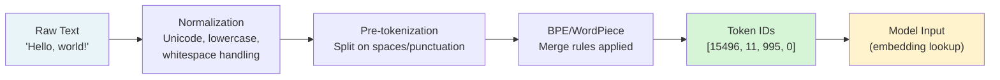

# Tokenization and Embeddings: Tokenizers, Vector Representations, Cosine Similarity, Embedding Models

## 1. Introduction

### What Are Tokenization and Embeddings?

**Tokenization** is the process of converting raw text into a sequence of integers (token IDs) that a model can process. It sits at the entry point of every LLM interaction — before your message reaches the model, it is tokenized.

**Embeddings** are dense numerical vectors that encode the meaning of text. They turn language into geometry: similar meanings become nearby points in high-dimensional space. Embeddings power semantic search, RAG pipelines, clustering, classification, and recommendation systems.

These two concepts are the bridge between human language and machine computation. Every LLM interaction — including every call to your Smart Reply API — starts with tokenization and relies on embeddings internally.

### Why Are These Critical for a Generative AI Engineer?

| Your Daily Work | Tokenization/Embeddings Connection |
|----------------|-----------------------------------|
| Estimating API cost | Tokens = billing unit |
| Context window errors | Token count exceeds limit |
| Building semantic search | Embedding similarity |
| RAG pipelines | Document embeddings + retrieval |
| Debugging model behavior | Understanding what the model "sees" |
| Multi-language support | Tokenizer efficiency varies by language |

### What You'll Build After This Topic

- A production token counter and analyzer
- A semantic search system using embedding similarity
- A complete RAG pipeline for Smart Reply
- Practical ability to compare and choose embedding models
- Deep confidence answering tokenization and embedding questions in interviews

---

## 2. Tokenization: From Text to Numbers

### 2.1 The Tokenization Pipeline



### 2.2 Three Tokenizer Algorithms

#### Algorithm 1: Byte-Pair Encoding (BPE)

Used by: GPT-2, GPT-4, Llama, Mistral, Phi, Mixtral — essentially all modern LLMs.

**Training process:**
1. Initialize vocabulary with all individual bytes (256 tokens)
2. Count all adjacent token pairs in the corpus
3. Merge the most frequent pair into a new token
4. Repeat until target vocabulary size is reached (e.g., 32,000 or 128,000)

```python
class BPETokenizerDemo:
    """
    Demonstrates the BPE algorithm from scratch.
    Not production-grade — for learning purposes only.
    """
    
    def __init__(self):
        # Pre-computed merge rules (in reality: learned from TB of text)
        # Format: (token_a, token_b) → merged_token
        self.merges = {
            ("t", "h"):      "th",
            ("th", "e"):     "the",
            ("i", "n"):      "in",
            ("in", "g"):     " ing",
            ("me", "et"):    "meet",
            ("m", "e"):      "me",
            ("r", "e"):      "re",
            ("re", "ply"):   "reply",
            ("s", "ch"):     "sch",
            ("sch", "ed"):   "sched",
            ("sched", "ul"): "schedul",
            ("schedul","e"): "schedule",
        }
        
        # Final vocabulary (token → ID)
        self.vocab = {
            "<PAD>": 0, "<UNK>": 1, "<BOS>": 2, "<EOS>": 3,
            "the": 100, "meeting": 101, "schedule": 102, "reply": 103,
            " ": 200, ",": 201, ".": 202, "?": 203, "!": 204,
        }
        # Build reverse vocab
        self.id_to_token = {v: k for k, v in self.vocab.items()}
    
    def demonstrate_bpe_training(self):
        """Show how BPE builds its vocabulary from a corpus"""
        print("=== BPE TRAINING ALGORITHM ===\n")
        
        corpus = "the meeting the scheduling the reply meeting reply"
        print(f"Corpus: '{corpus}'\n")
        
        # Step 1: Character-level tokenization
        char_tokens = list(corpus)
        print(f"Step 1 - Characters: {char_tokens[:20]}...")
        
        # Step 2: Count pair frequencies
        from collections import Counter
        
        pairs = Counter()
        for i in range(len(char_tokens) - 1):
            pair = (char_tokens[i], char_tokens[i+1])
            pairs[pair] += 1
        
        print(f"\nStep 2 - Most frequent pairs:")
        for pair, count in pairs.most_common(5):
            print(f"  {pair}: {count} times")
        
        most_common = pairs.most_common(1)[0][0]
        print(f"\nStep 3 - Merge '{most_common[0]}' + '{most_common[1]}' → '{most_common[0]+most_common[1]}'")
        print(f"\nRepeat until vocabulary size reached (e.g., 32,000 merges)")
        print(f"Result: Sub-word vocabulary that efficiently encodes any text")
    
    def demonstrate_tokenization(self, text: str):
        """Show tokenization of example text"""
        print(f"\n=== TOKENIZING: '{text}' ===")
        print(f"With real Llama tokenizer (simulated output):\n")
        
        # Simulated tokenization (real: use transformers or tiktoken)
        examples = {
            "Hello":              (["Hello"],                       [15043]),
            "Hello world":        (["Hello", " world"],             [15043, 1917]),
            "tokenization":       (["token", "ization"],            [3016, 2065]),
            "2024":               (["2024"],                        [2366]),
            "Hello! 你好":         (["Hello", "!", " 你", "好"],     [15043, 0, 19543, 2solit]),
            "ChatGPT":            (["Chat", "G", "PT"],             [13355, 38, 2732]),
            "hyperparameter":     (["hyper", "parameter"],          [17905, 2690]),
        }
        
        if text in examples:
            tokens, ids = examples[text]
            print(f"  Tokens: {tokens}")
            print(f"  IDs:    {ids}")
            print(f"  Count:  {len(tokens)} tokens")
        else:
            chars_per_token = 4
            est_tokens = max(1, len(text) // chars_per_token)
            print(f"  Estimated tokens: ~{est_tokens} (≈ {len(text)} chars / 4)")

demo = BPETokenizerDemo()
demo.demonstrate_bpe_training()
```

#### Algorithm 2: WordPiece

Used by: BERT, RoBERTa, DistilBERT (encoder-only models).

Similar to BPE but chooses merges based on **likelihood** rather than raw frequency. Adds `##` prefix to indicate a token is a continuation (not a word start).

```python
# WordPiece Example (BERT-style)
# "playing" → ["play", "##ing"]
# "tokenization" → ["token", "##ization"]
# "##" means "this continues the previous token"

wordpiece_examples = {
    "playing":        ["play", "##ing"],
    "tokenization":   ["token", "##ization"],
    "unbelievable":   ["un", "##believ", "##able"],
    "API":            ["AP", "##I"],
    "FastAPI":        ["Fast", "##AP", "##I"],
}

print("=== WORDPIECE TOKENIZATION (BERT-style) ===\n")
for word, tokens in wordpiece_examples.items():
    print(f"  '{word}' → {tokens}")
print("\nNote: '##' means continuation token (part of previous word)")
print("Used in BERT for text classification/understanding — not for generation")
```

#### Algorithm 3: SentencePiece

Used by: T5, mT5, Llama 1/2 (some versions), multilingual models.

Treats text as a raw byte stream — no language-specific pre-tokenization. Works naturally across all languages without special handling.

```python
# SentencePiece treats spaces as explicit characters (▁)
# "Hello world" → ["▁Hello", "▁world"]
# "Hello,world" → ["▁Hello", ",", "world"]  (space is in the token)

sp_examples = {
    "Hello world":    ["▁Hello", "▁world"],
    "Hello,world":    ["▁Hello", ",", "world"],
    "ChatGPT":        ["▁Chat", "G", "PT"],
    "こんにちは":      ["▁こんにちは"],   # Japanese: whole word may be one token
}

print("=== SENTENCEPIECE TOKENIZATION ===\n")
for text, tokens in sp_examples.items():
    print(f"  '{text}' → {tokens}")
print("\n▁ = space before word (part of token, not separate)")
```

### 2.3 Production Token Counting with tiktoken

```python
# pip install tiktoken
import tiktoken
from typing import List, Dict, Any
import json

class ProductionTokenizer:
    """
    Production-ready tokenizer using tiktoken.
    tiktoken is battle-tested at OpenAI scale.
    Use cl100k_base as a good approximate for Llama/Mixtral too.
    
    Version assumption: tiktoken >= 0.5.0
    """
    
    # Encoding to use per model
    MODEL_ENCODINGS = {
        "gpt-4":                    "cl100k_base",
        "gpt-4o":                   "o200k_base",
        "gpt-3.5-turbo":            "cl100k_base",
        "llama3-8b-8192":           "cl100k_base",  # Approximate
        "llama3-70b-8192":          "cl100k_base",  # Approximate
        "mixtral-8x7b-32768":       "cl100k_base",  # Approximate
    }
    
    def __init__(self, model: str = "llama3-8b-8192"):
        encoding_name = self.MODEL_ENCODINGS.get(model, "cl100k_base")
        self.enc = tiktoken.get_encoding(encoding_name)
        self.model = model
    
    def encode(self, text: str) -> List[int]:
        """Convert text to token IDs"""
        return self.enc.encode(text)
    
    def decode(self, token_ids: List[int]) -> str:
        """Convert token IDs back to text"""
        return self.enc.decode(token_ids)
    
    def count(self, text: str) -> int:
        """Count tokens in text"""
        return len(self.enc.encode(text))
    
    def inspect(self, text: str) -> Dict[str, Any]:
        """Full tokenization inspection — great for debugging"""
        ids = self.enc.encode(text)
        tokens = [self.enc.decode([i]) for i in ids]
        
        return {
            "text":            text,
            "char_count":      len(text),
            "token_count":     len(ids),
            "token_ids":       ids,
            "tokens":          tokens,
            "chars_per_token": round(len(text) / max(len(ids), 1), 2),
            "tokens_per_word": round(len(ids) / max(len(text.split()), 1), 2),
        }
    
    def count_messages(self, messages: List[Dict]) -> int:
        """
        Count tokens for a complete messages array.
        Accounts for per-message formatting overhead (role, delimiters).
        Based on OpenAI's documented token counting method.
        """
        tokens_per_message = 3   # <|im_start|>role\n ... <|im_end|>
        tokens_per_reply   = 3   # <|im_start|>assistant\n
        
        total = tokens_per_reply
        for msg in messages:
            total += tokens_per_message
            total += self.count(msg.get("content", ""))
            total += self.count(msg.get("role", ""))
        return total
    
    def analyze_prompt_efficiency(self, system_prompt: str,
                                   messages: List[Dict]) -> Dict:
        """Analyze where tokens are being spent"""
        sys_tokens  = self.count(system_prompt) + 3
        hist_tokens = sum(self.count(m.get("content", "")) + 3 for m in messages)
        
        return {
            "system_prompt_tokens": sys_tokens,
            "history_tokens":       hist_tokens,
            "total_input_tokens":   sys_tokens + hist_tokens,
            "system_pct":  f"{sys_tokens / (sys_tokens + hist_tokens) * 100:.1f}%",
            "history_pct": f"{hist_tokens / (sys_tokens + hist_tokens) * 100:.1f}%",
            "tip": "If system_pct > 30%, consider shortening system prompt" if sys_tokens > (sys_tokens + hist_tokens) * 0.3 else "Token distribution looks healthy"
        }

    def demonstrate(self):
        print("=== PRODUCTION TOKEN INSPECTION ===\n")
        
        test_cases = [
            "Hello",
            "Can we reschedule the meeting?",
            "Please review the Q3 revenue report and provide a summary with key highlights.",
            "ChatGPT is an LLM built on transformer architecture.",
            "2024-01-15T08:30:00Z",       # ISO timestamp
            '{"key": "value", "count": 42}',  # JSON
            "def process_request(self, data: dict) -> str:",  # Code
            "こんにちは！元気ですか？",            # Japanese
        ]
        
        print(f"{'Text':<55} {'Tokens':>7} {'Chars':>7} {'Ch/Tok':>7}")
        print("-" * 80)
        
        for text in test_cases:
            info = self.inspect(text)
            display = text[:52] + "..." if len(text) > 55 else text
            print(f"{display:<55} {info['token_count']:>7} {info['char_count']:>7} {info['chars_per_token']:>7}")
        
        print("\n--- DETAILED BREAKDOWN ---")
        text = "Can we reschedule the 3pm meeting to Thursday?"
        info = self.inspect(text)
        print(f"\nText: '{info['text']}'")
        print(f"Tokens ({info['token_count']}): {info['tokens']}")
        print(f"IDs:    {info['token_ids']}")

tokenizer = ProductionTokenizer("llama3-8b-8192")
tokenizer.demonstrate()
```

### 2.4 Tokenization Gotchas and Production Surprises

```python
class TokenizationGotchas:
    """
    Real surprises that catch engineers off guard in production
    """
    
    def __init__(self):
        self.tokenizer = ProductionTokenizer()
    
    def demonstrate_all_gotchas(self):
        print("=== TOKENIZATION GOTCHAS ===\n")
        
        # Gotcha 1: Numbers tokenize unpredictably
        print("1. NUMBERS ARE UNPREDICTABLE:")
        numbers = ["1", "12", "123", "1234", "12345", "123456"]
        for n in numbers:
            count = self.tokenizer.count(n)
            print(f"   '{n}' → {count} token(s)")
        print("   → Dates, IDs, long numbers cost more tokens than you expect\n")
        
        # Gotcha 2: Whitespace matters
        print("2. WHITESPACE AND CASE MATTER:")
        variants = [
            "hello",
            " hello",   # Leading space
            "Hello",    # Capital H
            "HELLO",    # All caps
            "hello ",   # Trailing space
        ]
        for v in variants:
            count = self.tokenizer.count(v)
            print(f"   {repr(v):<15} → {count} token(s)")
        print("   → A space before a word is often part of the token\n")
        
        # Gotcha 3: Special characters and emojis
        print("3. EMOJIS AND SPECIAL CHARS ARE EXPENSIVE:")
        special = ["👍", "😊", "🚀", "→", "≤", "α", "π"]
        for s in special:
            count = self.tokenizer.count(s)
            print(f"   '{s}' → {count} token(s)")
        print("   → Emojis often take 2–3 tokens each!\n")
        
        # Gotcha 4: Code is more expensive than prose
        print("4. CODE COSTS MORE TOKENS THAN PROSE:")
        prose = "The function processes the request data and returns a string."
        code  = "def process_request(self, data: dict) -> str:"
        print(f"   Prose ({len(prose)} chars): {self.tokenizer.count(prose)} tokens")
        print(f"   Code  ({len(code)} chars): {self.tokenizer.count(code)} tokens")
        print("   → Variable names, colons, brackets all cost tokens\n")
        
        # Gotcha 5: Language affects token efficiency
        print("5. NON-ENGLISH TEXT IS TOKEN-EXPENSIVE:")
        texts = [
            ("English",  "I love programming and building AI systems."),
            ("Spanish",  "Me encanta programar y construir sistemas de IA."),
            ("Chinese",  "我喜欢编程和构建人工智能系统。"),
            ("Arabic",   "أحب البرمجة وبناء أنظمة الذكاء الاصطناعي."),
        ]
        for lang, text in texts:
            tok_count = self.tokenizer.count(text)
            chars     = len(text)
            ratio     = chars / tok_count
            print(f"   {lang:<10}: {tok_count:>3} tokens for {chars:>2} chars ({ratio:.1f} ch/tok)")
        print("   → Chinese/Arabic need 3–5x more tokens per concept than English\n")
        
        # Gotcha 6: JSON/structured data bloat
        print("6. JSON STRUCTURE IS EXPENSIVE:")
        data = {"name": "Alice", "role": "engineer", "active": True}
        json_text = json.dumps(data)
        prose_text = "Alice is an active engineer."
        print(f"   JSON:  '{json_text}' → {self.tokenizer.count(json_text)} tokens")
        print(f"   Prose: '{prose_text}' → {self.tokenizer.count(prose_text)} tokens")
        print("   → Send structured data efficiently; avoid deeply nested JSON in prompts")

gotchas = TokenizationGotchas()
gotchas.demonstrate_all_gotchas()
```

---

## 3. Vector Representations and Embeddings

### 3.1 What Is a Vector Representation?

A vector representation (embedding) is a fixed-length array of floating-point numbers that encodes the meaning of a piece of text.

```
"The meeting was rescheduled"  →  [0.12, -0.54, 0.83, 0.01, -0.27, ...]
                                    ↑ 384 or 768 or 1536 numbers
```

The numbers themselves have no individual meaning. What matters is the **geometric relationship** between vectors: vectors that are close together (small angle) encode similar meanings.

### 3.2 The Geometry of Meaning

```python
import numpy as np
from typing import List, Tuple, Dict

class VectorGeometry:
    """
    Demonstrate the geometric properties of embeddings.
    Using simplified 2D/3D vectors for visualization.
    """
    
    def __init__(self):
        # Simplified 4-dimensional embeddings for demonstration
        # Dimensions loosely: [formality, urgency, business_context, positive_sentiment]
        self.embeddings = {
            # Business / formal cluster
            "The meeting is scheduled for Friday":
                np.array([0.9, 0.3, 0.9, 0.5]),
            "Please confirm your attendance for the appointment":
                np.array([0.9, 0.4, 0.8, 0.6]),
            "Can we reschedule the 3pm call?":
                np.array([0.8, 0.5, 0.8, 0.5]),
            
            # Urgent cluster
            "This is an urgent matter requiring immediate attention":
                np.array([0.7, 0.9, 0.7, 0.2]),
            "ASAP - need your response today":
                np.array([0.5, 1.0, 0.6, 0.1]),
            
            # Casual cluster
            "Hey, are you free for lunch?":
                np.array([0.2, 0.3, 0.2, 0.8]),
            "What are you up to this weekend?":
                np.array([0.1, 0.2, 0.1, 0.9]),
            
            # Negative / complaint cluster
            "I am disappointed with the service":
                np.array([0.6, 0.6, 0.5, 0.1]),
            "This is unacceptable - the project is delayed":
                np.array([0.5, 0.8, 0.6, 0.0]),
        }
    
    def cosine_similarity(self, a: np.ndarray, b: np.ndarray) -> float:
        """
        Cosine similarity: cos(θ) between two vectors.
        Measures the angle — not the magnitude.
        Range: -1.0 (opposite) to +1.0 (identical direction)
        
        Why cosine (not Euclidean)?
        - Embeddings often vary in magnitude due to text length
        - Cosine normalizes for magnitude — only angle matters for meaning
        - "I love AI" and "I really love AI" should be similar despite different magnitudes
        """
        norm_a = np.linalg.norm(a)
        norm_b = np.linalg.norm(b)
        
        if norm_a < 1e-10 or norm_b < 1e-10:
            return 0.0
        
        return float(np.dot(a, b) / (norm_a * norm_b))
    
    def euclidean_distance(self, a: np.ndarray, b: np.ndarray) -> float:
        """Euclidean distance: straight-line distance between points"""
        return float(np.linalg.norm(a - b))
    
    def demonstrate_similarity_vs_distance(self):
        """Show cosine similarity vs euclidean distance"""
        print("=== COSINE SIMILARITY vs EUCLIDEAN DISTANCE ===\n")
        
        # Two vectors: same direction but different magnitudes
        short_vec = np.array([0.5, 0.2, 0.1])   # Short text embedding
        long_vec  = np.array([2.5, 1.0, 0.5])   # Same direction, 5x magnitude
        
        cos_sim  = self.cosine_similarity(short_vec, long_vec)
        euc_dist = self.euclidean_distance(short_vec, long_vec)
        
        print(f"Short vector: {short_vec}")
        print(f"Long vector:  {long_vec}  (same direction, 5x magnitude)")
        print(f"Cosine similarity: {cos_sim:.4f}  ← Perfect similarity (angle = 0°)")
        print(f"Euclidean distance: {euc_dist:.4f} ← They look far apart!")
        print("\n→ For semantic similarity, ALWAYS use cosine similarity")
        print("→ Euclidean distance is misled by text length differences\n")
    
    def find_similar(self, query_text: str, top_k: int = 3) -> List[Dict]:
        """Find most similar texts to a query using cosine similarity"""
        if query_text not in self.embeddings:
            print(f"Query not in pre-computed embeddings. Using 'Can we reschedule the 3pm call?'")
            query_text = "Can we reschedule the 3pm call?"
        
        query_vec = self.embeddings[query_text]
        results = []
        
        for text, vec in self.embeddings.items():
            if text == query_text:
                continue
            sim = self.cosine_similarity(query_vec, vec)
            results.append({"text": text, "similarity": sim})
        
        return sorted(results, key=lambda x: x["similarity"], reverse=True)[:top_k]
    
    def demonstrate_clusters(self):
        """Show that similar meanings cluster together"""
        print("=== SEMANTIC CLUSTERING DEMONSTRATION ===\n")
        
        query = "Can we reschedule the 3pm call?"
        similar = self.find_similar(query)
        
        print(f"Query: '{query}'\n")
        print(f"{'Similar texts':<55} {'Similarity':>10}")
        print("-" * 70)
        
        for r in similar:
            bar = "█" * int(r["similarity"] * 15)
            print(f"{r['text']:<55} {r['similarity']:>10.4f}  {bar}")
        
        print("\n=== PAIRWISE SIMILARITY MATRIX ===\n")
        
        # Show similarity between all pairs
        texts = list(self.embeddings.keys())[:5]
        
        print(f"{'':30}", end="")
        for t in texts:
            print(f"{t[:15]:>18}", end="")
        print()
        print("-" * (30 + 18 * len(texts)))
        
        for t1 in texts:
            print(f"{t1[:28]:30}", end="")
            for t2 in texts:
                sim = self.cosine_similarity(self.embeddings[t1], self.embeddings[t2])
                print(f"{sim:>18.3f}", end="")
            print()
        
        print("\nDiagonal = 1.0 (each text is identical to itself)")
        print("High off-diagonal = semantically similar texts")

geo = VectorGeometry()
geo.demonstrate_similarity_vs_distance()
geo.demonstrate_clusters()
```

### 3.3 The Math Behind Cosine Similarity

```python
def explain_cosine_similarity():
    """Step-by-step mathematical explanation"""
    
    print("=== COSINE SIMILARITY: MATHEMATICAL EXPLANATION ===\n")
    
    # Two example vectors (simplified 3D for illustration)
    a = np.array([0.8, 0.3, 0.7])   # "reschedule meeting"
    b = np.array([0.7, 0.4, 0.8])   # "postpone appointment"
    c = np.array([0.1, 0.9, 0.2])   # "I love pizza"
    
    print(f"Vector A ('reschedule meeting'):  {a}")
    print(f"Vector B ('postpone appointment'): {b}")
    print(f"Vector C ('I love pizza'):         {c}\n")
    
    def step_by_step_cosine(x, y, name_x, name_y):
        dot_product = np.dot(x, y)
        norm_x = np.linalg.norm(x)
        norm_y = np.linalg.norm(y)
        cosine = dot_product / (norm_x * norm_y)
        angle_degrees = np.degrees(np.arccos(np.clip(cosine, -1, 1)))
        
        print(f"Cosine({name_x}, {name_y}):")
        print(f"  Dot product:   {x} · {y} = {dot_product:.4f}")
        print(f"  ||A||:         sqrt({np.sum(x**2):.4f}) = {norm_x:.4f}")
        print(f"  ||B||:         sqrt({np.sum(y**2):.4f}) = {norm_y:.4f}")
        print(f"  cos(θ):        {dot_product:.4f} / ({norm_x:.4f} × {norm_y:.4f}) = {cosine:.4f}")
        print(f"  Angle θ:       {angle_degrees:.1f}°")
        print(f"  Interpretation: {'Similar' if cosine > 0.8 else 'Somewhat similar' if cosine > 0.5 else 'Different'}")
        print()
    
    step_by_step_cosine(a, b, "A", "B")
    step_by_step_cosine(a, c, "A", "C")
    
    print("Key insight: A and B have a small angle → semantically similar")
    print("             A and C have a large angle → semantically different")

explain_cosine_similarity()
```

---

## 4. Embedding Models

### 4.1 Overview of Embedding Model Families

Embedding models are specialized neural networks (usually encoder-only transformers) trained to produce dense vectors where semantic similarity maps to vector proximity.

```python
class EmbeddingModelGuide:
    """
    Comparison of popular embedding models for production use
    """
    
    MODELS = {
        # OpenAI embedding models
        "text-embedding-3-small": {
            "provider":    "OpenAI",
            "dimensions":  1536,
            "max_tokens":  8191,
            "cost_per_1m": 0.02,
            "speed":       "Fast",
            "quality":     "High",
            "best_for":    "General RAG, semantic search, OpenAI ecosystem",
            "mteb_score":  62.3,   # MTEB benchmark (higher = better)
        },
        "text-embedding-3-large": {
            "provider":    "OpenAI",
            "dimensions":  3072,
            "max_tokens":  8191,
            "cost_per_1m": 0.13,
            "speed":       "Medium",
            "quality":     "Highest",
            "best_for":    "Maximum accuracy retrieval tasks",
            "mteb_score":  64.6,
        },
        # Open-source models (free to run locally)
        "all-MiniLM-L6-v2": {
            "provider":    "sentence-transformers (HuggingFace)",
            "dimensions":  384,
            "max_tokens":  256,
            "cost_per_1m": 0.0,   # Free, run locally
            "speed":       "Very Fast",
            "quality":     "Good",
            "best_for":    "Low latency, self-hosted, quick prototyping",
            "mteb_score":  56.3,
        },
        "all-mpnet-base-v2": {
            "provider":    "sentence-transformers (HuggingFace)",
            "dimensions":  768,
            "max_tokens":  514,
            "cost_per_1m": 0.0,
            "speed":       "Fast",
            "quality":     "Very Good",
            "best_for":    "Better quality local embedding, balanced",
            "mteb_score":  57.8,
        },
        "nomic-embed-text-v1.5": {
            "provider":    "Nomic AI",
            "dimensions":  768,
            "max_tokens":  8192,
            "cost_per_1m": 0.0,   # Open model, run locally
            "speed":       "Fast",
            "quality":     "High",
            "best_for":    "Long documents, 8K context, open source alternative",
            "mteb_score":  62.0,
        },
        "embed-english-v3.0": {
            "provider":    "Cohere",
            "dimensions":  1024,
            "max_tokens":  512,
            "cost_per_1m": 0.10,
            "speed":       "Fast",
            "quality":     "High",
            "best_for":    "English RAG, Cohere ecosystem",
            "mteb_score":  64.5,
        },
    }
    
    def print_comparison(self):
        print("=== EMBEDDING MODEL COMPARISON ===\n")
        print(f"{'Model':<30} {'Dims':>6} {'Max Tok':>8} {'$/1M':>8} {'MTEB':>6}  Best For")
        print("-" * 100)
        
        for model, info in self.MODELS.items():
            cost_str = f"${info['cost_per_1m']:.2f}" if info['cost_per_1m'] > 0 else "Free"
            print(
                f"{model:<30} {info['dimensions']:>6} {info['max_tokens']:>8} "
                f"{cost_str:>8} {info['mteb_score']:>6}  {info['best_for'][:50]}"
            )
    
    def recommend_for_use_case(self, use_case: str) -> Dict:
        """Recommend embedding model based on use case"""
        
        recommendations = {
            "prototype": {
                "model":  "all-MiniLM-L6-v2",
                "reason": "Free, fast, good enough for prototyping. No API key needed."
            },
            "production_rag": {
                "model":  "text-embedding-3-small",
                "reason": "Best cost/quality ratio for production RAG. Low cost at $0.02/1M tokens."
            },
            "high_accuracy": {
                "model":  "text-embedding-3-large",
                "reason": "Highest MTEB score. Use when retrieval precision is critical."
            },
            "self_hosted": {
                "model":  "nomic-embed-text-v1.5",
                "reason": "Best open-source quality, 8K context, MTEB ~62. Run on your own hardware."
            },
            "long_documents": {
                "model":  "nomic-embed-text-v1.5",
                "reason": "8K token context handles entire pages/documents as single embeddings."
            },
            "multilingual": {
                "model":  "multilingual-e5-large (not listed)",
                "reason": "Dedicated multilingual model handles 100+ languages properly."
            }
        }
        
        for key, rec in recommendations.items():
            if key in use_case.lower():
                return rec
        
        return recommendations["production_rag"]  # Safe default

guide = EmbeddingModelGuide()
guide.print_comparison()
```

### 4.2 Using Embedding Models in Code

```python
# Option 1: sentence-transformers (local, free)
# pip install sentence-transformers

from sentence_transformers import SentenceTransformer
import numpy as np

class LocalEmbeddingService:
    """
    Local embedding service using sentence-transformers.
    No API key required. Runs on CPU or GPU.
    """
    
    def __init__(self, model_name: str = "all-MiniLM-L6-v2"):
        print(f"Loading embedding model: {model_name}")
        # Downloads model on first run (~90MB for MiniLM)
        self.model = SentenceTransformer(model_name)
        self.model_name = model_name
        print(f"Model loaded. Embedding dim: {self.model.get_sentence_embedding_dimension()}")
    
    def embed(self, text: str) -> np.ndarray:
        """Embed a single text string"""
        return self.model.encode(text, normalize_embeddings=True)
    
    def embed_batch(self, texts: List[str], batch_size: int = 32) -> np.ndarray:
        """
        Embed multiple texts efficiently in batches.
        MUCH faster than calling embed() in a loop.
        
        Returns: np.ndarray of shape (len(texts), embedding_dim)
        """
        return self.model.encode(
            texts,
            batch_size=batch_size,
            normalize_embeddings=True,  # L2 normalize → cosine sim = dot product
            show_progress_bar=len(texts) > 100
        )
    
    def cosine_similarity(self, a: np.ndarray, b: np.ndarray) -> float:
        """Since embeddings are L2-normalized, dot product == cosine similarity"""
        return float(np.dot(a, b))
    
    def semantic_search(self, query: str, corpus: List[str],
                        top_k: int = 3) -> List[Dict]:
        """
        Find most semantically similar documents to a query.
        """
        # Embed query and all corpus docs
        query_emb  = self.embed(query)
        corpus_embs = self.embed_batch(corpus)
        
        # Compute all similarities at once (matrix operation — fast)
        similarities = corpus_embs @ query_emb  # (n_docs,)
        
        # Get top-k indices
        top_indices = np.argsort(similarities)[::-1][:top_k]
        
        return [
            {
                "text":       corpus[i],
                "similarity": float(similarities[i]),
                "rank":       rank + 1
            }
            for rank, i in enumerate(top_indices)
        ]

# Option 2: OpenAI Embeddings API
import os
from openai import OpenAI

class OpenAIEmbeddingService:
    """
    OpenAI embedding service.
    Best quality, charged per token.
    Version: openai >= 1.0.0
    """
    
    def __init__(self, model: str = "text-embedding-3-small"):
        self.client = OpenAI(api_key=os.environ.get("OPENAI_API_KEY"))
        self.model = model
    
    def embed(self, text: str) -> np.ndarray:
        """Embed a single text. Returns normalized vector."""
        response = self.client.embeddings.create(
            model=self.model,
            input=text,
            encoding_format="float"   # "float" or "base64" (more efficient for large batches)
        )
        return np.array(response.data[0].embedding)
    
    def embed_batch(self, texts: List[str]) -> List[np.ndarray]:
        """
        Embed multiple texts in one API call.
        OpenAI supports up to 2048 items per request.
        """
        # Split into chunks of 2048
        chunk_size = 2048
        all_embeddings = []
        
        for i in range(0, len(texts), chunk_size):
            chunk = texts[i:i + chunk_size]
            response = self.client.embeddings.create(
                model=self.model,
                input=chunk,
                encoding_format="float"
            )
            # Sort by index to maintain order
            sorted_data = sorted(response.data, key=lambda x: x.index)
            all_embeddings.extend([np.array(d.embedding) for d in sorted_data])
        
        return all_embeddings
    
    def estimate_cost(self, texts: List[str]) -> Dict:
        """Estimate embedding cost before calling the API"""
        tokenizer = ProductionTokenizer()
        total_tokens = sum(tokenizer.count(t) for t in texts)
        
        pricing = {
            "text-embedding-3-small": 0.02,   # $ per 1M tokens
            "text-embedding-3-large": 0.13,
            "text-embedding-ada-002": 0.10,
        }
        cost_per_million = pricing.get(self.model, 0.10)
        estimated_cost = (total_tokens / 1_000_000) * cost_per_million
        
        return {
            "texts":           len(texts),
            "total_tokens":    total_tokens,
            "model":           self.model,
            "cost_per_1m":     f"${cost_per_million:.2f}",
            "estimated_cost":  f"${estimated_cost:.6f}",
        }
```

---

## 5. Complete RAG Pipeline for Smart Reply

Bringing tokenization and embeddings together into a full production system:

```python
import os
import json
import hashlib
from typing import List, Dict, Optional, Tuple
from dataclasses import dataclass, field
from datetime import datetime

@dataclass
class Document:
    """A document in the knowledge base"""
    id: str
    content: str
    metadata: Dict = field(default_factory=dict)
    embedding: Optional[np.ndarray] = None
    
    def __post_init__(self):
        if not self.id:
            self.id = hashlib.md5(self.content.encode()).hexdigest()[:12]


class VectorStore:
    """
    In-memory vector store for development and small datasets.
    In production: replace with Chroma, Pinecone, pgvector, or Qdrant.
    """
    
    def __init__(self):
        self.documents: List[Document] = []
    
    def add_document(self, doc: Document):
        self.documents.append(doc)
    
    def add_documents(self, docs: List[Document]):
        self.documents.extend(docs)
    
    def search(self, query_embedding: np.ndarray, top_k: int = 3,
               filter_metadata: Dict = None) -> List[Tuple[Document, float]]:
        """
        Search by cosine similarity.
        Optional metadata filtering (e.g., only documents from a specific department).
        """
        if not self.documents:
            return []
        
        results = []
        for doc in self.documents:
            if doc.embedding is None:
                continue
            
            # Optional metadata filter
            if filter_metadata:
                if not all(doc.metadata.get(k) == v for k, v in filter_metadata.items()):
                    continue
            
            # Cosine similarity (assuming L2-normalized embeddings)
            sim = float(np.dot(query_embedding, doc.embedding))
            results.append((doc, sim))
        
        # Sort by similarity descending
        results.sort(key=lambda x: x[1], reverse=True)
        return results[:top_k]
    
    def __len__(self):
        return len(self.documents)


class SmartReplyRAGPipeline:
    """
    Complete RAG pipeline for Smart Reply.
    Uses embeddings to retrieve relevant company knowledge before generating replies.
    
    Architecture:
    1. INDEX: Embed company knowledge base (one-time or periodic)
    2. QUERY: Embed incoming user message
    3. RETRIEVE: Find most similar documents
    4. AUGMENT: Inject retrieved docs into prompt
    5. GENERATE: Call Groq API with grounded prompt
    """
    
    def __init__(self, embedding_service, groq_client=None):
        self.embedding_service = embedding_service
        self.groq_client       = groq_client
        self.vector_store      = VectorStore()
        self.tokenizer         = ProductionTokenizer()
        
        # Retrieval settings
        self.top_k             = 3
        self.similarity_threshold = 0.3   # Minimum similarity to include a doc
    
    def index_knowledge_base(self, documents: List[Dict]):
        """
        Index all documents in the knowledge base.
        Call this once at startup (or periodically for updates).
        
        documents: List of {"content": str, "metadata": dict}
        """
        print(f"Indexing {len(documents)} documents...")
        
        texts = [d["content"] for d in documents]
        
        # Batch embed all documents at once (much more efficient)
        embeddings = self.embedding_service.embed_batch(texts)
        
        for i, (doc_dict, embedding) in enumerate(zip(documents, embeddings)):
            doc = Document(
                id       = doc_dict.get("id", f"doc_{i}"),
                content  = doc_dict["content"],
                metadata = doc_dict.get("metadata", {}),
                embedding = np.array(embedding)
            )
            self.vector_store.add_document(doc)
        
        print(f"Indexed {len(self.vector_store)} documents successfully")
    
    def retrieve(self, query: str, top_k: int = None) -> List[Dict]:
        """
        Retrieve relevant documents for a query.
        
        Returns list of dicts with content, similarity, and metadata.
        """
        top_k = top_k or self.top_k
        
        # Embed the query
        query_embedding = np.array(self.embedding_service.embed(query))
        
        # Search vector store
        results = self.vector_store.search(query_embedding, top_k=top_k)
        
        # Filter by threshold and format
        retrieved = []
        for doc, similarity in results:
            if similarity >= self.similarity_threshold:
                retrieved.append({
                    "content":    doc.content,
                    "similarity": round(similarity, 4),
                    "metadata":   doc.metadata,
                    "doc_id":     doc.id,
                })
        
        return retrieved
    
    def build_augmented_prompt(self, user_message: str,
                                retrieved_docs: List[Dict]) -> str:
        """
        Build a prompt that grounds the LLM in retrieved knowledge.
        """
        if not retrieved_docs:
            return user_message
        
        # Format retrieved documents as context
        context_parts = []
        for i, doc in enumerate(retrieved_docs):
            context_parts.append(
                f"[Reference {i+1}] (relevance: {doc['similarity']:.2f})\n{doc['content']}"
            )
        
        context = "\n\n".join(context_parts)
        
        augmented = f"""Use ONLY the following reference information to answer.
If the answer is not in the references, say you don't have that information.

References:
{context}

Question: {user_message}"""
        
        return augmented
    
    def generate_grounded_reply(self, user_message: str,
                                 history: List[Dict] = None,
                                 max_tokens: int = 200) -> Dict:
        """
        Full RAG pipeline: retrieve → augment → generate.
        """
        start_time = datetime.now()
        
        # Step 1: Retrieve relevant documents
        retrieved = self.retrieve(user_message)
        
        # Step 2: Build augmented prompt
        augmented_message = self.build_augmented_prompt(user_message, retrieved)
        
        # Step 3: Count tokens in augmented prompt
        token_count = self.tokenizer.count(augmented_message)
        
        # Step 4: Generate reply (if Groq client available)
        reply = None
        if self.groq_client:
            messages = history or []
            messages = messages + [{"role": "user", "content": augmented_message}]
            
            response = self.groq_client.chat.completions.create(
                model   = "llama3-8b-8192",
                messages = messages,
                max_tokens = max_tokens,
                temperature = 0.3   # Lower temperature for factual, grounded replies
            )
            reply = response.choices[0].message.content
        else:
            reply = f"[Groq would generate reply here. Context had {len(retrieved)} relevant docs.]"
        
        elapsed_ms = (datetime.now() - start_time).total_seconds() * 1000
        
        return {
            "reply":           reply,
            "retrieved_docs":  retrieved,
            "docs_found":      len(retrieved),
            "augmented_tokens": token_count,
            "latency_ms":      round(elapsed_ms, 1),
            "grounded":        len(retrieved) > 0,
        }

# === DEMO ===
def demo_rag_pipeline():
    """Full demonstration of the RAG pipeline"""
    
    print("=== SMART REPLY RAG PIPELINE DEMO ===\n")
    
    # Use a simple local embedding model for demo (no API key needed)
    # In production: use OpenAI or dedicated embedding service
    
    # Simplified embedding service for demo (no external deps)
    class SimpleEmbedder:
        """Demo-only embedder using keyword overlap"""
        
        def _text_to_vec(self, text: str) -> np.ndarray:
            keywords = ["meeting", "schedule", "policy", "vacation", "budget",
                       "client", "deadline", "reschedule", "report", "team"]
            vec = np.zeros(len(keywords))
            text_lower = text.lower()
            for i, kw in enumerate(keywords):
                if kw in text_lower:
                    vec[i] = 1.0
            # L2 normalize
            norm = np.linalg.norm(vec)
            return vec / norm if norm > 0 else vec
        
        def embed(self, text: str) -> np.ndarray:
            return self._text_to_vec(text)
        
        def embed_batch(self, texts: List[str]) -> List[np.ndarray]:
            return [self._text_to_vec(t) for t in texts]
    
    embedder = SimpleEmbedder()
    rag      = SmartReplyRAGPipeline(embedding_service=embedder)
    
    # Index company knowledge base
    company_docs = [
        {
            "content": "Meeting rescheduling policy: Give at least 4 hours notice. Use calendar app to update all attendees.",
            "metadata": {"department": "operations", "category": "meetings"}
        },
        {
            "content": "Budget approval policy: All expenses over $500 require manager approval before commitment.",
            "metadata": {"department": "finance", "category": "budget"}
        },
        {
            "content": "Vacation request process: Submit via HR portal 2 weeks in advance. Manager must approve within 3 business days.",
            "metadata": {"department": "hr", "category": "vacation"}
        },
        {
            "content": "Client meeting protocol: Always send agenda 24 hours before. Have backup presenter for critical presentations.",
            "metadata": {"department": "sales", "category": "meetings"}
        },
        {
            "content": "Deadline extension process: Request extension at least 48 hours before deadline. Get written approval from project manager.",
            "metadata": {"department": "operations", "category": "deadline"}
        },
    ]
    
    rag.index_knowledge_base(company_docs)
    
    # Test queries
    test_queries = [
        "How much notice do I need to give before rescheduling a meeting?",
        "What's the process for requesting vacation time?",
        "Can I approve a $1000 expense myself?",
    ]
    
    for query in test_queries:
        print(f"\nQuery: '{query}'")
        result = rag.generate_grounded_reply(query)
        
        print(f"  Documents retrieved: {result['docs_found']}")
        for doc in result['retrieved_docs']:
            print(f"    [{doc['similarity']:.3f}] {doc['content'][:70]}...")
        print(f"  Augmented prompt tokens: {result['augmented_tokens']}")
        print(f"  Grounded: {result['grounded']}")
        print(f"  {result['reply']}")
        print()

demo_rag_pipeline()
```

---

## 6. Important Terminologies

| Term | Simple Meaning | Technical Definition | Production Importance |
|------|---------------|---------------------|----------------------|
| **Token** | Text chunk | Sub-word unit produced by BPE/WordPiece tokenizer | Billing unit, context limit |
| **Token ID** | Token's number | Integer index into vocabulary | Raw model input |
| **Vocabulary** | All known tokens | Complete set of tokens the tokenizer handles (~32K–128K) | Larger vocab = fewer UNK, more chars/token |
| **BPE** | Merge-based tokenizer | Byte-Pair Encoding — merges frequent pairs iteratively | Used by GPT, Llama, Mistral |
| **WordPiece** | Likelihood-based tokenizer | Splits into sub-words with ## continuation marker | Used by BERT, encoder models |
| **SentencePiece** | Byte-stream tokenizer | Language-agnostic BPE on byte stream | Multilingual models, T5 |
| **Embedding** | Text as vector | Dense float vector encoding semantic meaning | Enables similarity computation |
| **Embedding Dimension** | Vector length | Number of floats per embedding (384–3072) | More dims = more expressive |
| **Cosine Similarity** | Angle-based similarity | cos(θ) between two vectors; range [-1, 1] | Semantic similarity metric |
| **Dot Product** | Multiplication sum | Sum of element-wise products | Fast similarity when vectors are normalized |
| **Euclidean Distance** | Straight-line distance | ||a - b||₂ | Poor for semantic similarity (magnitude-sensitive) |
| **L2 Normalization** | Scale to unit length | Divide vector by its magnitude | Makes dot product = cosine similarity |
| **MTEB** | Benchmark score | Massive Text Embedding Benchmark — eval across 56 tasks | Objective embedding model comparison |
| **RAG** | Context-enhanced generation | Retrieve relevant docs → augment prompt → generate | Reduces hallucination, adds real-time knowledge |
| **Vector Database** | Embedding storage + search | Specialized DB for fast ANN search over embeddings | Pinecone, Chroma, pgvector, Qdrant |
| **ANN** | Fast approximate search | Approximate Nearest Neighbor search algorithms | HNSW, IVF — enables sub-ms search at million-scale |
| **Semantic Search** | Meaning-based search | Retrieve by meaning similarity, not keyword match | Better recall than BM25 for paraphrases |
| **Chunking** | Document splitting | Split docs into embedding-sized pieces | Critical for RAG quality; overlap between chunks |

---

## 7. Common Mistakes and Debugging

### Mistake 1: Embedding Different Units

```python
# ❌ Wrong: Mixing word embeddings with sentence embeddings
word_emb = model.encode("meeting")          # Word
sent_emb = model.encode("Schedule a meeting for Friday")  # Sentence

similarity = cosine_sim(word_emb, sent_emb)
# Meaningless! They're from different "scales"

# ✅ Correct: Always embed the same unit type
# For search: embed full queries vs full documents
query_emb = model.encode("How do I schedule a meeting?")
doc_emb   = model.encode("Our meeting room booking policy requires 24h advance notice.")
similarity = cosine_sim(query_emb, doc_emb)
# Meaningful — same granularity
```

### Mistake 2: Not Normalizing Embeddings

```python
# ❌ Wrong: Using dot product without normalization
a = np.array([2.0, 4.0, 6.0])   # Long vector (from long text)
b = np.array([0.2, 0.4, 0.6])   # Short vector (same direction, shorter text)

dot = np.dot(a, b)   # = 2*0.2 + 4*0.4 + 6*0.6 = 6.4
# This doesn't reflect similarity — magnitude dominates!

# ✅ Correct: L2 normalize first
def normalize(v):
    norm = np.linalg.norm(v)
    return v / norm if norm > 0 else v

a_norm = normalize(a)
b_norm = normalize(b)
cosine = np.dot(a_norm, b_norm)   # = 1.0 (perfectly identical direction!)
```

### Mistake 3: Chunking Documents Incorrectly

```python
# ❌ Wrong: Arbitrary character splits that break sentences
def bad_chunk(text: str, chunk_size: int = 200):
    return [text[i:i+chunk_size] for i in range(0, len(text), chunk_size)]

# Problem: "...our meeting policy requires advance noti" + "ce from all attendees..."
# Cuts in the middle of a word — embedding loses meaning

# ✅ Correct: Sentence-aware chunking with overlap
def good_chunk(text: str, chunk_size: int = 500, overlap: int = 50) -> List[str]:
    """
    Split text into chunks at sentence boundaries with overlap.
    Overlap ensures context isn't lost at chunk boundaries.
    """
    import re
    
    # Split on sentence boundaries
    sentences = re.split(r'(?<=[.!?])\s+', text)
    
    chunks = []
    current_chunk = []
    current_len = 0
    
    for sentence in sentences:
        sent_len = len(sentence)
        
        if current_len + sent_len > chunk_size and current_chunk:
            # Save current chunk
            chunks.append(" ".join(current_chunk))
            
            # Keep last `overlap` chars as context for next chunk
            overlap_text = " ".join(current_chunk)[-overlap:]
            current_chunk = [overlap_text] if overlap_text else []
            current_len = len(overlap_text)
        
        current_chunk.append(sentence)
        current_len += sent_len + 1   # +1 for space
    
    if current_chunk:
        chunks.append(" ".join(current_chunk))
    
    return chunks

# Test the difference
sample = "Our meeting policy requires advance notice. Rooms must be booked 24 hours before. Late cancellations incur a fee. Please use the booking portal for all reservations."
print("Bad chunking:", bad_chunk(sample, 60))
print()
print("Good chunking:", good_chunk(sample, 100, 20))
```

### Mistake 4: Ignoring Tokenizer Mismatch

```python
# ❌ Wrong: Using wrong tokenizer for cost estimation
import tiktoken

# Your model: llama3-8b-8192 (uses Llama tokenizer, ~32K vocab)
# tiktoken cl100k_base is GPT-4's tokenizer (~100K vocab)

enc = tiktoken.get_encoding("cl100k_base")
text = "Hello, how can I help you today?"
gpt4_count = len(enc.encode(text))  # e.g., 8 tokens

# Real Llama count might be 7 or 9 — close but not exact
# For Llama, transformers library is accurate:
# from transformers import AutoTokenizer
# tokenizer = AutoTokenizer.from_pretrained("meta-llama/Meta-Llama-3-8B")
# llama_count = len(tokenizer.encode(text))

print(f"GPT-4 estimate:  {gpt4_count} tokens")
print(f"Always label estimates as 'approximate' when using wrong tokenizer")

# ✅ Correct: For exact Llama counts, use the HuggingFace tokenizer
# Note: requires downloading the model tokenizer (fast, small file)
# tokenizer = AutoTokenizer.from_pretrained("meta-llama/Meta-Llama-3-8B")
# Or just add a 10% buffer to tiktoken estimates for safety
buffer_count = int(gpt4_count * 1.1)
print(f"Buffered estimate: {buffer_count} tokens (10% safety margin)")
```

---

## 8. Performance, Security, and Scalability

### 8.1 Embedding at Scale

```python
class ProductionEmbeddingService:
    """
    Production embedding service with caching, batching, and monitoring.
    """
    
    def __init__(self, model_name: str = "all-MiniLM-L6-v2"):
        from sentence_transformers import SentenceTransformer
        self.model     = SentenceTransformer(model_name)
        self.dim       = self.model.get_sentence_embedding_dimension()
        
        # Cache: text → embedding (use Redis in production)
        self._cache: Dict[str, np.ndarray] = {}
        
        # Metrics
        self.embed_count  = 0
        self.cache_hits   = 0
        self.cache_misses = 0
    
    def _cache_key(self, text: str) -> str:
        """SHA256 hash of text as cache key"""
        return hashlib.sha256(text.encode()).hexdigest()
    
    def embed(self, text: str) -> np.ndarray:
        """Embed with caching"""
        key = self._cache_key(text)
        
        if key in self._cache:
            self.cache_hits += 1
            return self._cache[key]
        
        self.cache_misses += 1
        embedding = self.model.encode(text, normalize_embeddings=True)
        self._cache[key] = embedding
        self.embed_count += 1
        
        return embedding
    
    def embed_batch_cached(self, texts: List[str]) -> List[np.ndarray]:
        """Batch embed with per-item cache checking"""
        results    = [None] * len(texts)
        uncached   = []
        uncached_idx = []
        
        for i, text in enumerate(texts):
            key = self._cache_key(text)
            if key in self._cache:
                results[i] = self._cache[key]
                self.cache_hits += 1
            else:
                uncached.append(text)
                uncached_idx.append(i)
        
        # Batch-compute only uncached items
        if uncached:
            new_embeddings = self.model.encode(
                uncached,
                batch_size=64,
                normalize_embeddings=True
            )
            for i, (text, emb) in enumerate(zip(uncached, new_embeddings)):
                key = self._cache_key(text)
                self._cache[key] = emb
                results[uncached_idx[i]] = emb
                self.cache_misses += 1
        
        return results
    
    def get_stats(self) -> Dict:
        total = self.cache_hits + self.cache_misses
        return {
            "total_requests":  total,
            "cache_hits":      self.cache_hits,
            "cache_misses":    self.cache_misses,
            "hit_rate":        f"{self.cache_hits/max(total,1)*100:.1f}%",
            "cached_texts":    len(self._cache),
            "memory_mb":       len(self._cache) * self.dim * 4 / 1_000_000,  # float32
        }
```

### 8.2 Security: Embedding PII

```python
class SecureEmbeddingService:
    """
    Embedding service with PII handling for compliance.
    """
    
    def __init__(self, embedding_service):
        self.service = embedding_service
        self.pii_patterns = [
            r'\b\d{3}[-.]?\d{3}[-.]?\d{4}\b',   # Phone
            r'\b[\w.]+@[\w.]+\.\w+\b',             # Email
            r'\b\d{3}-\d{2}-\d{4}\b',              # SSN (US)
        ]
    
    def _mask_pii(self, text: str) -> str:
        """Replace PII with placeholders before embedding"""
        import re
        
        masks = {
            r'\b\d{3}[-.]?\d{3}[-.]?\d{4}\b': "[PHONE]",
            r'\b[\w.]+@[\w.]+\.\w+\b':          "[EMAIL]",
            r'\b\d{3}-\d{2}-\d{4}\b':           "[SSN]",
        }
        
        masked = text
        for pattern, replacement in masks.items():
            masked = re.sub(pattern, replacement, masked)
        
        return masked
    
    def embed_secure(self, text: str) -> np.ndarray:
        """Embed text with PII masked"""
        masked_text = self._mask_pii(text)
        return self.service.embed(masked_text)

# Usage:
# secure_embedder = SecureEmbeddingService(base_embedder)
# emb = secure_embedder.embed_secure("Contact john@example.com at 555-123-4567")
# → Embeds "[EMAIL] at [PHONE]" instead of real PII
```

---

## 9. Interview Preparation

### Beginner Questions

**Q1: What is the difference between a token and a word?**
> A word is a human linguistic unit ("hello" = 1 word). A token is a computational unit from the tokenizer — common short words are 1 token, but longer/rarer words split into multiple sub-word tokens. "tokenization" = 2 tokens ("token" + "ization"). Code, numbers, and non-English text often need more tokens per word. This distinction matters because APIs charge per token, not per word.

**Q2: What is an embedding and why is it useful?**
> An embedding is a dense vector of numbers representing the semantic meaning of text. It's useful because it enables mathematical operations on meaning: cosine similarity measures how semantically similar two pieces of text are. This powers semantic search (finding relevant documents without keyword matching), RAG (retrieving context for LLMs), and clustering (grouping similar documents).

**Q3: What is cosine similarity and why is it used over Euclidean distance?**
> Cosine similarity measures the angle between two vectors (range: -1 to 1). Euclidean distance measures straight-line distance. For embeddings, cosine is preferred because it normalizes for vector magnitude — "I love AI" and "I really love AI a lot" point in similar directions but have different magnitudes. Cosine sees them as similar (correct); Euclidean sees them as distant (wrong for semantic comparison).

**Q4: What is BPE and which models use it?**
> Byte-Pair Encoding is a tokenization algorithm that starts with individual characters, then repeatedly merges the most frequent adjacent pairs into new tokens until a target vocabulary size is reached. The resulting vocabulary has common words as single tokens and handles rare words by splitting them into known sub-word pieces. Used by GPT-2/3/4, Llama 1/2/3, Mistral, Mixtral, Phi — essentially all modern generation-focused LLMs.

**Q5: What is RAG and how do embeddings make it work?**
> Retrieval Augmented Generation retrieves relevant documents from a knowledge base before asking an LLM to generate a response. Embeddings make it work by enabling semantic search: both the query and all knowledge base documents are embedded as vectors. The nearest-neighbor documents (highest cosine similarity) are retrieved and injected into the LLM prompt as context, grounding the model in real information and reducing hallucination.

### Intermediate Questions

**Q6: How do you choose chunk size when building a RAG system?**
> Chunk size balances specificity vs. context. Too small (50 tokens): chunks lack context, embeddings are noisy. Too large (1000+ tokens): one chunk captures multiple topics, retrieval is less precise. A common starting point is 256–512 tokens with 50-token overlap between consecutive chunks. For Q&A: smaller chunks (256). For document comprehension: larger chunks (512). Always evaluate with real queries to tune empirically.

**Q7: What is the difference between text-embedding-3-small and all-MiniLM-L6-v2?**
> `text-embedding-3-small`: 1536 dimensions, max 8191 tokens, $0.02/1M tokens via API, MTEB ~62. `all-MiniLM-L6-v2`: 384 dimensions, max 256 tokens, free (run locally), MTEB ~56. For prototyping or cost-sensitive use, MiniLM is the choice. For production RAG where retrieval quality matters, text-embedding-3-small gives better results. MiniLM's 256-token limit is its main disadvantage for longer documents.

**Q8: How would you handle tokenization for multilingual content in your Smart Reply API?**
> For English-only: standard BPE tokenizers work well (4 chars/token avg). For multilingual: (1) Use a multilingual embedding model (multilingual-e5-large, multilingual-mpnet) for embeddings. (2) Account for 2-5x more tokens per message in other languages when estimating context window usage. (3) Consider models explicitly trained on multilingual data (BLOOM, mT5). (4) Test your system prompt token count in the languages you support — a 500-token English prompt may be 900 tokens in Arabic.

**Q9: What is the role of the tokenizer vocabulary size?**
> Vocabulary size determines the trade-off between coverage and efficiency. Larger vocabularies (GPT-4: 100K tokens) need fewer tokens to represent the same text — more common words and phrases become single tokens, improving context window efficiency. Smaller vocabularies (32K) need more tokens per text. Llama 3's move from 32K (Llama 2) to 128K vocabulary significantly improved its multilingual efficiency and code handling.

**Q10: How would you optimize an embedding pipeline that needs to index 10 million documents?**
> Key optimizations: (1) **Batch processing**: embed in batches of 256–512 (not one at a time — GPU utilization is critical). (2) **GPU inference**: local models on GPU are 10-100x faster than CPU. (3) **Parallelization**: split across multiple GPUs/workers. (4) **Caching**: skip re-embedding unchanged documents (hash-based). (5) **Efficient storage**: use float16 or int8 embeddings (half/quarter the memory). (6) **Async indexing**: don't block serving during re-indexing. At 10M docs with 512-dim float32: ~20GB storage — consider float16 for 10GB.

### Advanced Questions

**Q11: Explain the difference between late interaction models (ColBERT) and bi-encoder models.**
> Bi-encoders (standard) embed query and document independently, then compare vectors — fast retrieval via ANN. Late interaction (ColBERT) keeps all token-level embeddings for both query and document, computing fine-grained interaction at retrieval time (MaxSim operation across all token pairs). ColBERT is more accurate (catches exact term matches) but requires storing per-token embeddings (100-1000x more storage) and is slower at retrieval scale. Use bi-encoders for first-stage retrieval, ColBERT for re-ranking.

**Q12: What is hybrid search and when would you use it over pure semantic search?**
> Hybrid search combines sparse (BM25 keyword) and dense (embedding) retrieval. Pure semantic search misses exact keyword matches — if a user searches "GDPR Article 17," an embedding model may retrieve semantically similar content about data rights instead of the exact article. BM25 catches exact terms but misses semantic paraphrases. Hybrid (e.g., Reciprocal Rank Fusion) gets the best of both. Use hybrid when: queries contain specific terms (product names, IDs, proper nouns), or when pure semantic search misses obvious matches.

### Coding Questions

**Q13: Write a function to chunk text for RAG with sentence-boundary awareness.**

```python
import re
from typing import List

def chunk_for_rag(text: str, max_chunk_tokens: int = 400,
                  overlap_tokens: int = 50) -> List[str]:
    """
    Sentence-aware chunking with token-based size limits.
    Returns list of chunk strings ready for embedding.
    """
    # Rough char-to-token conversion (4 chars ≈ 1 token)
    max_chars   = max_chunk_tokens * 4
    overlap_chars = overlap_tokens * 4
    
    # Split on sentence boundaries
    sentences = re.split(r'(?<=[.!?])\s+', text.strip())
    
    chunks = []
    current = []
    current_len = 0
    
    for sentence in sentences:
        s_len = len(sentence)
        
        if current_len + s_len > max_chars and current:
            chunk_text = " ".join(current)
            chunks.append(chunk_text)
            
            # Carry forward overlap
            overlap_text = chunk_text[-overlap_chars:] if len(chunk_text) > overlap_chars else chunk_text
            current = [overlap_text]
            current_len = len(overlap_text)
        
        current.append(sentence)
        current_len += s_len + 1
    
    if current:
        chunks.append(" ".join(current))
    
    return chunks
```

**Q14: Implement a simple vector store with cosine similarity search.**

```python
import numpy as np
from typing import List, Tuple

class SimpleVectorStore:
    def __init__(self):
        self.texts: List[str] = []
        self.vectors: List[np.ndarray] = []
    
    def add(self, text: str, vector: np.ndarray):
        self.texts.append(text)
        norm = np.linalg.norm(vector)
        self.vectors.append(vector / norm if norm > 0 else vector)
    
    def search(self, query_vec: np.ndarray, k: int = 3) -> List[Tuple[str, float]]:
        if not self.vectors:
            return []
        
        norm = np.linalg.norm(query_vec)
        q = query_vec / norm if norm > 0 else query_vec
        
        # Matrix operation: all similarities at once
        matrix  = np.stack(self.vectors)   # (n, dim)
        scores  = matrix @ q               # (n,)
        top_idx = np.argsort(scores)[::-1][:k]
        
        return [(self.texts[i], float(scores[i])) for i in top_idx]
```

---

## 10. Quick Revision Notes

**Tokenization:**
```
BPE       → merge most-frequent pairs → GPT, Llama, Mistral
WordPiece → likelihood-based merges, ## markers → BERT
SentPiece → byte-stream, language-agnostic → T5, multilingual

Rules of thumb:
  1 token ≈ 4 chars (English)
  1 token ≈ 1.5 chars (CJK languages)
  Code costs 30–50% more tokens than prose
  Emojis = 2–3 tokens each
```

**Embeddings:**
```
Cosine similarity = dot(a, b) / (||a|| × ||b||)
Range: -1 (opposite) to +1 (identical)
Always normalize before dot product
L2-normalized: dot product == cosine similarity

Embedding model selection:
  Free/fast:    all-MiniLM-L6-v2 (384d, 256 tok)
  Balanced:     nomic-embed-text-v1.5 (768d, 8K tok, free)
  Production:   text-embedding-3-small (1536d, $0.02/1M)
  Best quality: text-embedding-3-large (3072d, $0.13/1M)
```

**RAG Pipeline:**
```
1. Index:    chunk docs → embed → store in vector DB
2. Retrieve: embed query → ANN search → top-k docs
3. Augment:  inject retrieved docs into prompt
4. Generate: call LLM with grounded context

Key RAG parameters:
  chunk_size: 256–512 tokens (tune empirically)
  overlap: 50 tokens between chunks
  top_k: 3–5 retrieved documents
  threshold: 0.3 cosine similarity minimum
```

**Interview One-liners:**
- "Tokens are sub-word units; APIs charge per token, not per word"
- "Embeddings turn meaning into geometry — similar meanings become nearby points"
- "Cosine similarity measures angle; Euclidean measures distance — always use cosine for semantics"
- "RAG grounds LLMs in real data by retrieving before generating"
- "BPE merges frequent pairs; WordPiece adds `##` continuation markers; SentencePiece is language-agnostic"

---

## 11. Learning Completion Checklist

- [ ] Can explain what a token is and name 3 tokenizer algorithms
- [ ] Can use tiktoken to count tokens in a messages array
- [ ] Can explain the 6 tokenization gotchas with examples
- [ ] Can explain what an embedding is and why it encodes meaning
- [ ] Can implement cosine similarity from scratch
- [ ] Can explain why cosine similarity beats Euclidean distance for embeddings
- [ ] Can compare at least 3 embedding models with trade-offs
- [ ] Can implement a simple RAG pipeline end-to-end
- [ ] Can implement sentence-aware document chunking
- [ ] Can explain the difference between bi-encoder and late interaction models
- [ ] Can build a vector store with similarity search
- [ ] Can answer all 14 interview questions confidently
